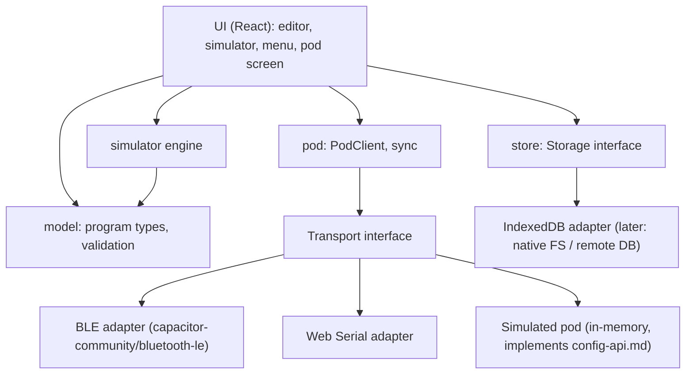

# ReactPod Config App – Specification

Status: **agreed** (2026-10-18) · Branch: `feature/config-app` · Date: 2026-10-18

The ReactPod Config App is a configuration tool for coaches and trainers, separate from
the firmware. It connects to a ReactPod set, shows the block types and programs, lets the
user build new programs visually, simulates them, keeps them on the device and pushes
them to the pods.

It is developed as a web app (PWA) first and later packaged as a native Android / iOS
app. Everything the app may do on a pod is defined by [doc/config-api.md](../doc/config-api.md).
Program format and block semantics: [doc/programs.md](../doc/programs.md).

---

## 1. Goals and non-goals

### Version 1 (this spec)

| # | Feature |
|---|---|
| F1 | Connect to a central over **BLE** (Web Bluetooth) or **USB serial** (Web Serial) |
| F2 | Read the pod: `info`, `list`, `get` of all program files and the menu |
| F3 | Show the **block types** (palette) and the **library** (`/prog/lib/*`, read-only) |
| F4 | Show existing programs as a **block graph** with automatic layout |
| F5 | **Visual editor**: create and edit programs (blocks, ports, parameters, variables, menu LEDs) |
| F6 | Live **validation** while editing (TypeScript port of `tools/validate_programs.py`) |
| F7 | **Simulator**: all pods of the program on screen, current block highlighted, run / pause / step |
| F8 | **Local storage** of programs (offline), JSON import / export |
| F9 | **Push** changed files to the pod, update `/programs.json`, run `validate` on the pod |
| F10 | **Menu editor**: order of programs, 18-LED ring picker for each program's menu pattern |
| F11 | **Restore defaults**: put the shipped programs back on the pod |
| F12 | **i18n** from the start: English (primary, fallback) and German |
| F13 | **Offline PWA** prepared (installable once hosted), mobile first |

### Not in version 1

- Live control (`status`, `select`, `start`, `press`, `results`, MaxLoop override), results display.
- Native apps (the architecture prepares for them, see §3).
- Editing library fragments (`/prog/lib/*` is read-only).
- Cloud storage / accounts (later a remote database may replace the local store, see §6).
- Firmware OTA.

---

## 2. Users and platforms

**Users:** coaches and trainers (customers), not developers. They use a phone in a sports
hall. The UI must be usable with one hand and must not lose data by accident.

| Platform | Editor / simulator / local store | BLE | USB serial |
|---|---|---|---|
| Android Chrome (PWA) | ✅ | ✅ | – (desktop only in v1) |
| Desktop Chrome / Edge | ✅ | ✅ | ✅ |
| iPhone / iPad Safari (PWA) | ✅ (offline only) | ❌ no Web Bluetooth | ❌ |
| Native app (later, Capacitor) | ✅ | ✅ native | – |

Web Bluetooth and Web Serial need **HTTPS** (or `localhost`). Version 1 is **prepared** as
a PWA (manifest, service worker, offline cache, relative base path). Hosting and domain are
decided later and are not part of version 1. Development runs on `localhost`.

---

## 3. Technology

| Concern | Choice | Reason |
|---|---|---|
| Language | TypeScript (strict) | shared types for program format, API messages |
| UI | React 19 + Vite | large ecosystem, works unchanged inside Capacitor |
| Native shell (later) | Capacitor | same web code becomes the Android / iOS app |
| BLE | `@capacitor-community/bluetooth-le` | one API: Web Bluetooth in the browser, native BLE in the app |
| USB serial | Web Serial API (own small adapter) | desktop testing |
| Graph editor | React Flow (`@xyflow/react`) | nodes + typed handles map 1:1 to blocks + ports, touch support |
| Auto layout | `dagre` | layered layout of the block graph, deterministic |
| State | Zustand | small, no boilerplate |
| Local store | IndexedDB via `idb` | offline, large enough, behind an interface |
| i18n | `i18next` + `react-i18next` | standard, lazy language files |
| Icons | `lucide-react` | consistent line icons, tree-shakeable |
| Styling | plain CSS with design tokens (CSS variables), CSS modules | no heavy UI kit, easy theming |
| PWA | `vite-plugin-pwa` (Workbox) | offline cache, install prompt |
| Tests | Vitest (unit), Playwright (later, e2e on the simulated pod) | |

All platform access sits behind interfaces (§4.2), so the native app replaces adapters
and nothing else.

---

## 4. Architecture

```
configApp/
├── public/                      icons, manifest assets
├── src/
│   ├── app/                     shell, routing, navigation, theme
│   ├── i18n/                    de.json, en.json, setup
│   ├── model/                   program format: types, block type definitions, parse / serialise
│   │   ├── blockTypes.ts        ports, fields, defaults per block type (app-owned copy)
│   │   ├── program.ts           Program, Block, Fragment, Menu types
│   │   └── validate.ts          port of tools/validate_programs.py
│   ├── pod/                     everything about talking to a pod
│   │   ├── transport/           Transport interface + BLE, Web Serial, simulated pod
│   │   ├── framing.ts           JSON line framing, MTU chunking
│   │   ├── client.ts            PodClient: one request at a time, ids, timeouts, retries
│   │   ├── files.ts             chunked get / put, UTF-8 byte offsets, CRC-32
│   │   └── sync.ts              compare local vs pod, push plan, push execution
│   ├── store/                   local persistence (Storage interface + IndexedDB adapter)
│   ├── editor/                  graph view, node components, inspector, palette, layout
│   ├── simulator/               engine (TS port of the block semantics), pod views, controls
│   ├── menu/                    menu order + LED ring picker
│   └── defaults/                shipped programs, copied from ../data at build time
└── docs/
    └── acceptance-tests.md      acceptance criteria and test procedures on real pods
```

### 4.1 Layers



### 4.2 Interfaces

```ts
interface Transport {                       // byte/line level
  connect(): Promise<void>;                 // shows the platform device chooser
  disconnect(): Promise<void>;
  send(line: string): Promise<void>;        // one JSON object + "\n", chunked to MTU−3 (BLE)
  onLine(cb: (line: string) => void): void; // complete lines; non-JSON lines are logs (serial)
  onDisconnect(cb: () => void): void;
  readonly kind: "ble" | "serial" | "simulated";
  readonly mtu?: number;
}

interface PodClient {                       // API level, on top of Transport
  request<T>(op: string, args?: object): Promise<T>; // serialised, id-matched, timeout, retry on "overflow"
  info(); list(); getFile(path); putFile(path, text); deleteFile(path); validate(path);
}

interface Storage {                         // local programs, swappable for a remote DB later
  listPrograms(); getProgram(id); saveProgram(p); deleteProgram(id);
  getSyncState(setId); saveSyncState(setId, state);
}
```

The **simulated pod** implements the API from [config-api.md](../doc/config-api.md) in
memory (files, generation, CRC, chunking, error codes). It is used for development,
unit tests and demos without hardware.

---

## 5. Screens (mobile first)

Bottom tab bar on phones (Pod, Programs, Editor, Simulate, Menu; Settings is the gear
icon in the header), side rail with all six on wide screens (≥ 900 px). Icon first, short
label below.

| Tab | Icon | Content |
|---|---|---|
| **Pod** | bluetooth / usb | connect (BLE / USB), set id, firmware, free space, generation; file list with sync state; push, restore defaults |
| **Programs** | list | local programs + programs read from the pod + library (read-only); create, duplicate, import, export |
| **Editor** | workflow | graph of one program (§7) |
| **Simulate** | play | pods + graph + controls (§8) |
| **Menu** | circle-dot | order of programs in `/programs.json`, LED ring picker per program |
| **Settings** | settings | language, about, advanced (delete files, see §9.4) |

UX rules:
- Touch targets ≥ 44 px. Primary action in the thumb zone (bottom right floating button).
- Every editing action works **without drag and drop** too (bottom sheets with selects),
  because drawing wires on a small screen is error prone.
- State shown by colour + icon + text (never colour alone).
- The connection state is always visible (small status chip in the header).
- When the BLE connection is not possible, the app explains how to get the central
  into the program menu (hold button during the blue boot animation).

---

## 6. Local data model

```ts
type ProgramDoc = {
  id: string;                 // local uuid
  path: string;               // target path on the pod, e.g. "/prog/sprint.json"
  json: ProgramJson;          // exactly what goes to the pod (format of programs.md)
  origin: "local" | "pod" | "default";
  readOnly: boolean;          // true for /prog/lib/* and for shipped defaults
  updatedAt: number;
};

type SyncState = {            // per pod set (setId), remembered after each sync
  setId: string;
  files: Record<string /*path*/, { crc: string; size: number }>; // last known common state
};
```

- **Layout is not stored on the pod** (keeps files small). The graph is laid out
  automatically (dagre) every time it is opened. Proposal: the editor may keep manual
  node positions **locally only** (in IndexedDB, keyed by program id + block name);
  "re-layout" resets them. See §12.
- Paths: generated from the program name. Slug ≤ 20 characters so that
  `/prog/<slug>.json` stays ≤ 31 characters. Allowed characters as in config-api §4.
- Import / export: a single program `.json`, or a whole set as a `.zip`
  (`programs.json` + `prog/…`), the same layout as `data/`.

---

## 7. Editor

### 7.1 Graph

- One **node per block**. Header: icon + type colour + block name. Body: 1–2 key
  parameters (e.g. `3000 ms`, `RUNS >= MAX_LOOPS`).
- One **output handle per port** (`next`, `pressed`, `short`, `long`, `timeout`, `true`,
  `false`, `avoidHit`), labelled. One input handle.
- The fallback rule of the firmware is visible: if a port is unconnected and the block
  has `next`, a dashed "→ next" hint is shown on that port.
- The **start block** has a flag icon. Blocks without any target (program ends) get an end marker.
- Blocks unreachable from `start` are dimmed.

### 7.2 Library: presets and templates (decision 4c)

`/prog/lib/*` is read-only. A program can use a fragment in two ways:

| Mode | What happens | Graph |
|---|---|---|
| **Preset** (include) | `include: ["/prog/lib/loop.json"]` is kept. The program links to its blocks (e.g. `EnterProgram` → `EndLoop`) | fragment blocks shown greyed and locked, grouped in a frame labelled with the file |
| **Template** (copy) | the fragment's blocks and variables are copied into the program; name clashes get a suffix | normal editable blocks |

Existing programs that use includes open in preset mode. "Convert to editable copy"
turns all presets into templates (flattens the program). New programs are
self-contained by default.

On push, preset fragments the pod does not have are uploaded too (from the bundled defaults).

### 7.3 Editing actions

| Action | Touch | Desktop |
|---|---|---|
| Add block | floating button → palette sheet (grouped: Light, Wait, Input, Logic, Remote, Stats) | palette sidebar, drag onto canvas |
| Edit parameters | tap node → inspector bottom sheet | inspector side panel |
| Connect port | inspector: per port a "go to" select with all block names (+ "new block…") | drag from handle |
| Delete / duplicate / rename | inspector actions | keyboard + context menu |
| Set start block | inspector | inspector |
| Undo / redo | header buttons | Ctrl+Z / Ctrl+Y |

Renaming a block updates every port that points to it.

### 7.4 Parameter inputs

- **value** fields (number or variable): a number field with a toggle to choose a variable
  from the program's variables + built-ins (`REQUIRED_PERIPHERALS`, `NODE_COUNT`).
- **Colours**: swatches. Fields sent to peripherals (`remotePress.color`, `colorAfter`,
  `hitColor`, `avoidColor`) offer **only the 8 named colours**. Central `led.color` also
  offers a free colour picker (`#RRGGBB`).
- **LED indices** (`led.leds`, `menu[].leds`): the **18-LED ring picker** (tap LEDs on a
  ring, "all" shortcut). The same component is used in the menu editor.
- **Metric names** (`record`, `summary.metric`): free text with suggestions from the metrics
  already used (default `reaction`).
- **Program header**: name, description, number of peripherals (0–7, more cannot be entered), variables table,
  start block, menu pattern.

### 7.5 Validation

Runs on every change. It mirrors `tools/validate_programs.py`: known types, required
fields, unique names over program + includes, all targets exist, start exists, colours
valid (named only towards peripherals), value fields are numbers or known variables,
path length, file size ≤ 16384 bytes, block types supported by the connected pod
(`info.blockTypes`). Problems are listed in a sheet, and tapping one selects the block.
Errors block the push. Warnings (e.g. "program ends here", unreachable blocks) do not.

---

## 8. Simulator

The simulator runs the program in the browser with the same semantics as the firmware
(`src/BlockManager/BlockManager.cpp` and the block classes):

- Instant blocks (`led`, `setVariable`, `if`, `summary`, …) chain in the same pass, waiting
  blocks (`delay`, `button`, `remote*`) wait. Fallback to `next` for unconnected ports. No
  target = program ends. Same limit of steps per pass as the firmware (`MAX_STEPS_PER_PASS`),
  so an endless loop of instant blocks behaves like on the pod.
- `REQUIRED_PERIPHERALS` and `NODE_COUNT` come from `peripherals`. Pod ids as in programs.md §1.3.
- Button rules: only presses that start after the block was entered count. `pressed` on the
  edge, `short`/`long` on release (`shortMs`).
- `remoteMultiPress`: random draw of avoid pods incl. the central, `syncStartMs`, `avoidHit`.

### 8.1 View

- All pods of the program side by side (central + `peripherals` pods, wraps on phones):
  each pod is an **18-LED ring** with its id, and a big round button in the middle.
- **Tap / click a pod = press its button** (press and hold = long press, for `short`/`long`).
- The graph (compact) with the **current block highlighted**, and the edge just taken animated.
- Panels: variables (live values, changed ones flash), metrics (reaction times measured
  from "lit" to the simulated press), log of entered blocks (like the firmware `trace`).

### 8.2 Controls

| Control | Effect |
|---|---|
| Run / pause | simulated time runs in real time (speed ×0.25 … ×4) |
| **Step** | runs until the next block is **entered**, then pauses (instant blocks one by one) |
| Skip wait | ends the current waiting block through its timeout / time-out port (no waiting for a delay) |
| Reset | back to start, variables to initial values |
| Seed | random numbers come from a seeded generator, so a run can be repeated exactly |
| Breakpoint | tap a block in the graph → pause when entered |

In step mode a waiting block stays current until the user presses a pod or uses "skip wait".

The simulator models logic, not radio timing. Reaction times shown are user click times,
not pod measurements.

---

## 9. Pod connection and sync

### 9.1 Connect

1. User picks BLE or USB. BLE: device chooser filtered by the service UUID.
2. Subscribe to Response, request MTU 517 (native) / use what the browser negotiates.
3. `info` → check `firmware`, `linkProtocol`, `blockTypes`, limits (`maxRequest`, `maxGetChunk`).
4. `list` → files with size + CRC, menu, generation.
5. Files whose CRC differs from the local copy are read with chunked `get`.

**Writes only go to a central.** The app reads `status.role` after connecting. Over USB a
peripheral can be connected and inspected (read-only), but push, restore and delete are
disabled.

USB serial: 115200 baud, lines that do not start with `{` are firmware log (shown in a
debug console in Settings → Advanced). The app must **not toggle DTR/RTS** (risk R1, §11).

### 9.2 Sync states per file

Using the remembered `SyncState` (last common CRC) the app can tell who changed a file:

| Local vs pod | State | Default action |
|---|---|---|
| same CRC | in sync | – |
| local changed, pod = last sync | local newer | push |
| pod changed, local = last sync | pod newer | take over |
| both changed / never synced | **conflict** | user chooses **"keep pod"** or **"keep mine"** (no diff view, decision 9) |
| only local | new | push |
| only on pod | pod only | take over (shown in the list) |

### 9.3 Push

1. Validate locally. Errors stop the push.
2. Build the plan: changed / new programs + missing preset fragments, then `/programs.json`
   **last** (config-api §7). Show the plan ("3 files will be uploaded").
3. Upload each file: chunks ≤ 2048 characters at character boundaries, offsets in UTF-8
   bytes, CRC-32 on the final chunk. `overflow` → resend that request. `busy` → stop
   and explain.
4. `validate` each program in the menu, map errors back to the block in the editor.
5. Save the new `SyncState`. Tell the user to start any program once with all pods on, so
   the set syncs.

**Push never deletes** (decision 8). Files on the pod that the app does not know stay.

### 9.4 Deleting and restoring defaults

- Removing a program from the **menu** is a normal action (the file stays on the pod).
- **Deleting files** on the pod is only in Settings → Advanced: select files, then confirm in a
  dialog that names the files and needs an extra tap on a "hold to delete" button.
  Library and menu (`/programs.json`) cannot be deleted.
- **Restore defaults** (Pod tab): uploads the shipped programs + library and the default
  `/programs.json`. User programs on the pod are not deleted, only removed from the menu.
  Confirmation dialog. The defaults are bundled with the app from `../data` at build time.

---

## 10. i18n and design

- All UI text in `src/i18n/{en,de}.json`. **English is the primary language** and the fallback
  for missing keys. Language from the browser, switchable in Settings.
  Block type names and JSON field names stay technical (`button`, `timeoutMs`), and every
  one gets a translated label and help text.
- Design: minimal, functional, icon driven. Neutral surfaces, one accent colour, LED
  colours only where they mean LED colours. Light and dark theme (system setting).
  Design tokens in one CSS file, so a brand theme can be dropped in later.
- Accessibility: contrast AA, focus visible, every icon button has a label (also for screen readers).

---

## 11. Risks

| # | Risk | Mitigation |
|---|---|---|
| R1 | Opening the port with Web Serial may set DTR/RTS and reset the ESP32-C3 (config-api "Serial specifics") | test early on hardware (AT-S1), if needed set signals explicitly after open, document in acceptance tests |
| R2 | Several centrals in range all advertise "ReactPod Config", so the user can't pick the right set | change request CR-1 |
| R3 | Simulator semantics drift from the firmware | engine unit tests use the shipped programs; acceptance test compares a stepped run with the pod's `trace` |
| R4 | Browser-negotiated BLE MTU is small (23) → slow upload | chunking works with any MTU, show progress; measure in AT-B3 |
| R5 | Two pods of a set edited separately → only one store survives (config-api §6) | show `setId` + generation, hint after push to let the set sync |

---

## 12. Decisions

| # | Topic | Decision |
|---|---|---|
| O1 | Manual node positions | stored locally only (IndexedDB), never on the pod. "Re-layout" resets them |
| O2 | Hosting | only prepare the PWA. Hosting and domain later, not in v1 |
| O3 | Languages | English (primary, fallback) and German |
| O4 | Long press in the simulator | press and hold = held button, release = release (`shortMs` decides) |
| O5 | Number of peripherals | the editor prevents more than 7. No other warning |
| O6 | Write target | only a central. Peripherals are read-only in the app |
| 4 | Library | `/prog/lib/*` read-only, used as preset (include) or template (copy) |
| 5 | Layout on the pod | none, automatic layout |
| 7 | Block type definitions | app keeps its own copy, separate from the firmware |
| 8 | Push | update only, never delete unless the user asks |
| 9 | Conflicts | simple choice "keep pod" / "keep mine", no diff |

---

## 13. Phases

| Phase | Content | Done when |
|---|---|---|
| P0 | Scaffold: Vite + React + TS, PWA, i18n, theme, navigation | `npm run build` + `npm test` pass, production build works offline from `localhost`, language switch works |
| P1 | Model + validation + simulated pod + PodClient + file transfer | unit tests: all `data/` programs parse and validate; get/put with chunking and CRC against the simulated pod |
| P2 | Transports: Web Serial, BLE | AT-S*, AT-B* pass on hardware |
| P3 | Programs list, read-only graph view with auto layout, library browser | all shipped programs display correctly |
| P4 | Editor + menu editor + LED ring picker | a new program can be created on a phone without drag and drop |
| P5 | Sync + push + validate + restore defaults | AT-P* pass on hardware |
| P6 | Simulator | AT-M* pass, stepped run matches pod trace |

Acceptance criteria and test procedures on real pods: [docs/acceptance-tests.md](docs/acceptance-tests.md).
Requested firmware / API changes: [../doc/changerequest/config-app-api.md](../doc/changerequest/config-app-api.md).

---

## 14. Development

```sh
cd configApp
npm install
npm run dev        # http://localhost:5173 (Web Bluetooth / Web Serial work on localhost)
npm test           # unit tests (Vitest)
npm run build      # type check + production build with service worker → dist/
npm run preview    # serve dist/ on http://localhost:4173, e.g. to test offline mode
npm run icons      # redraw public/icons/* (scripts/make-icons.mjs)
```

Routing uses the URL hash (`#/programs`), so the build runs from any path, offline and later
inside the Capacitor webview. A new app version is only activated after the user confirms
(update prompt), so an edit in progress is never reloaded away.

