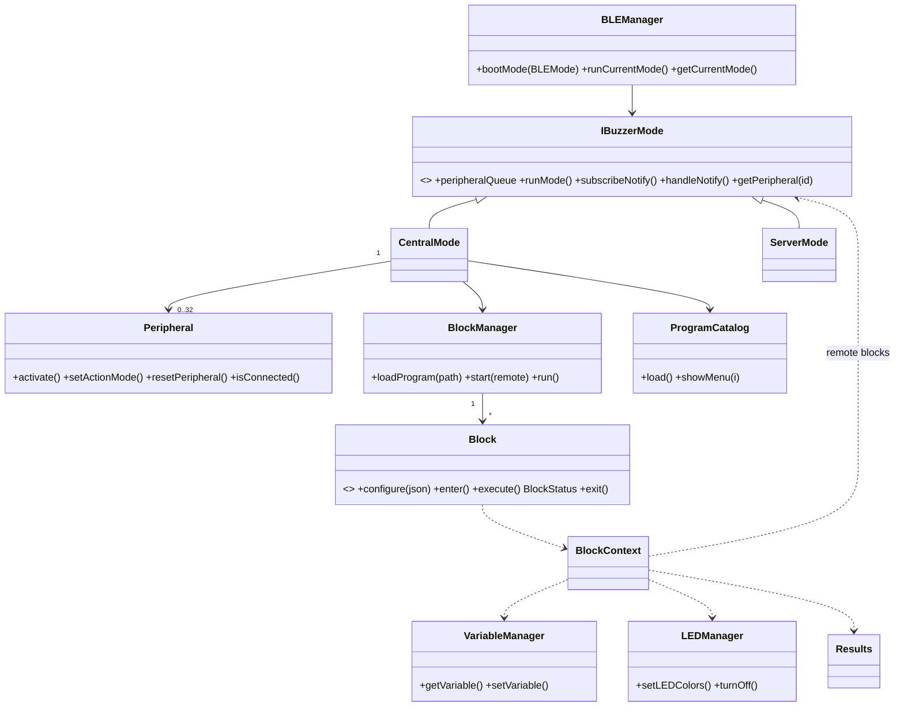
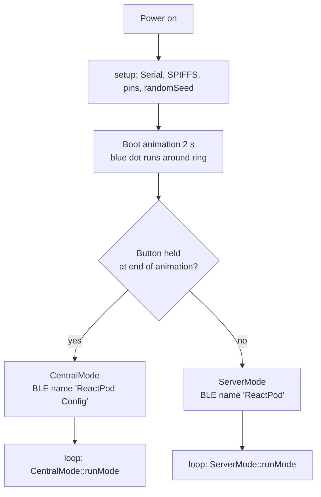
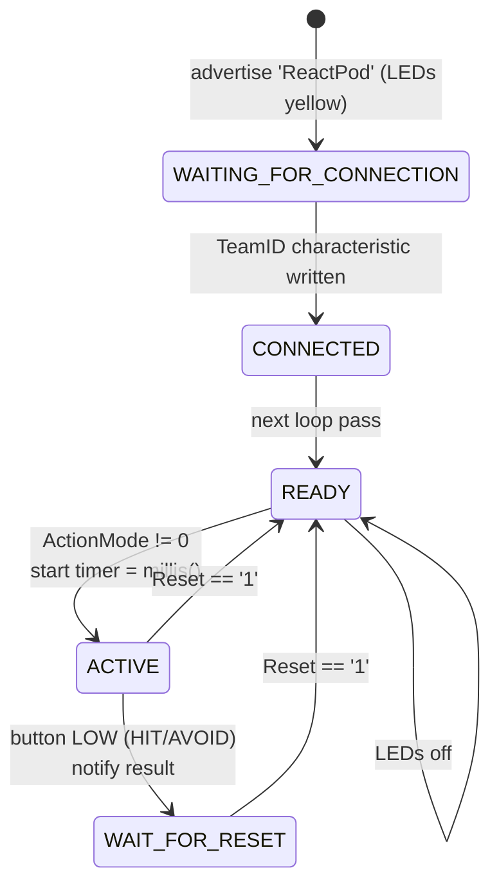
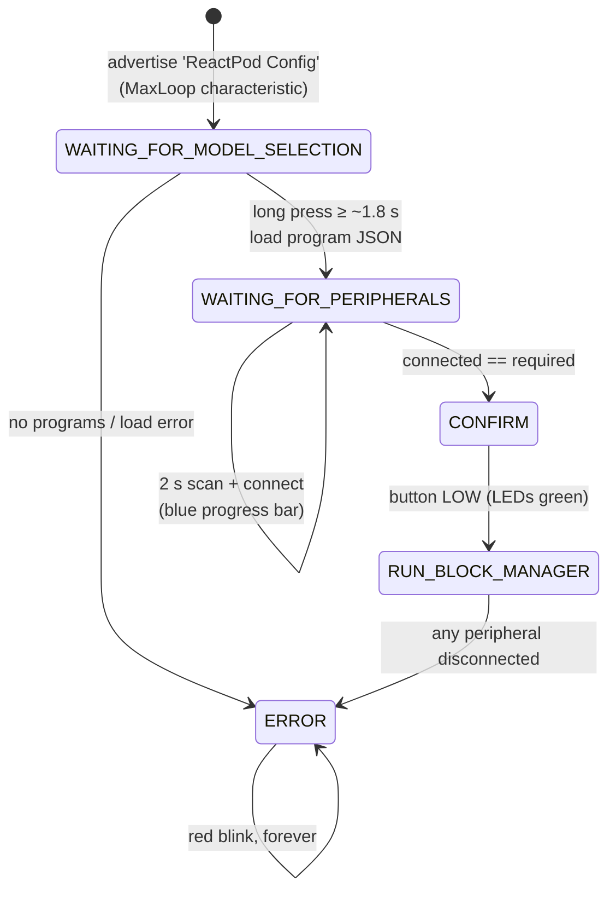

# Architecture

## 1. Hardware view

```
            ┌──────────────────────────────────────────┐
            │                ReactPod                  │
            │                                          │
  USB-C ───►│ charger / step-up ──► ESP32-C3 module    │
            │                                          │
            │   GPIO 3  ◄── push button (active LOW)   │
            │   GPIO 5  ◄── battery voltage (unused)   │
            │   GPIO 7  ──► 18 × WS2812 LED ring       │
            │   GPIO 0  ◄── ADC read once for seeding  │
            └──────────────────────────────────────────┘
```

PCB and casing sources are in `cad/pcb` (KiCad) and `cad/casing` (FreeCAD).

## 2. Build configuration

| File | Purpose |
|---|---|
| `platformio.ini` | Single env `NewBoard`: ESP32-C3, Arduino + ESP-IDF, USB-CDC console |
| `sdkconfig.NewBoard` | ESP-IDF config. Relevant: Bluedroid, `BT_ACL_CONNECTIONS=8`, `BT_CTRL_BLE_MAX_ACT=10`, `BT_GATTC_NOTIF_REG_MAX=5`, `FREERTOS_HZ=1000`, task WDT **off**, C++ exceptions **off**, Arduino log level DEBUG |
| `partitions.csv` | nvs 20 KB, otadata, **one** app slot (`ota_0`, 2 MB), SPIFFS 1.9 MB, coredump 64 KB |
| `CMakeLists.txt`, `src/CMakeLists.txt` | ESP-IDF build glue (globs all of `src/`) |
| `data/programs.json`, `data/prog/` | Game programs (JSON), uploaded with `pio run -t uploadfs`. See [programs.md](programs.md) |
| `data/homepage.html` | Placeholder SPIFFS content, not used by the firmware |
| `tools/validate_programs.py` | Checks the program files on the PC before upload |
| `customPartitions.csv` | Empty, unused |

## 3. Module structure

```
src/
├── main.cpp                  setup(): boot animation, role selection; loop(): run mode
├── _Definitions.h            pins, GATT UUIDs
├── BLEManager/
│   ├── BLEManager.*          singleton, creates CentralMode or ServerMode
│   ├── IBuzzerMode.h         interface: runMode(), notify handling, peripheral lookup, event queue
│   ├── CentralMode/          CENTRAL role: program menu, scanning, connecting, runs BlockManager
│   ├── ServerMode/           PERIPHERAL role: GATT server, local state machine, reaction timing
│   ├── BootupAnimation.*     blue "running light" pattern
│   └── ErrorAnimation.*      red blinking pattern
├── Peripheral/Peripheral.*   central-side proxy for one connected peripheral (GATT client)
├── BlockManager/             loads JSON programs into blocks, runs the block graph
├── Block/                    block types (see §6)
│   ├── Block.h               base class: configure / enter / execute / exit, named ports
│   ├── BlockContext.h        what blocks may use: variables, LEDs, button, results, peripherals
│   ├── Value.*               parameter that is a constant or a variable reference
│   ├── JsonUtil.*            colour parsing
│   └── BlockFactory/         table: JSON "type" -> block class
├── Program/ProgramCatalog.*  program menu read from /programs.json
├── Input/Button.*            debounced button with edge counters (used by blocks)
├── Results/Results.*         measurement records + statistics, CSV on serial
├── VariableManager/          program variables (int64), resolved to ids at load time
├── LEDManager/               singleton NeoPixel wrapper, palette patterns + animations
└── ColorSet/                 RGB struct and colour constants
```

All managers are lazily created singletons (`getManager()`). Objects are allocated
with `new` once and never freed.



## 4. Boot flow



The BLE stack is only initialised after role selection. The role cannot change
without a reboot.

## 5. State machines

### 5.1 Peripheral (`ServerMode::runMode`)



- **ACTIVE / HIT (`'1'`)**: LEDs show colour index `LedColor[0]`; on press they switch to
  `LedColor[1]` and the reaction time `millis() - timer` is notified as a decimal string.
- **ACTIVE / AVOID (`'2'`)**: same, but `"-1"` is notified.
- **COUNTER (`'3'`) / COUNTDOWN (`'4'`)**: only print a log line (not implemented).
- The reset check runs after the state switch on every pass, in any state.
- There is no disconnect handling: after the central disconnects, the peripheral does
  not advertise again and must be power-cycled.

### 5.2 Central (`CentralMode::runMode`)



- **Model selection**: the menu is read from `/programs.json` (`ProgramCatalog`). The current
  program's LED pattern is shown at once. The button hold used to enter CENTRAL mode is
  ignored until it is released. A short press (< 1 s) selects the next program. A long press
  (~1.8 s, a white LED group ramps up in brightness) loads it. A load error leads to ERROR.
  See [game-modes.md](game-modes.md).
- **Scanning**: a device only counts as connected if the connection succeeded and all
  five characteristics were found. Others (failed connects, another central) are skipped.
- **CONFIRM**: while waiting, the phone-writable `MaxLoop` characteristic is read; a valid
  number > 0 overrides `MAX_LOOPS`. Invalid text is ignored. The press starts the
  program and discards notifications that arrived before.
- **ERROR** is terminal; a reboot of the whole set is needed.

## 6. Block engine

Game programs are directed graphs of *blocks*, loaded from JSON files on SPIFFS
(`data/` in the repository). The file format and every block type are documented in
[programs.md](programs.md). This section describes how the engine works.

### 6.1 Loading (`BlockManager::loadProgram`)

1. Clear all blocks and variables.
2. Read the program file. Load its `include` fragments first (recursively, max depth 3),
   then its own `peripherals`, `variables` and `blocks`.
3. For each block, `BlockFactory::create(type)` → `block->configure(json)`. The block
   parses its own parameters. Variable names are resolved to `VarId`s here.
4. After all blocks are known, resolve the port targets (names) to indices. Unknown
   names, duplicate names, unknown types and invalid parameters all abort the load with
   a message that names the file and the block. The central then shows the error blink.

### 6.2 Execution model (`BlockManager::run`, called once per `loop()`)

```
button.update()
repeat up to 32 times:
    status = current.execute(ctx)
    if status == running: return                 // block waits, try again next pass
    next = current.target[status.port]
    if not connected and block has "next": next = current.target[next]
    current.exit(ctx)
    if next == none: program ends
    current = next; current.enter(ctx)
```

- `enter()` runs every time a block becomes current, also for the start block and
  when a block links to itself.
- Instant blocks are chained within one pass. Waiting blocks (delay, button, remote)
  return `running` and never block the loop.
- Blocks get everything they need through `BlockContext`: variables, LEDs, button,
  results, peripherals, and the central's pod id.

### 6.3 Block types

| JSON `type` | Class | Ports |
|---|---|---|
| `led` | `LEDBlock` | next |
| `delay` | `DelayBlock` (non-blocking) | next |
| `button` | `ButtonBlock` | next, short, long, pressed, timeout |
| `if` | `IfBlock` | true, false |
| `setVariable` | `SetVariableBlock` | next |
| `remotePress` | `RemotePressBlock` | next, timeout |
| `remoteMultiPress` | `RemoteMultiplePressBlock` | next, avoidHit, timeout |
| `remoteResetAll` | `RemoteResetAllBlock` | next |
| `summary` | `SummaryBlock` | next |

### 6.4 Variables

`VariableManager` holds `int64` values in a vector. Names are resolved to ids once at
load time. Unknown variables read as 0. Variables set by the system:

| Variable | Set by | Used by |
|---|---|---|
| `REQUIRED_PERIPHERALS` | `"peripherals"` in the program file | CentralMode (how many to connect), programs |
| `NODE_COUNT` | `peripherals + 1` | random mode |
| `MAX_LOOPS` | program variables, phone override in CONFIRM | `lib/loop.json` |

### 6.5 Events from peripherals and measurements

- The BLE notify callback runs in the Bluedroid task. It pushes a `PodEvent`
  `{podId, value, rxTime}` into a FreeRTOS queue (`CentralMode::handleNotify`). Remote
  blocks read it with `IBuzzerMode::pollEvent()`. This makes the handover thread-safe.
- `value` is the reaction time measured on the peripheral, or −1 for a pressed AVOID pod.
- Blocks with `record` pass measurements to `Results`. Results prints a `RESULT,…` CSV
  line and keeps per-metric statistics for the `summary` block.

## 7. LED subsystem

- `LEDManager::setLEDColors(ColorSet*)` – all LEDs one colour.
- `setLEDColors(uint8_t colorId)` – colour index used on the wire:
  `0 red, 1 green, 2 blue, 3 yellow, 4 magenta, 5 cyan, 6 white, 255 off`; other values are ignored.
- `setLEDColors(index, ColorSet*)` – single pixel (calls `show()` each time).
- `setLEDColors(LEDPattern*)` – palette pattern: up to 8 palette colours, per-LED palette
  index packed as 3 bits × 18 into a `uint64_t` (`LEDPaletteID`), plus an optional
  `LEDAnimation::animate(now)` that mutates the indices.
- All colours are at full brightness (255); no global brightness limit.
