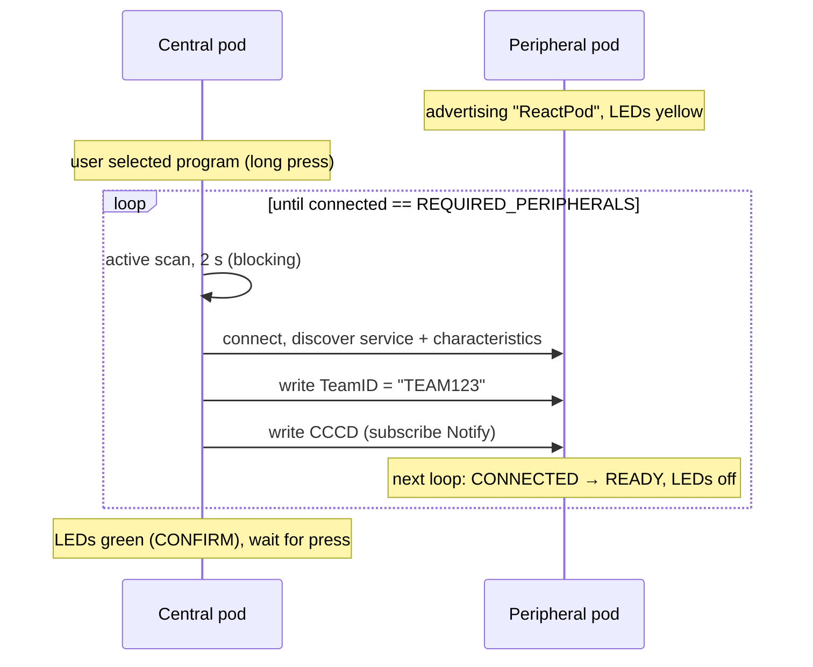
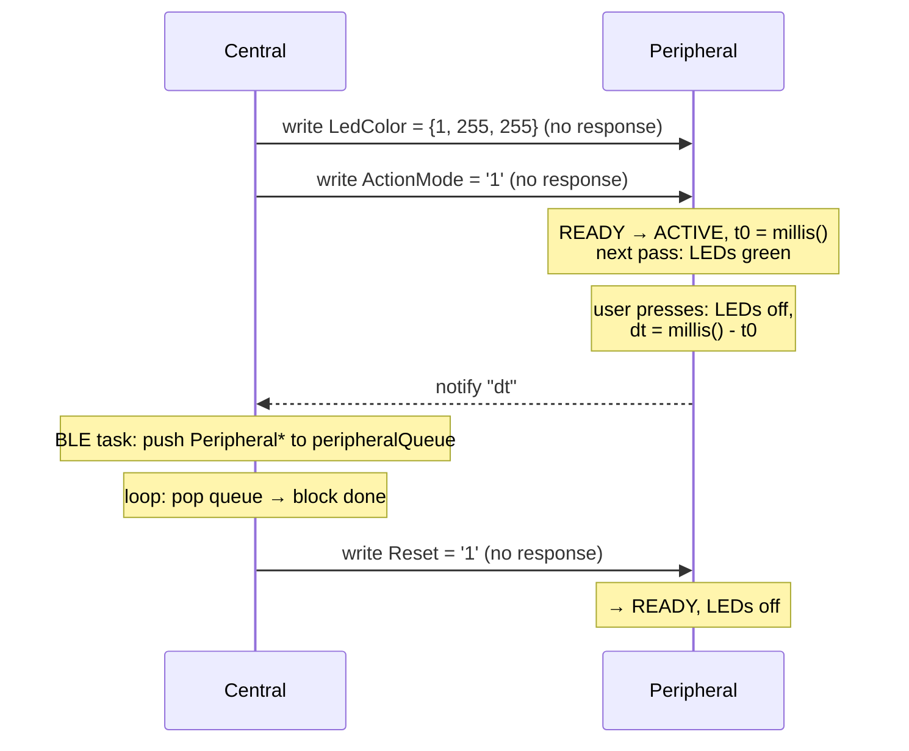

# BLE Protocol

All pods use the same custom GATT service. Roles:

- **Peripheral pod** = GATT server ("ReactPod").
- **Central pod** = GATT client towards every peripheral, *and* GATT server
  ("ReactPod Config") towards a phone.

## 1. Service and characteristics

Service UUID: `12345678-1234-1234-1234-1234567890ab` (placeholder-style UUID; see
[known-issues.md](known-issues.md)).

### 1.1 Peripheral GATT server (`ServerMode`)

| Characteristic | UUID suffix | Props | Format | Meaning |
|---|---|---|---|---|
| TeamID | `…90ac` | W, R | string | Written once by the central to "claim" the pod. Value is always `"TEAM123"` and is not checked. Any non-empty value → CONNECTED |
| LedColor | `…90ad` | W | 3 bytes | `[0]` colour index while active, `[1]` colour index after press, `[2]` unused |
| ActionMode | `…90ae` | W, R | 1 ASCII byte | `'1'` HIT, `'2'` AVOID, `'3'` COUNTER, `'4'` COUNTDOWN. Non-zero → ACTIVE |
| Reset | `…90b0` | W, R | 1 ASCII byte | `'1'` → LEDs off, clear ActionMode/Notify, state READY; firmware writes back `"0"` |
| Notify | `…90af` | N, R (+CCCD) | ASCII decimal | Reaction time in ms (HIT) or `"-1"` (AVOID pressed) |

Colour indices: `0 red, 1 green, 2 blue, 3 yellow, 4 magenta, 5 cyan, 6 white, 255 off`.

### 1.2 Central config server (`CentralMode::startConfigurationBLE`)

| Characteristic | UUID suffix | Props | Format | Meaning |
|---|---|---|---|---|
| MaxLoop | `…90a7` | W, R | ASCII decimal | Default `"-1"`. A value > 0, read while in CONFIRM, overrides `MAX_LOOPS` |

The central advertises the **same service UUID** as the peripherals.

## 2. Sequences

### 2.1 Set-up

### 2.2 Single remote press (`RemotePressBlock`)

### 2.3 Multi press with avoid (`RemoteMultiplePressBlock`)

For every peripheral `i`: write LedColor + ActionMode (`HIT` = green / `AVOID` = red).
The central decides for itself whether it is HIT or AVOID. Each incoming notification
leads to a Reset write to that pod. The round ends when all HIT pods were pressed, or
early when any AVOID pod is pressed. `RemoteResetAllBlocks` then resets every peripheral.

## 3. Properties of the protocol

- **Level-triggered, polled state**: the peripheral polls characteristic values in
  its main loop instead of reacting to write events. Several writes that arrive between
  two loop passes are seen together, in the order the code checks them, not in the order
  they arrived.
- **No message IDs / sequence numbers**: a notification cannot be matched to a specific
  activation.
- **No version field**: central and peripherals must run the same firmware.
- **No security**: no pairing/bonding, no allow-list. Any central in range can take any
  advertising peripheral.
- **Text payloads**: numbers are sent as ASCII strings and parsed with `atoi`/`std::stoll`.
- The reaction time in Notify is parsed into `Peripheral::peripheralTimer`, but nothing
  reads that value afterwards.
