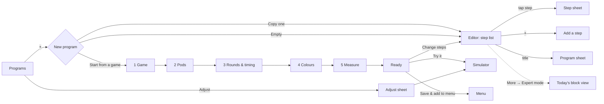

# Block builder UX – simple by default, everything still reachable

Status: **approved as phase P8** (2026-10-21, [spec.md §13](spec.md#13-phases)). The clickable prototype is
[`prototypes/editor-flow.html`](prototypes/editor-flow.html). It is a page fragment (no
`<html>` wrapper) that opens in any browser and runs on its own: a game wizard, the step list, step
sheets with working switches, expert mode and a small simulator.

This document lists everything the block builder must let people do, who uses it and for what,
and a redesigned flow. The flow hides optional things (measuring, storing, tuning) behind plain
toggles and keeps the block-level view for people who want it. It extends
[spec.md §7](spec.md#7-editor) and is phase P8 (§6 below).

## 1. Today (what the code does)

The editor (`app/src/editor/`) shows a program as one column of cards (`ProgramColumnView.tsx`).
Tapping a card opens the inspector (`BlockInspector.tsx`). The inspector always shows the whole
block: name, type select, one "go to" select per port, and every field of the type, each with its
raw JSON key. Program settings (`ProgramSettings.tsx`) mix name and description with the start
block, a variables table, library includes and "flatten". "New program" asks for a name and
opens an empty program (`programs/actions.tsx`).

Problems that matter for people who have never seen a block graph:

| # | Problem | Where |
|---|---|---|
| 1 | Every field and every port is always shown: `button` has 6 fields and 5 ports, `remoteMultiPress` has 8 fields and 3 ports | `BlockInspector.tsx:78-89` |
| 2 | Fields that exclude each other sit side by side: `ms` vs `minMs`/`maxMs`, `timeoutMs` vs `minTimeoutMs`/`maxTimeoutMs`; only help text explains it | `blockTypes.ts` |
| 3 | Raw keys and port names: `<code>storeAverage</code>` under every label; ports read `next`, `short`, `pressed`, `timeout`, `true`; `if` operators are `>=`, `!=` | `BlockInspector.tsx:216`, `BlockDetails.tsx:42-48,100`, `en.json` `ports` |
| 4 | Jargon: peripherals, central, metric, "library presets" vs "library as copy", ms everywhere, pods counted from 0, file path in the title, size in bytes | inspector, settings, check sheet |
| 5 | New blocks get placeholder values (`VALUE`, `reaction`, `0`) that silently create variables and metrics | `ops.ts:41-56` |
| 6 | Connecting means picking from a long list of generated names (`Button1`, `Led3`); a block added with nothing selected is left unconnected | `BlockInspector.tsx:225-252` |
| 7 | Variable and metric fields are free text, so a typo creates a new one without warning | `fields.tsx:231-265` |
| 8 | Problems appear only in the Check sheet, not on the card or in the inspector | `EditorPage.tsx:282-286` |
| 9 | Deleting a block or changing its type drops fields and links without asking; palette tiles have no description; templates are bare file names | `ops.ts:108-148`, `Palette.tsx` |
| 10 | No guided start: you must already know that a reaction game is led + delay + button + remotePress + setVariable + if + summary | `actions.tsx:60-105` |

Gap in the model: `@reactpod/program-model` is still at `PROGRAM_FORMAT = 1`, while firmware 2.8
and programs.md §6 have format 2 (`repeat` block, `timerStart`/`timerStop`). The plan below
uses both. The model update is P8a's first step.

## 2. Who uses it

| Persona | Typical sentence | Sees blocks? | Main path |
|---|---|---|---|
| **First-timer** (parent, PE teacher, someone who got a set) | "I have 3 pods. I want a reaction game, now." | No, unless they ask | Chooser → game wizard → Try → Add to menu |
| **Coach / trainer** | "Same drill as last week, 20 rounds, 1–3 s random pause, 2 s time limit, record times; red means don't touch." | Steps in plain language, occasionally adds one | Programs → Adjust; or editor in simple mode with toggles |
| **Tinkerer** (secondary, must keep working) | "I want a branch on long press and a variable that counts streaks." | Yes, everything | Editor with expert mode on (today's UI) |

Shared context from spec §2: a phone held in one hand in a sports hall, often with gloves or
sweaty fingers, set already switched on. Nothing may get lost by accident.

## 3. What we want to be able to do

Level: **S** = simple view, always visible · **T** = behind a toggle or "More options" in the
simple view · **E** = expert mode only. "Today" says whether the app already offers it.

### 3.1 Start a program

| Capability | Level | Today |
|---|---|---|
| Start from a game recipe (wizard): solo, star, random pod, all at once (with red pods), duo | S | no |
| Copy a program (mine, on the pod, shipped) and change it | S | yes (duplicate / edit copy) |
| Start empty | E | yes |
| Import a `.json` file | S | yes (Programs page) |

### 3.2 Adjust without touching the flow (coach's daily job)

| Capability | Maps to | Level | Today |
|---|---|---|---|
| Number of rounds | `variables.MAX_LOOPS` or `repeat.count` | S | as a raw variable |
| Pause before the light: fixed or random between two times | `delay.ms` / `minMs`+`maxMs` | S | both fields shown |
| Time limit per press, and what happens when it runs out | `timeoutMs` + `timeout` port | T | always shown |
| Colours of target and "don't touch" pods | `color`, `hitColor`, `avoidColor` | S | yes |
| Number of red "don't touch" pods | `remoteMultiPress.avoid` | T | yes |
| Number of pods the program needs | `peripherals` | S | as "peripherals" |
| Catch presses that come too early (false start) | `button` with random timeout as the pause | T | only by building it |

### 3.3 Change the flow

| Capability | Level | Today |
|---|---|---|
| Add a step after this one, chosen by intent ("Wait for a press", "Light a pod") | S | by block type |
| Add a step into a branch ("If too slow → …") | S | via port select "new block…" |
| Move a step up or down within the round | S | no |
| Delete (with undo), duplicate a step | S | yes, no undo prompt |
| Repeat a group of steps N times | S (shown as a bracket) | via if/counter only |
| Decide on a value (`if`) with words ("is at least") | T | operators as symbols |
| Short vs. long press go different ways | T | ports always shown |
| Rename a step, change its block type, set the start block | E | yes |
| Connect any port to any block | E | yes |

### 3.4 Measure (all optional, all off unless the recipe turns them on)

| Capability | Maps to | Level | Today |
|---|---|---|---|
| Record the reaction time of this press | `record: "reaction"` | T (one switch) | free-text metric |
| Count misses when too slow / when a red pod is hit | `setVariable MISSES +1` on `timeout` / `avoidHit` | T | build by hand |
| Show results at the end (average, best, worst, count) | `summary` + `store…` | S (one step, checkboxes) | raw store fields |
| Keep the last time in a setting | `storeAs` | T (More options) | always shown |
| Measure the time between two steps (stopwatch) | `timerStart`/`timerStop` (format 2) | T (More options) | no |
| Name of the measurement (metric) | `record`, `summary.metric` | E | always shown |

### 3.5 Settings (variables)

| Capability | Level | Today |
|---|---|---|
| See the program's numbers as labelled controls ("Rounds: 12") | S | raw table |
| Use a setting instead of a fixed number in a step | T | yes (# / variable switch) |
| Create, rename, delete settings; built-ins `REQUIRED_PERIPHERALS`, `NODE_COUNT` | E | yes |

### 3.6 Reuse

| Capability | Level | Today |
|---|---|---|
| Recipe snippets in the add-step list ("Count a miss when too slow", "Pause between rounds") | S | no |
| Library part as linked preset (locked) or as copy; "convert to editable copy" | E | yes |

### 3.7 Menu entry

Name, description and the LED pattern shown in the pod's menu: S (today: yes).

### 3.8 Check and try

| Capability | Level | Today |
|---|---|---|
| Problems shown on the step and in its sheet, in words | S | Check sheet only |
| Try it in the simulator from anywhere | S | yes |
| Undo / redo | S | yes |
| Size budget as "uses 23 % of the space" | S | bytes |
| Steps the connected pod cannot run are marked | S | yes |

### 3.9 Get it onto the pods

"Save and add to menu" ends the wizard and the editor: S. Push stays on the Pod page (spec §9).

## 4. Redesigned flow

### A. "New program" chooser

Three large cards: **Start from a game** (recommended, with a short line per game), **Copy one
of my programs**, **Start empty** (marked "for people who know blocks"). Replaces the name-only
dialog.

### B. Game wizard (one screen per question, Back / Next, everything prefilled)

1. **Game**: solo (central only), star (central and a random pod take turns), random pod (never
   the same twice), all at once (with red "don't touch" pods), duo (two pods take turns). Each
   card shows an animated LED preview and the pod count it needs.
2. **Pods**: stepper "how many pods do you have", with a drawing of the set. Games that need more
   pods are explained, not hidden.
3. **Rounds and timing**: rounds; pause **fixed** or **random between** (seconds, not ms); time
   limit switch.
4. **Colours**: target colour from the 8 named colours; for "all at once", a switch for red pods
   and their count.
5. **Measure**: switches "Record reaction times" (on), "Count misses" (on when there is a time
   limit), "Show average and best at the end" (on), "Catch false starts" (solo only).

The last screen shows the name (prefilled, editable), the menu LED pattern and the program as
a short story ("12 rounds: pause 1–3 s, light a random pod green, wait for the press (max 2 s)…").
Actions: **Try it**, **Change steps**, **Save and add to menu**.

The generated program is self-contained (spec §7.2: templates, not includes). The round steps
follow the shipped programs (`star`, `random`, `multi`, `solo`, `duo`). The wizard's answers are
written into variables (`ROUNDS`, `PAUSE_MIN_MS`…) and fields, so the Adjust sheet can change them
later.

The loop is a **`repeat` block** (decision 2): `count: "ROUNDS"`, `storeIndex: "RUNS"`, `body` =
the first round step, `done` = the first step after the last round. The last round step and the
early exits (false start, red pod hit) link back to the `repeat` block (programs.md §7.10). The
wizard checks `info.programFormat` (`pod/session.ts` reads it already). If it is below 2 or
missing, or no pod is connected and the program is pushed later to an older pod, the wizard
uses the `lib/loop` pattern instead (`setVariable RUNS +1`, `if RUNS >= MAX_LOOPS`). The editor
shows both forms as the same Repeat bracket.

### C. Editor, simple view (default)

- The column becomes a **numbered step list** in plain language: "Light all LEDs green", "Wait
  1–3 s (random)", "Wait for a press · max 2 s · records time". Card summaries
  (`editor/summary.ts`) get a sentence form.
- Loops become a **"Repeat 12 rounds" bracket** around the steps. It is detected from `repeat`
  (format 2) or from the `lib/loop` pattern (setVariable + if on a counter).
- Branches are **chips** under the step: "If too slow → count a miss", "If a red pod is hit →
  flash red". Tapping a chip opens the branch steps.
- Block names, port names and the file path are not shown. Badges show on the card: a check
  problem, "records time", "not supported by your pod".
- One floating **+** adds a step after the selected step, or at the end of the round.

### D. Step sheet (replaces the inspector in the simple view)

Order, top to bottom:

1. **Problems** for this step, in words ("The shortest pause must be shorter than the longest").
2. **Essentials**: 1–3 large controls (colour swatches, LED ring, "which pod" chips with "Pod 1…n",
   "random pod", "random, never the same twice"; pause with a Fixed | Random switch).
3. **Feature switches**. Each one shows its fields only when on, and turning it off removes the
   fields and the branch it created:
   - *Time limit* → seconds (+ "random" sub-switch) and "If too slow → go on | count a miss | end
     the round"
   - *Record reaction time*
   - *Count a miss* (only with a time limit or red pods)
   - *Red "don't touch" pods* → count, colour, "If a red pod is hit → …"
   - *Catch early presses* (on a pause) → turns the pause into the button-with-random-timeout
     pattern from `solo.json`
   - *Long press does something else* → hold time, second chip
4. **More options** (collapsed): tuning fields from the table in §5 (keep time in a setting,
   colour after, sync start, include the central, stopwatch start/stop).
5. **Actions**: add a step after, move up/down, duplicate, delete (with an undo toast).
6. **Expert** (only in expert mode): step name, block type, raw keys, one "go to" select per
   port, raw JSON.

### E. "Add a step" by intent

Tiles with an icon and one line: Light up the central, Pause, Wait for a press, Light a pod,
Race: all pods at once, Count or remember, Decide, Repeat, Show results, Turn all pods off.
Above them, **recipes** that add several blocks at once: "Count a miss when too slow", "Pause
between rounds", "Flash red on a false start". In expert mode the tiles show the block type, and
library parts (as copy or linked preset) come last.

### F. Program sheet

- **Basics**: name, description, "pods besides the central" as a picture stepper, menu LED pattern.
- **Settings you can tweak**: the program's variables as labelled steppers ("Rounds", "Pause min").
  Labels come from a name table **in the app** (decision 1), e.g. `app/src/editor/settingLabels.ts`
  with the texts in `i18n/en.json` and `de.json`: `MAX_LOOPS`/`ROUNDS` → "Rounds",
  `PAUSE_MIN_MS` → "Shortest pause", a known `_MS` suffix → shown in seconds. Unknown names show
  as is. The program file format does not change.
- **Expert**: start block, library parts and "convert to editable copy", raw variables table.

### G. Adjust sheet (coach shortcut, on the Programs page)

"Adjust" on a program row opens a sheet with the program's settings (from F) and the switches
that apply to the whole program (time limit, record times, results at the end). **Try it**
and **Save** sit at the bottom. Adjust is offered for every program: mine, on the pod (also a
read-only pod) and shipped (decision 3). Anything that is not already a local program is saved
as a local copy with the same path, as Edit does today; the program on the pod stays as it is
until the next push. The coach never has to open the editor for the weekly change.

On a read-only pod the sheet says so before saving: the copy is kept on this phone and can be
tried in the simulator or pushed to another set (decision 3).

### H. Expert mode

A switch under More (editor) and Settings → Advanced, remembered per device. When it is on, the
step list shows block names and port arrows (today's `ProgramColumnView`), sheets show the
expert section, and the palette shows block types. Nothing is removed: expert mode is today's
editor.

## 5. Field levels per block type

**Essential** shows in the step sheet. **Switch** shows behind the named switch. **More** shows
under "More options". **Expert** shows only in expert mode. Ports are named in words.

| Block | Essential | Switch | More | Expert | Port names |
|---|---|---|---|---|---|
| `led` | `color`, `leds` | – | `timerStart`/`timerStop` | name | – |
| `delay` | `ms` or `minMs`+`maxMs` (Fixed / Random switch) | *Catch early presses* (becomes a `button`) | timers | | – |
| `button` | – | *Time limit*: `timeoutMs` / `minTimeoutMs`+`maxTimeoutMs`, `timeout`; *Record*: `record`; *Long press*: `shortMs`, `short`, `long` | `storeAs`, timers | `pressed` vs `next`, metric name | pressed/next "Then", timeout "If too slow", short "Short press", long "Long press" |
| `remotePress` | `pod` (chips), `color` | *Time limit*: `timeoutMs`, `timeout`; *Don't touch*: `mode: avoid`; *Record*: `record` | `colorAfter`, `storeAs`, timers | metric name | timeout "If too slow" (avoid: "If left alone") |
| `remoteMultiPress` | `hitColor`, `pods` (all / pick) | *Red pods*: `avoid`, `avoidColor`, `avoidHit`; *Time limit*: `timeoutMs`; *Record*: `record` | `includeCentral`, `syncStartMs`, timers | metric name | avoidHit "If a red pod is hit", timeout "If too slow" |
| `remoteResetAll` | – | – | `pods`, `ledsOff` | | – |
| `setVariable` | `var` (pick, with "new setting…"), `op` in words, `value` | – | – | raw op | – |
| `if` | `left`, `op` in words ("is at least"), `right` | – | – | raw op | true "If yes", false "If no" |
| `summary` | what to show: average / best / worst / count (each creates its `store…` variable) | – | `reset` | `metric` | – |
| `repeat` (format 2) | `count` | – | `storeIndex` | | body "Each round", done "After the last round" |

Defaults that remove problem 5: new steps get their values from the recipe or the step before
(colour of the previous light, the time limit already used in the round). A `value` field never
creates a variable on its own; "new setting…" asks for a name.

Implementation: add `level: "essential" | "more" | "expert"` and an optional `group` (switch id)
to `FieldDef` in `packages/program-model/src/blockTypes.ts`, plus port labels per type. The app
and the platform then read the same table.

## 6. Phase P8

| Step | Content |
|---|---|
| P8a | Program model to format 2 (`repeat`, timers); `level`/`group` metadata; step sheet with switches and More options; expert section; inline problems |
| P8b | Sentence summaries, step list with Repeat bracket and branch chips; move up/down; delete with undo toast |
| P8c | "New program" chooser and game wizard. Generator with two loop forms (`repeat` for format 2, `lib/loop` pattern for format 1); tests that each recipe in each form validates and runs in the simulator |
| P8d | "Add a step" by intent, recipes |
| P8e | Program sheet split, settings label table in the app (en + de), Adjust sheet on Programs for every source, expert mode switch |

Each step gets acceptance tests in [acceptance-tests.md](acceptance-tests.md) before it is
marked done (AT-E*). Generated programs use only blocks the firmware already has. The
simulator and the demo pod get format 2 (`repeat`, timers, programs.md §7.9, §7.10) in P8a;
they do not have it yet, and the firmware does since 2.8.

## 7. Decisions (2026-10-21)

1. **Setting labels live in the app.** A name table in the app maps variable names to labels and
   units. The program file gets no new key, so no firmware change is needed.
2. **The wizard uses the `repeat` block** when the pod reports `programFormat` 2 or newer, and
   the `lib/loop` pattern otherwise.
3. **Adjust is offered for programs on a read-only pod too.** It saves a local copy and says
   that the copy cannot be pushed to that pod. Implemented in P8e (confirmed 2026-10-21).
