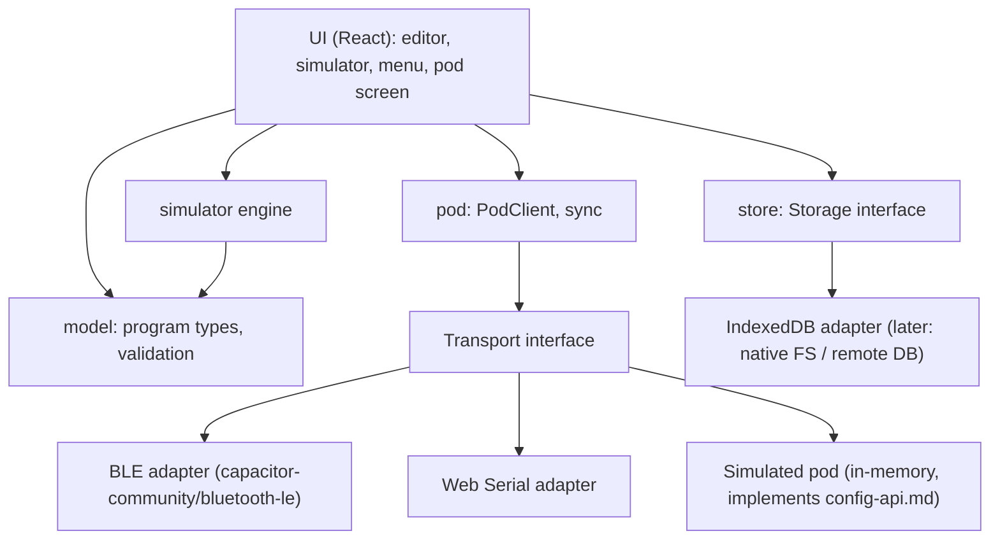

# ReactPod Config App – Specification

Status: **agreed** (2026-10-18), P0–P6 accepted (2026-10-19) · Branch: `main` · Date: 2026-10-19

The ReactPod Config App is a configuration tool for coaches and trainers, separate from
the firmware. It connects to a ReactPod set, shows the block types and programs, lets the
user build new programs visually, simulates them, keeps them on the device and pushes
them to the pods.

It is developed as a web app (PWA) first and later packaged as a native Android / iOS
app. Everything the app may do on a pod is defined by [docs/firmware/config-api.md](../firmware/config-api.md).
Program format and block semantics: [docs/firmware/programs.md](../firmware/programs.md).

---

## 1. Goals and non-goals

### Version 1 (this spec)

| # | Feature |
|---|---|
| F1 | Connect to a central over **BLE** (Web Bluetooth) or **USB serial** (Web Serial) |
| F2 | Read the pod: `info`, `list`, `get` of all program files and the menu |
| F3 | Show the **block types** (palette) and the **library** (`/prog/lib/*`, read-only) |
| F4 | Show existing programs as a **block graph** (one column, automatic order) |
| F5 | **Visual editor**: create and edit programs (blocks, ports, parameters, variables, menu LEDs) |
| F6 | Live **validation** while editing (TypeScript port of `tools/validate_programs.py`) |
| F7 | **Simulator**: all pods of the program on screen, current block highlighted, run / pause / step |
| F8 | **Local storage** of programs (offline), JSON import / export |
| F9 | **Push** changed files to the pod, update `/programs.json`, run `validate` on the pod |
| F10 | **Menu editor**: order of programs, 18-LED ring picker for each program's menu pattern |
| F11 | **Restore defaults**: put the shipped programs back on the pod |
| F12 | **i18n** from the start: English (primary, fallback) and German |
| F13 | **Offline PWA** prepared (installable once hosted), mobile first |

### Not in version 1

- Live control (`status`, `select`, `start`, `press`, `results`, MaxLoop override), results display.
- Native apps (the architecture prepares for them, see §3).
- Editing library fragments (`/prog/lib/*` is read-only).
- Cloud storage / accounts (later a remote database may replace the local store, see §6).
- Firmware OTA.

---

## 2. Users and platforms

**Users:** coaches and trainers (customers), not developers. They use a phone in a sports
hall. The UI must be usable with one hand and must not lose data by accident.

| Platform | Editor / simulator / local store | BLE | USB serial |
|---|---|---|---|
| Android Chrome (PWA) | ✅ | ✅ | – (desktop only in v1) |
| Desktop Chrome / Edge | ✅ | ✅ | ✅ |
| iPhone / iPad Safari (PWA) | ✅ (offline only) | ❌ no Web Bluetooth | ❌ |
| Native app (later, Capacitor) | ✅ | ✅ native | – |

Web Bluetooth and Web Serial need **HTTPS** (or `localhost`). The app is a PWA (manifest,
service worker, offline cache, relative base path). It is published on **GitHub Pages**:
https://runningjoke.github.io/reactionButton/ , built and deployed by
[.github/workflows/app.yml](../../.github/workflows/app.yml) on every push
to `main` that touches `app/` or `firmware/data/`. Development runs on `localhost`.

---

## 3. Technology

| Concern | Choice | Reason |
|---|---|---|
| Language | TypeScript (strict) | shared types for program format, API messages |
| UI | React 19 + Vite | large ecosystem, works unchanged inside Capacitor |
| Native shell (later) | Capacitor | same web code becomes the Android / iOS app |
| BLE | `@capacitor-community/bluetooth-le` | one API: Web Bluetooth in the browser, native BLE in the app |
| USB serial | Web Serial API (own small adapter) | desktop testing |
| Block graph | own column view (HTML cards + SVG arrows) | compact on phones, native scrolling, no canvas library needed |
| State | Zustand | small, no boilerplate |
| Local store | IndexedDB via `idb` | offline, large enough, behind an interface |
| i18n | `i18next` + `react-i18next` | standard, lazy language files |
| Icons | `lucide-react` | consistent line icons, tree-shakeable |
| Styling | plain CSS with design tokens (CSS variables), CSS modules | no heavy UI kit, easy theming |
| PWA | `vite-plugin-pwa` (Workbox) | offline cache, install prompt |
| Tests | Vitest (unit), Playwright (later, e2e on the simulated pod) | |

All platform access sits behind interfaces (§4.2), so the native app replaces adapters
and nothing else.

---

## 4. Architecture

```
app/
├── public/                      icons, manifest assets
├── src/
│   ├── app/                     shell, routing, navigation, theme
│   ├── i18n/                    de.json, en.json, setup
│   ├── model/                   program format: types, block type definitions, checks, formatting
│   │   ├── blockTypes.ts        ports, fields, defaults per block type (app-owned copy)
│   │   ├── program.ts           ProgramFile, FragmentFile, Block, ProgramIndex types
│   │   ├── colors.ts, limits.ts colours, store limits, path rules, name → path
│   │   ├── validate.ts          port of tools/validate_programs.py (+ warnings), issue codes
│   │   └── format.ts            writes files in the style of firmware/data/ (one block per line)
│   ├── pod/                     everything about talking to a pod
│   │   ├── transport/           Transport interface, BleTransport (capacitor BLE plugin), WebSerialTransport
│   │   ├── simulated/           SimulatedPod (config API in memory) + SimulatedTransport
│   │   ├── utf8.ts, crc32.ts    byte counting, UTF-8 safe splitting, line decoder, CRC-32
│   │   ├── protocol.ts          request / response types, PodError
│   │   ├── client.ts            PodClient: one request at a time, ids, timeouts, resend on "overflow"
│   │   ├── files.ts             chunked get / put, UTF-8 byte offsets, CRC check both ways
│   │   ├── session.ts           connection state for the UI: connect, info / status / list, read-only role, log
│   │   ├── sync.ts              compare local vs pod, push / restore plan, push execution
│   │   └── syncActions.ts       sync for the UI: states of the connected set, keep pod / mine, push, delete
│   ├── store/                   local persistence (Storage interface + IndexedDB adapter), workspace (local programs + menu)
│   ├── editor/                  column view + layout, editing operations (ops.ts), undo / redo, inspector, fields, palette, program settings
│   ├── programs/                catalog, sources (pod / shipped / local), program actions (new, edit copy, export, delete)
│   ├── pages/                   one component per screen (Pod, Programs, program view, Editor, Menu, Settings)
│   ├── components/              LED ring + LED ring picker, sheet, modal
│   ├── simulator/               engine.ts (TS port of the block semantics), seeded random, useSimulation (real-time loop)
│   └── defaults/                shipped programs, bundled from ../firmware/data at build time (raw text)
└── docs/
    └── acceptance-tests.md      acceptance criteria and test procedures on real pods
```

### 4.1 Layers



### 4.2 Interfaces

```ts
interface Transport {                       // byte/line level
  connect(): Promise<void>;                 // shows the platform device chooser
  disconnect(): Promise<void>;
  send(line: string): Promise<void>;        // one JSON object + "\n", chunked to MTU−3 (BLE)
  onLine(cb: (line: string) => void): void; // complete lines; non-JSON lines are logs (serial)
  onDisconnect(cb: () => void): void;
  readonly kind: "ble" | "serial" | "simulated";
  readonly mtu?: number;
}

interface PodClient {                       // API level, on top of Transport
  request<T>(op: string, args?: object): Promise<T>; // serialised, id-matched, timeout, retry on "overflow"
  info(); list(); getFile(path); putFile(path, text); deleteFile(path); validate(path);
}

interface Storage {                         // local programs, swappable for a remote DB later
  listPrograms(); saveProgram(p); deleteProgram(id);
  getMenu(); saveMenu(paths);               // the local menu (§6)
  getSyncState(setId); saveSyncState(state);          // per set, in IndexedDB "meta" as sync:<setId>
}
```

The **simulated pod** implements the API from [config-api.md](../firmware/config-api.md) in
memory (files, generation, CRC, chunking, error codes). It is used for development,
unit tests and demos without hardware.

---

## 5. Screens (mobile first)

Bottom tab bar on phones (Pod, Programs, Editor, Simulate, Menu; Settings is the gear
icon in the header), side rail with all six on wide screens (≥ 900 px). Icon first, short
label below.

| Tab | Icon | Content |
|---|---|---|
| **Pod** | bluetooth / usb | set id, firmware, free space, generation; file list with sync state; push, restore defaults. Not connected: a Connect button that opens the connection dialog |
| **Programs** | list | local programs + programs read from the pod + library (read-only); create, duplicate, import, export |
| **Editor** | workflow | graph of one program (§7) |
| **Simulate** | play | pods + graph + controls (§8) |
| **Menu** | circle-dot | order of programs in `/programs.json`, LED ring picker per program |
| **Settings** | settings | language, about, advanced (delete files, see §9.4) |

UX rules:
- Touch targets ≥ 44 px. Primary action in the thumb zone (bottom right floating button).
- Every editing action works **without drag and drop** too (bottom sheets with selects),
  because drawing wires on a small screen is error prone.
- State shown by colour + icon + text (never colour alone).
- The connection state is always visible (small status chip in the header). Tapping the chip opens the
  **connection dialog**: connect (Bluetooth / USB / demo pod) or, when connected, the pod and **Disconnect**.
- When the BLE connection is not possible, the app explains how to get the central
  into the program menu (hold button during the blue boot animation).

---

## 6. Local data model

```ts
type ProgramDoc = {
  id: string;                 // local uuid
  path: string;               // target path on the pod, e.g. "/prog/sprint.json"
  json: ProgramJson;          // exactly what goes to the pod (format of programs.md)
  origin: "local" | "pod" | "default";   // made here, or a copy of a pod / shipped program
  updatedAt: number;
};

type SyncState = {            // per pod set (setId), remembered after each sync
  setId: string;
  files: Record<string /*path*/, { crc: string; size: number }>; // last known common state
};
```

- **Layout is not stored on the pod** (keeps files small). The block order of the column view
  is computed every time a program is opened (§7.1), so there are no node positions to keep.
- Paths: generated from the program name. Slug ≤ 20 characters so that
  `/prog/<slug>.json` stays ≤ 31 characters. Allowed characters as in config-api §4.
- **Local programs are always editable.** Shipped and pod programs are read-only in the app;
  **Edit** makes a local copy with the **same path** (origin `pod` / `default`), which replaces the
  file on the pod at push (decision 10). If a local copy of that path exists, Edit opens it.
  **Duplicate** makes a new program with its own name and path. Library files are never local.
- A new program's path must not collide with a local, pod or shipped path.
- **Local menu** (decision 11): one menu, the set being built. Until the user changes it, the
  menu tab shows the connected pod's menu, else the shipped one. Changing the menu pattern of a
  program that is not local makes a local copy (same path).
- Every change is saved to IndexedDB at once; undo / redo (100 steps) lives in memory per open program.
- Import / export: a single program `.json` (v1). A whole set as a `.zip`
  (`programs.json` + `prog/…`, the same layout as `firmware/data/`): **Export set** on the Programs tab
  writes the local menu, its programs with their includes and every local program. **Import set**
  takes the menu and the programs (library parts are ignored); local programs with the same path
  are replaced after a confirmation. A single top folder in the archive is accepted.

---

## 7. Editor

### 7.1 Graph

- All blocks in **one column**, one card per block. Header: icon + type colour + block name + type.
  Body: the key parameters on one wrapping line (e.g. `3000 ms`, `RUNS >= MAX_LOOPS`).
- **Order:** flow order from the start block. Loops are ignored for the order, the rest is placed
  topologically, first port first: the main path reads straight down and a short branch sits between
  its fork and the block where it rejoins.
- A block with **one** connection to the block directly below just continues downwards (no arrow).
- Every other connection is an **arrow beside the column**: it leaves from a port row of the card
  (`timeout → CentralMiss`) and enters the header of the target. Arrows going down run on the
  **right**, loops back up on the **left**. A block with a choice (several ports) has all its ports
  as arrows, also the one to the block below. Arrows into the same target share a lane.
- The fallback rule of the firmware is visible: if a port is unconnected and the block
  has `next`, a "→ next" hint is shown on the card.
- The **start block** has a flag icon. Blocks without any target (program ends) get an end marker.
- Blocks unreachable from `start` are dimmed.
- Targets that no loaded file defines (a library part viewed on its own) are dashed "external" cards.
- The view scrolls natively; tapping a card selects it, its arrows are highlighted, and the block sheet shows its details.

### 7.2 Library: presets and templates (decision 4c)

`/prog/lib/*` is read-only. A program can use a fragment in two ways:

| Mode | What happens | Graph |
|---|---|---|
| **Preset** (include) | `include: ["/prog/lib/loop.json"]` is kept. The program links to its blocks (e.g. `EnterProgram` → `EndLoop`) | fragment blocks shown greyed with a lock and the file name ("Set variable · loop"). No frame: a preset like `loop` has blocks at the start *and* the end of a program, a frame would span the whole graph |
| **Template** (copy) | the fragment's blocks and variables are copied into the program; name clashes get a suffix | normal editable blocks |

Existing programs that use includes open in preset mode. "Convert to editable copy"
turns all presets into templates (flattens the program). New programs are
self-contained by default.

On push, preset fragments the pod does not have are uploaded too (from the bundled defaults).

### 7.3 Editing actions

| Action | Touch | Desktop |
|---|---|---|
| Add block | floating button or "add block after" in the inspector → palette sheet (grouped: Light, Wait, Input, Logic, Remote, Stats, library as copy) | same, palette in the side panel |
| Edit parameters | tap node → inspector bottom sheet | inspector side panel |
| Connect port | inspector: per port a "go to" select with all block names (+ "new block…") | same as touch |
| Delete / duplicate / rename | inspector actions | inspector actions, Delete key |
| Set start block | inspector | inspector |
| Undo / redo | header buttons | Ctrl+Z / Ctrl+Y |

Renaming a block updates every port that points to it. With a block selected, a new block is
inserted after it (selected → new → the old next, decision 12); otherwise it is added at the end,
unconnected (the first block of an empty program becomes the start). "New block…" in a port
select adds a block and connects that port to it. Own blocks that a preset continues at (e.g.
`EnterProgram` for `loop`) cannot be renamed or deleted. Renaming a variable updates every block
that reads or writes it. Changing the block type keeps the fields and ports the new type has.

A block that continues straight down through a port other than `next` (e.g. a button with only
`timeout`) shows the port name on the card, so the column view never hides which exit is taken.

### 7.4 Parameter inputs

- **value** fields (number or variable): a number field with a toggle to choose a variable
  from the program's variables + built-ins (`REQUIRED_PERIPHERALS`, `NODE_COUNT`).
- **Colours**: swatches. Fields sent to peripherals (`remotePress.color`, `colorAfter`,
  `hitColor`, `avoidColor`) offer **only the 8 named colours**. Central `led.color` also
  offers a free colour picker (`#RRGGBB`).
- **LED indices** (`led.leds`, `menu[].leds`): the **18-LED ring picker** (tap LEDs on a
  ring, "all" shortcut). The same component is used in the menu editor.
- **Metric names** (`record`, `summary.metric`): free text with suggestions from the metrics
  already used (default `reaction`).
- **Program header**: name, description, number of peripherals (0–7, more cannot be entered), variables table,
  start block, menu pattern.

### 7.5 Validation

Runs on every change. It mirrors `tools/validate_programs.py`: known types, required
fields, unique names over program + includes, all targets exist, start exists, colours
valid (named only towards peripherals), value fields are numbers or known variables,
path length, file size ≤ 16384 bytes, block types supported by the connected pod
(`info.blockTypes`). Problems are listed in a sheet, and tapping one selects the block.
Errors block the push. Warnings (e.g. "program ends here", unreachable blocks) do not.

---

## 8. Simulator

The simulator runs the program in the browser with the same semantics as the firmware
(`src/BlockManager/BlockManager.cpp` and the block classes):

- Instant blocks (`led`, `setVariable`, `if`, `summary`, …) chain in the same pass, waiting
  blocks (`delay`, `button`, `remote*`) wait. Fallback to `next` for unconnected ports. No
  target = program ends. Same limit of steps per pass as the firmware (`MAX_STEPS_PER_PASS`),
  so an endless loop of instant blocks behaves like on the pod.
- `REQUIRED_PERIPHERALS` and `NODE_COUNT` come from `peripherals`. Pod ids as in programs.md §1.3.
- Button rules: only presses that start after the block was entered count. `pressed` on the
  edge, `short`/`long` on release (`shortMs`).
- `remoteMultiPress`: random draw of avoid pods incl. the central, `syncStartMs`, `avoidHit`.

### 8.1 View

- All pods of the program side by side (central + `peripherals` pods, wraps on phones):
  each pod is an **18-LED ring** with its id, and a big round button in the middle.
- **Tap / click a pod = press its button** (press and hold = long press, for `short`/`long`).
- The graph (compact) with the **current block highlighted**, and the edge just taken animated.
- Panels: variables (live values, changed ones flash), metrics (reaction times measured
  from "lit" to the simulated press), log of entered blocks (like the firmware `trace`).

### 8.2 Controls

| Control | Effect |
|---|---|
| Run / pause | simulated time runs in real time (speed ×0.25 … ×4) |
| **Step** | runs until the next block is **entered**, then pauses (instant blocks one by one) |
| Skip wait | ends the current waiting block through its timeout / time-out port (no waiting for a delay) |
| Reset | back to start, variables to initial values |
| Seed | random numbers come from a seeded generator, so a run can be repeated exactly |
| Breakpoint | tap a block in the graph → pause when entered |

In step mode a waiting block stays current until the user presses a pod or uses "skip wait".

The simulator models logic, not radio timing. Reaction times shown are user click times,
not pod measurements.

### 8.3 Implementation notes

- `src/simulator/engine.ts` follows [programs.md](../firmware/programs.md) §7 rule by rule: one engine
  pass per simulated ms, 32 steps per pass, `enter` takes times and random values, unconnected
  ports fall back to `next`, unknown variables read 0, `uint8_t` pod ids, `timeoutMs: 0` means *no
  timeout* for `button` but *at once* for the remote blocks, 20 ms button debounce.
- The set always has the program's `peripherals` connected. Peripherals behave like
  `PeripheralRole`: an armed pod lights (at once or at `syncStartMs`), a press shows `colorAfter`
  and reports the reaction time; the central then resets it. Presses of earlier activations are
  dropped when a block polls them, like on the pod.
- **Step** runs the current pass until the next block is entered. A block waiting for a press stays
  current ("waiting"); pods that light by themselves (`syncStartMs`) are lit by the step, because
  that is no wait for the user. While paused, a press or release is handled at once (one step).
- **Skip wait** jumps the simulated clock to the end of a delay or timeout. A block that waits
  without a timeout (`button`, `remotePress`, `remoteMultiPress`) leaves through its `timeout` port
  (fallback rules apply); a `button` already pressed keeps waiting for the release.
- The log has every entered block and the `RESULT` / `SUMMARY` lines. **Copy trace** gives the
  block events in the format of the pod's `trace on` (AT-M5).
- Entry points: the Simulate tab (program picker: own programs and the menu), the play button in
  the editor and in the program view. Programs with errors are not simulated.

---

## 9. Pod connection and sync

### 9.1 Connect

1. User picks BLE or USB. BLE: device chooser filtered by the service UUID. The pod
   advertises as `ReactPod <set name>` or `ReactPod <last 4 digits of setId>` (firmware ≥ 2.2).
2. Subscribe to Response (indications, firmware ≥ 2.1), request MTU 517 (native) / use what the browser negotiates.
3. `info` → check `firmware`, `linkProtocol`, `blockTypes`, limits (`maxRequest`, `maxGetChunk`).
   BLE: write `info.mtu − 3` bytes per write (firmware ≥ 2.7, else 20).
4. `status` → role. `list` → files with size + CRC, menu, generation.
5. Files whose CRC differs from the local copy are read with chunked `get`.

Optional `info` fields (missing = older firmware, the app keeps the old behaviour):

| Field | Firmware | Use in the app |
|---|---|---|
| `setName` | 2.2 | shown as the set's name; Pod tab → rename (`setName`) |
| `programFormat` | 2.3 | warning if the pod is newer than the app's block types (`PROGRAM_FORMAT`) |
| `features: validateInline` | 2.4 | `PodClient.validate(path, data)` dry run, for push (P5) |
| `features: listMeta` | 2.5 | program names in the Pod tab file list |
| `pinRequired` | 2.6 | PIN asked before the first write (`auth`), once per connection |
| `mtu` | 2.7 | BLE write size |

**Writes only go to a central.** The app reads `status.role` after connecting. Over USB a
peripheral can be connected and inspected (read-only), but push, restore and delete are
disabled.

USB serial: 115200 baud, lines that do not start with `{` are firmware log (shown in a
debug console in Settings → Advanced). The app must **not toggle DTR/RTS** (risk R1, §11).

### 9.2 Sync states per file

Using the remembered `SyncState` (last common CRC) the app can tell who changed a file:

| Local vs pod | State | Default action |
|---|---|---|
| same CRC | in sync | – |
| local changed, pod = last sync | local newer | push |
| pod changed, local = last sync | pod newer | take over |
| both changed / never synced | **conflict** | user chooses **"keep pod"** or **"keep mine"** (no diff view, decision 9) |
| only local | new | push |
| only on pod | pod only | take over (shown in the list) |

### 9.3 Push

1. Validate locally. Errors stop the push.
2. Build the plan: changed / new programs + missing preset fragments, then `/programs.json`
   **last** (config-api §7). Show the plan ("3 files will be uploaded").
3. Upload each file: chunks ≤ 2048 characters at character boundaries, offsets in UTF-8
   bytes, CRC-32 on the final chunk. `overflow` → resend that request. `busy` → stop
   and explain.
4. `validate` each program in the menu, map errors back to the block in the editor.
5. Save the new `SyncState`. Tell the user to start any program once with all pods on, so
   the set syncs.

**Push never deletes** (decision 8). Files on the pod that the app does not know stay.

Implementation notes (`src/pod/sync.ts`):
- A pod file counts as **in sync** when its CRC equals the app's formatted text *or* its JSON is
  equal (key order and formatting ignored), so a pod copy that was never edited is not a change.
- The **last common CRC** is remembered per set and path: after every upload, on "take over" /
  "keep pod", on "keep mine" (the pod's current CRC, so the local file wins) and when a local
  copy is made from a pod program. An untouched copy of a shipped program uses the shipped file.
- The **menu** is the set being built (decision 11): a saved local menu that differs from the pod's
  is pushed, unless the pod's menu changed since the last sync (then conflict). "Keep pod" for the
  menu forgets the local menu, so the Menu tab follows the pod again.
- With `features: validateInline` (firmware ≥ 2.4) every program is checked by the pod's loader
  (dry run) **before** any program or the menu is written; library parts are uploaded first, because
  the dry run reads includes from the store. Without it, `validate` runs after the upload only.
- Menu entries the pod does not have are uploaded from the shipped programs, missing presets from
  the shipped library. The plan lets the user deselect programs; conflicts and pod-newer files are
  never pushed and are listed as skipped.
- The sync state is saved after each file, so an interrupted push (busy, lost connection, wrong PIN)
  shows the right states afterwards; pushing again finishes it.
- With `info.pinRequired` the push dialog asks for the PIN (`auth`) before the first write.

### 9.4 Deleting and restoring defaults

- Removing a program from the **menu** is a normal action (the file stays on the pod).
- **Deleting files** on the pod is only in Settings → Advanced: select files, then confirm in a
  dialog that names the files and needs an extra tap on a "hold to delete" button.
  Library and menu (`/programs.json`) cannot be deleted.
- **Restore defaults** (Pod tab): uploads the shipped programs + library and the default
  `/programs.json`. User programs on the pod are not deleted, only removed from the menu.
  Confirmation dialog. The defaults are bundled with the app from `../firmware/data` at build time.

---

## 10. i18n and design

- All UI text in `src/i18n/{en,de}.json`. **English is the primary language** and the fallback
  for missing keys. Language from the browser, switchable in Settings.
  Block type names and JSON field names stay technical (`button`, `timeoutMs`), and every
  one gets a translated label and help text.
- Design: minimal, functional, icon driven. Neutral surfaces, one accent colour, LED
  colours only where they mean LED colours. Light and dark theme (system setting).
  Design tokens in one CSS file, so a brand theme can be dropped in later.
- Accessibility: contrast AA, focus visible, every icon button has a label (also for screen readers).

---

## 11. Risks

| # | Risk | Mitigation |
|---|---|---|
| R1 | Opening the port with Web Serial may set DTR/RTS and reset the ESP32-C3 (config-api "Serial specifics") | test early on hardware (AT-S1), if needed set signals explicitly after open, document in acceptance tests |
| R2 | Several centrals in range all advertise "ReactPod Config", so the user can't pick the right set | solved by CR-1 (firmware 2.2): `ReactPod <xxxx>` / set name |
| R3 | Simulator semantics drift from the firmware | engine unit tests use the shipped programs; acceptance test compares a stepped run with the pod's `trace` |
| R4 | Browser-negotiated BLE MTU is small (23) → slow upload | chunking works with any MTU, show progress; measure in AT-B3 |
| R6 | Firmware indicates on the Response characteristic, browsers / Android subscribe for notifications → BLE responses never arrive | solved by CR-0 (firmware 2.1): indications only. Firmware 2.0 still times out over BLE |
| R5 | Two pods of a set edited separately → only one store survives (config-api §6) | show `setId` + generation, hint after push to let the set sync |

---

## 12. Decisions

| # | Topic | Decision |
|---|---|---|
| O1 | Manual node positions | none: the column view computes the block order (§7.1) |
| O2 | Hosting | GitHub Pages (`runningjoke.github.io/reactionButton`), deployed from `main` by GitHub Actions. Own domain later |
| O3 | Languages | English (primary, fallback) and German |
| O4 | Long press in the simulator | press and hold = held button, release = release (`shortMs` decides) |
| O5 | Number of peripherals | the editor prevents more than 7. No other warning |
| O6 | Write target | only a central. Peripherals are read-only in the app |
| 4 | Library | `/prog/lib/*` read-only, used as preset (include) or template (copy) |
| 5 | Layout on the pod | none, automatic order in one column |
| 7 | Block type definitions | app keeps its own copy, separate from the firmware |
| 8 | Push | update only, never delete unless the user asks |
| 9 | Conflicts | simple choice "keep pod" / "keep mine", no diff |
| 10 | Editing a shipped / pod program | local copy with the same path; replaces the pod file at push |
| 11 | Menu before push exists | one local menu, starting from the pod's (or the shipped) menu |
| 12 | Where a new block goes | after the selected block (rewired), else at the end unconnected |

---

## 13. Phases

| Phase | Content | Done when | Status |
|---|---|---|---|
| P0 | Scaffold: Vite + React + TS, PWA, i18n, theme, navigation | `npm run build` + `npm test` pass, production build works offline from `localhost`, language switch works | done |
| P1 | Model + validation + simulated pod + PodClient + file transfer | unit tests: all `firmware/data/` programs parse and validate; get/put with chunking and CRC against the simulated pod | done |
| P2 | Transports: Web Serial, BLE | AT-S*, AT-B* pass on hardware | USB done (AT-S1–S4 pass), BLE ready for test with firmware 2.7 (AT-B*) |
| P3 | Programs list, read-only graph view with auto layout, library browser | all shipped programs display correctly | done |
| P4 | Editor + menu editor + LED ring picker | a new program can be created on a phone without drag and drop | done |
| P5 | Sync + push + validate + restore defaults | AT-P* pass on hardware | done (accepted 2026-10-19) |
| P6 | Simulator | AT-M* pass, stepped run matches pod trace | done (accepted 2026-10-19); AT-M1–M4 also covered by unit tests |

Acceptance criteria and test procedures on real pods: [docs/acceptance-tests.md](acceptance-tests.md).
**Firmware / API changes the app needs** are requested as **GitHub issues** in this repository
(label `firmware`): what is missing, why the app needs it, a proposed API, acceptance. The app
must keep working without the change (check `info`, missing field → old behaviour). The earlier
change requests CR-0 … CR-7 are all done and archived in
[../docs/archive/changerequest/config-app-api.md](../archive/changerequest/config-app-api.md).

---

## 14. Development

```sh
cd app
npm install
npm run dev        # http://localhost:5173 (Web Bluetooth / Web Serial work on localhost)
npm test           # unit tests (Vitest)
npm run build      # type check + production build with service worker → dist/
npm run preview    # serve dist/ on http://localhost:4173, e.g. to test offline mode
npm run icons      # redraw public/icons/* (scripts/make-icons.mjs)
node scripts/screenshots.mjs <dir>   # screenshots of the preview build (local Chrome, playwright-core)
node scripts/offline-check.mjs       # AT-U1: preview build loads offline
```

Deployment: merging to `main` runs the Pages workflow (`npm ci`, `npm test`, `npm run build`,
upload `dist/`). It can also be started by hand (Actions → "Config app (GitHub Pages)" → Run).

Routing uses the URL hash (`#/programs`), so the build runs from any path, offline and later
inside the Capacitor webview. A new app version is only activated after the user confirms
(update prompt), so an edit in progress is never reloaded away.

