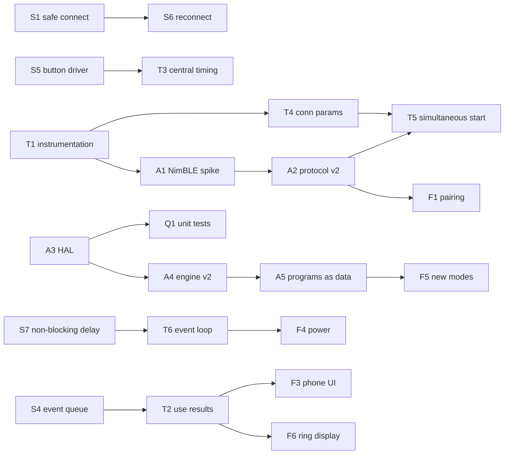

# Firmware Improvement Plan

This plan turns the findings in [known-issues.md](known-issues.md) into work packages
(WP). Each WP lists the issues it closes, a proposed design and a "done when" check.
Effort: **S** ≈ < 1 day · **M** ≈ 1–3 days · **L** ≈ > 3 days (hobby-time estimates).

**Progress:** the block system rework (JSON programs) completed WP-S3, WP-S4, WP-S7,
WP-T3 and WP-A5. It also completed most of WP-S1, WP-S2, WP-S5, WP-T2 and WP-A4. These are marked
✅ / ◐ below. See [programs.md](../firmware/programs.md) for the result.

**Firmware 2.0 (ESP-NOW link)** replaced the BLE pod link. It completes WP-S6 (pause +
reconnect), WP-T5 (synchronous start), WP-F1 (pairing) and the protocol part of WP-A2.
WP-T4 (BLE connection parameters) and WP-A1 (NimBLE) are obsolete. Details:
[link-protocol.md](../firmware/link-protocol.md).

The order matters. Stabilise first (P0). Then make timing measurable and correct (P1).
Then restructure (P2), and only then add features (P3). Quality work (Q) runs alongside.

---

## P0 – Stabilise (no crashes, no hangs)

### ◐ WP-S1 Safe peripheral connection · S · closes C1, C2
> ◐ Done: connection/characteristic checks, only valid pods are counted. Open: freeing failed clients (M16).
- `Peripheral` gets a `bool init()` (or factory returning `nullptr`). Return false if `connect()`,
  `getService()` or **any** characteristic lookup fails, or if `canWrite()`/`canNotify()` are missing.
- `CentralMode::clientScanForPeripherals` increments `connectedPeripherals` only on success.
  On failure it deletes the client (`pClient->disconnect()`, `delete`).
- Skip devices whose address is already in `peripherals[]`.
- **Done when**: switching a pod off during connection does not crash the central. A second
  central in config mode is ignored.

### ◐ WP-S2 Input validation & defensive engine · S · closes C3, C5, M4, M5, H8
> ◐ Done: strtoll, link validation at load, signed If, randomOther, avoid clamp. Still open: the phone MaxLoop value is only read during CONFIRM.
- Replace `std::stoll` with `strtoll` + `endptr` check. Ignore invalid values.
- `BlockManager`: resolve all `next` names to indices **once** after the program is
  built (`validate()`). Unknown names → log + error pattern, never index 255.
  `BlockFactory` returning `nullptr` → reject the block.
- `IfBlock`: use `int64_t`.
- `SetVariable '!'`: if `changeSize <= 1` fall back to `'?'`.
- `RemoteMultiplePress`: clamp `avoidCount` to `pods`. Replace the VLA with a fixed array or a bitmask.
- **Done when**: a program with a typo produces a clear serial error instead of a crash.

### ✅ WP-S3 Initialise all state · S · closes C6, H7
- Initialise all members in class definitions (`uint8_t selectedModel = 0;` …).
- `RemoteMultiplePress`: use a signed counter or `if (remaining > 0) remaining--`.

### ✅ WP-S4 Thread-safe event handover · S · closes H2
- Replace `std::queue<Peripheral*>` with a FreeRTOS queue (`xQueueCreate(16, sizeof(Event))`).
  The notify callback sends with `xQueueSendFromISR`/`xQueueSend` and a timeout of 0.
- `Event` = `{ uint8_t podId; int32_t reactionMs; uint32_t rxTimeMs; }`, so the value from H1
  is carried along.
- **Done when**: RUN5 with 4 pods hammered simultaneously runs for 30 min without corruption.

### ◐ WP-S5 Button handling & UX leaks · M · closes H4, H5, H6, M12
> ◐ Done: `Input/Button` (immediate edge + 20 ms lockout, press counters). Game blocks only count new presses; the boot hold is ignored in the menu. Open: interrupt timestamps, use in menu and on peripherals.
- New `Button` driver, shared by all roles:
  - GPIO interrupt on both edges. Timestamp with `esp_timer_get_time()` (µs).
  - 15–20 ms debounce lockout after each edge.
  - Events `PRESS(t)`, `RELEASE(t, heldMs)`, plus a state query `isDown()`.
- `ButtonBlock` consumes events instead of sampling. A release always produces a result:
  `< shortLimit` → SHORT, otherwise LONG. No dead zone.
- **Arm-on-release rule**: a block that waits for a press ignores a press that began
  *before* the block was entered. This fixes the confirm press and the boot-hold leaks.
- Model selector: draw program #0 immediately. Ignore the first release after boot.
- **Done when**: on hardware, SOLO and star mode start without a phantom press. A 1.5 s
  press on the central is accepted.

### ✅ WP-S6 Disconnect recovery · M · closes C4
- Peripheral: register `BLEServerCallbacks`. On disconnect → state `WAITING_FOR_CONNECTION`,
  clear characteristics, `startAdvertising()`.
- Central: on disconnect → new state `PAUSED` (pods amber, missing pod's LED pair blinks).
  Rescan for the **same address** in the background. Resume the current round when it is
  back. A long press aborts to the menu.
- Supervision timeout: set explicitly (e.g. 4 s) so a pod that has gone away is detected quickly.
- **Done when**: power-cycling one peripheral mid-game pauses the game, and the game
  continues after the pod is back.

### ✅ WP-S7 Non-blocking delay · S · closes M2, M3
- `DelayBlock::enterBlock` draws the random duration and stores `until = now + d`.
  `executeBlock` returns "waiting" until `now >= until`.
- `BlockManager::defineStartBlock` calls `enterBlock()` on the start block.
  Self-transitions are allowed to re-enter via an explicit `restart` flag.

---

## P1 – Timing: make it measurable, then make it right

### WP-T1 Timing instrumentation · S
- Compile-time flag `REACTPOD_TRACE`. Log `esp_timer_get_time()` for: block enter/exit,
  write sent/confirmed, notify received, button edges, LED show. Output as CSV over serial.
- Log the actual connection parameters from `ESP_GAP_BLE_UPDATE_CONN_PARAMS_EVT`.
- Use a GPIO toggle on a spare pin for scope/logic-analyser measurements of LED onset
  vs. button edge. This is the ground truth for accuracy.
- **Deliverable**: a measured version of the tables in [timing.md](../firmware/timing.md).

### ◐ WP-T2 Use the measured reaction times · S · closes H1
> ◐ Done: `Results` with RESULT/SUMMARY CSV lines, `summary` block. Open: display on the ring / phone.
- Carry `reactionMs` through the event (WP-S4) into a `ResultLog`
  (`round, podId, outcome {HIT, MISS, AVOID_HIT, FALSE_START}, ms`).
- Print a CSV line per round. Show a summary at the end of `MAX_LOOPS`, for example an
  LED bar graph of the average time, or best/average via the phone characteristic (WP-F3).

### ✅ WP-T3 Measure on the central too · S
- `ButtonBlock` gets an optional `measure` flag: it takes `t0` when the LED is shown and
  `t1` from the button **press** edge timestamp (WP-S5). The block advances on press.
- SOLO mode shows the result (e.g. number of lit LEDs ∝ time, or a colour band).

### ✗ obsolete: WP-T4 Connection parameters · S
- After connecting each peripheral, call `esp_ble_gap_update_conn_params` with min/max
  interval 7.5–15 ms (≤ 4 pods) or 15–30 ms (5–7 pods), latency 0, timeout 4 s.
- Fix `setMinPreferred`/`setMaxPreferred` in advertising (L3).
- **Done when**: WP-T1 shows a stable CI and activation latency ≤ 2 CI.

### ✅ WP-T5 Simultaneous start for multi-pod modes · M · closes M15
- Use write-without-response without waiting for the confirmation (or NimBLE, WP-A1), so
  that all ARM commands go out within one or two connection events.
- Add a **start delay** to the ARM command: central timestamps each send `t_i` and sends
  `delay_i = D - (t_i - t_0)` with D ≈ 50–100 ms. All pods then light at ≈ `t_0 + D`.
  The pods measure from their own LED onset, so fairness only depends on the residual
  skew (~1 CI).
- Optional later: clock sync (ping/pong, NTP-style offset per pod) for sub-ms alignment.

### WP-T6 Event-driven main loop · M · closes M9 (partly), M10
- The loop task blocks on the event queue with a timeout = "time until the next block
  deadline" (`xQueueReceive`). No more busy loop.
- `LEDManager` keeps a frame buffer and only calls `show()` when the content changed.
- Logging through a macro with compile-time level. Release builds use WARN and no
  `Serial.print` in hot paths.

---

## P2 – Architecture

### ✗ obsolete: WP-A1 Evaluate NimBLE-Arduino · M
- NimBLE uses much less RAM than Bluedroid. It allows up to 9 connections and has
  non-blocking writes and better callbacks. It may let the project drop the `arduino, espidf`
  dual framework, which would mean faster builds and no sdkconfig handling.
- Spike: port `ServerMode` + `Peripheral` to NimBLE on a branch. Compare RAM, connection
  time and latency with WP-T1.
- Decide based on numbers. If adopted, do it **before** WP-A2, so the protocol is
  only implemented once.

### ✅ WP-A2 Protocol v2 · L · closes M1, H3, H9 (with WP-F1), L1
Replace the 5 polled characteristics with two:

| Characteristic | Dir | Frame |
|---|---|---|
| `Command` | central → pod, write w/o response | `[ver][op][seq][len][payload…]` |
| `Event` | pod → central, notify | `[ver][type][seq][payload…]` |

- Commands: `CLAIM(setId)`, `ARM(seq, mode, colorActive, colorAfter, startDelayMs, timeoutMs)`,
  `RESET(seq)`, `LED(pattern)`, `IDENTIFY`, `PING`.
- Events: `PRESSED(seq, reactionUs, flags)`, `TIMEOUT(seq)`, `STATUS(battery, fwVersion)`, `PONG`.
- The peripheral handles commands in the `onWrite` callback → queue → loop. No lost or
  reordered writes.
- `seq` lets the central drop stale or duplicate events. `ver` allows mixed firmware to
  be detected.
- Binary little-endian payloads. Reaction time in µs.
- New random 128-bit UUID base.

### ◐ WP-A3 Hardware abstraction & role split · M
> ◐ Done in firmware 2.0: `RoleManager`/`CentralRole`/`PeripheralRole`, `IPodNetwork` as the link abstraction. Open: `IClock`/`IButton`/`ILeds` for host tests.
- Interfaces `IClock`, `IButton`, `ILeds`, `IRemotePods`. The block engine and the game
  logic only depend on these.
- Rename for clarity: `ServerMode` → `PeripheralRole`, `CentralMode` → `CentralRole`,
  "model" → "program".
- `ColorSet` constants become `constexpr` values (L2).
- This is the base for host-side unit tests (WP-Q1).

### ◐ WP-A4 Block engine v2 · M
> ◐ Done: ports, `BlockStatus`, index links, instant chaining, timeouts on button/remote blocks, interned variables. Open: switching programs without reboot (engine supports it, CentralRole does not offer it).
- Links resolved to indices at load time (from WP-S2). A program is an immutable
  `Program` object (blocks + variables), so switching programs does not need a reboot.
- Blocks return `Status { RUNNING, DONE(outputPort) }` instead of each config overriding
  `getNextBlockName`. Next block = `ports[outputPort]`. This removes the
  `parentBlock` back-pointers.
- Run consecutive instant blocks in one pass (cap e.g. 32 steps, to catch accidental
  infinite loops).
- Generic timeouts on every waiting block (`timeoutMs` → `timeout` port).
- Variables: interned IDs instead of `std::map<std::string>` lookups on every pass.

### ✅ WP-A5 Programs as data · L · closes M8
- JSON schema v1 (`{"version":1,"name":…,"pods":3,"vars":{…},"start":…,"blocks":[…]}`)
  that maps 1:1 to the WP-A4 block types.
- Rewrite the loader (owned strings, all block types, validation errors with block name).
- Built-in programs move to JSON files in LittleFS (SPIFFS is deprecated), built from `data/`.
- The menu lists the programs found in the file system. Program count and menu LED
  pattern are taken from the file.

---

## P3 – Features

| WP | Feature | Effort | Notes |
|---|---|---|---|
| F1 ✅ | **Set pairing** | M | Central creates a random `setId` once (NVS). Peripherals store their owner on first `CLAIM`. Advertising carries manufacturer data `{role, setId, battery}`, so the central filters without connecting. Pair mode = hold button 5 s at boot on a peripheral. Closes H9, M6 |
| F2 | **Battery monitoring** | S | `analogReadMilliVolts(PIN_BATTERY_LEVEL)`, divider ratio from schematic, averaging. Status event + adv data. Low battery → amber blink, block game start below threshold |
| F3 | **Phone interface** | M | Extend the config service: program select, MAX_LOOPS, brightness, results notify (CSV/JSON per round), pod list with battery. Usable with a generic BLE app first, later a small web-bluetooth page |
| F4 | **Power management** | M | Brightness cap (e.g. 40 %), LED off when idle, BT modem sleep + auto light sleep on idle peripherals, deep sleep after N min idle with GPIO 3 wake-up (RTC-capable on C3) |
| F5 | **New game modes** | M each | COUNTER (hit as often as possible in T s), COUNTDOWN/timeout (miss if not hit in T), sequence/memory, two-player split, "go/no-go" with distractor colours. Built on WP-A4/A5 |
| F6 | **Result display on the ring** | S | End-of-cycle summary: average/best as LED bar, colour per performance band |
| F7 | **OTA update** | L | New partition table with `ota_0`/`ota_1` (needs verified 4 MB flash, L5). Central via phone. Peripherals via central relay or one at a time. Rollback with `esp_ota_mark_app_valid` |
| F8 | **Identify pod** | S | `IDENTIFY` command blinks a pod so the user knows which physical pod is #n |
| F9 | **Charging-dock awareness** | S | Detect USB/charge state (if the HW exposes it) and show a charge animation instead of game states |

---

## Follow-ups from the ESP-NOW link

| WP | Item | Effort |
|---|---|---|
| L1 | Measure link latency, loss and start skew on hardware ([timing.md](../firmware/timing.md) §6) and replace the estimates | S |
| L2 | **Pre-arming**: an `ARM` with trigger "after PRESSED of pod X" plus a pod-to-pod PRESSED broadcast saves one hop for remote → remote transitions. Needs program look-ahead (choose the next pod before the current press) | M |
| L3 | ESP-NOW channel selectable via the phone, stored in NVS (M20) | S |
| L4 | Battery level in PING frames, shown on the central (with WP-F2) | S |
| L5 | Revert to the plain Arduino framework if the BLE connection limits in `sdkconfig` are no longer needed (faster builds) | S |
| L6 | Optional ESP-NOW encryption (PMK/LMK per set) (M19) | M |
| L7 ✅ | BLE config API for program upload/download + program store sync between pods ([config-api.md](../firmware/config-api.md)) | done |
| L8 | Config API: PIN protection, `setMenu` convenience op, upload of a whole program set as one transaction | S–M |

## Q – Quality (continuous)

| WP | Item | Effort |
|---|---|---|
| Q1 | PlatformIO `native` env with Unity tests for the block engine, variable manager, button state machine and protocol encode/decode (needs WP-A3) | M |
| Q2 | GitHub Actions: `pio run -e NewBoard` + `pio test -e native` on every push | S |
| Q3 | `pio check` (cppcheck/clang-tidy) and a `.clang-format` | S |
| Q4 | Remove dead code (L4). Tidy `.vscode` and sdkconfig backups out of git | S |
| Q5 | Hardware test checklist (connect 7 pods, disconnect/reconnect, 30 min soak per mode, battery run-down) run before each release | S |
| Q6 | Version string (`FW_VERSION`) printed at boot and reported in STATUS events | S |

---

## Dependencies

