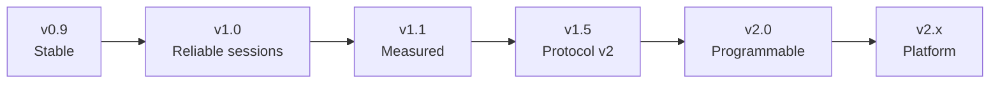

# Roadmap

Milestones build on each other. Each one ends in a usable firmware release that can be
flashed onto all pods. Work package IDs refer to [improvement-plan.md](improvement-plan.md).
There are no dates: this is a hobby project, so the order matters more than the calendar.

---

## v0.9 – "Stable" (current protocol, bugfixes only)

**Goal:** the existing 8 programs never crash or hang. No new features.

| Contents | |
|---|---|
| WP-S1 | Safe peripheral connection |
| WP-S2 | Input validation & engine guards |
| WP-S3 | Initialise all state, fix underflow |
| WP-S4 | Thread-safe event queue |
| WP-S7 | Non-blocking delay, `enterBlock` on start |
| Q2, Q6 | CI build, firmware version string |

**Exit criteria:**
- Each program runs 30 min on hardware without a reset.
- Switching a peripheral off during scanning does not crash the central.
- Invalid phone input does not crash the central.

---

## v1.0 – "Reliable sessions"

**Goal:** a training session with a full set works without power-cycling, and the
controls work the way the manual describes.

| Contents | |
|---|---|
| WP-S5 | Button driver (debounce, edges, no leaked presses, no dead zone) |
| WP-S6 | Disconnect → pause → reconnect → resume |
| WP-F2 | Battery monitoring + low-battery warning |
| WP-F8 | Identify pod |
| WP-T1 | Timing instrumentation (needed for v1.1, cheap to add now) |
| Docs | Update `anleitung` (program order, new LED codes for PAUSE / low battery) |

**Exit criteria:**
- Power-cycling one peripheral mid-game resumes the game within 10 s.
- The battery level of every pod is visible before the game starts.
- The first press after "green" is never skipped.

---

## v1.1 – "Measured"

**Goal:** ReactPods show reaction times, and the timing behaviour is known and documented.

| Contents | |
|---|---|
| WP-T2 | Use peripheral reaction times, result log, CSV over serial |
| WP-T3 | Central-side measurement (press edge), SOLO mode shows a time |
| WP-T4 | Explicit connection parameters |
| WP-F6 | End-of-cycle summary on the LED ring |
| WP-F3 (part 1) | Results notify on the config service, readable with a generic BLE app |
| Docs | Replace estimates in [timing.md](../firmware/timing.md) with measured values |

**Exit criteria:**
- Measured reaction-time error ≤ 2 ms, verified with logic analyser (LED data line vs. button).
- Activation latency is documented for 1, 4 and 7 pods.

---

## v1.5 – "Protocol v2"

**Goal:** a robust, versioned link that scales to 7 pods and supports simultaneous starts.
This release **breaks compatibility**: all pods must be updated together.

| Contents | |
|---|---|
| WP-A1 | NimBLE decision (spike first, adopt if the numbers are better) |
| WP-A2 | Command/Event characteristics with `seq` and version |
| WP-T5 | Simultaneous start with per-pod start delay |
| WP-F1 | Set pairing via `setId` in NVS + manufacturer data in advertising |
| WP-T6 | Event-driven main loop, LED refresh on change only |

**Exit criteria:**
- Two sets in the same room do not interfere.
- 7 peripherals connect and RUN-mode start skew is ≤ 1 connection interval.
- Firmware version mismatch is detected and shown.

---

## v2.0 – "Programmable"

**Goal:** new games without recompiling the firmware.

| Contents | |
|---|---|
| WP-A3 | Hardware abstraction, role/class renames |
| WP-A4 | Block engine v2 (ports, timeouts, instant-block chaining, interned variables) |
| WP-A5 | JSON programs in LittleFS, menu built from the file system |
| WP-F5 | First new modes as JSON: COUNTER, COUNTDOWN/timeout, go/no-go |
| Q1, Q3 | Host unit tests for engine + protocol, static analysis |
| WP-F4 | Power management (brightness cap, light sleep, idle deep sleep) |

**Exit criteria:**
- All 8 legacy programs run unchanged as JSON.
- A new program can be added by copying a JSON file only.
- Engine test coverage includes every block type.

---

## v2.x – "Platform" (ideas, not yet planned)

- **WP-F7 OTA**: phone → central → peripherals, with rollback. Needs the new partition table.
- **Phone / web-bluetooth app** (WP-F3 part 2): choose and upload programs, live results,
  history, multi-player scoreboards.
- **Program editor**: visual block editor that exports the v2.0 JSON format.
- **Charging dock integration** (WP-F9): charge animation, "all pods charged" overview.
- **Sound/haptics**, if a future PCB revision adds a buzzer or vibration motor.
- **Multi-central sessions**: two sets competing, with results compared via the phone.

---

## Progress

The JSON block-system rework pulled parts of v0.9, v1.0, v1.1 and v2.0 forward (WP-S3, S4,
S7, T3, A5 done; S1, S2, S5, T2, A4 mostly done; see [improvement-plan.md](improvement-plan.md)).
Firmware 2.0 then replaced the BLE pod link with ESP-NOW. That is the core of the
"Protocol v2" milestone: reconnect, pairing, synchronous start and ms latency. Battery
monitoring, power management and OTA are still open.

Before any of these milestones can be called finished, **all programs have to be tested on hardware**.

## Recommended next three steps

1. **Hardware test of firmware 2.0** on a full set: pairing, all 8 programs, power-cycle a
   pod mid-game, 30 min soak. Then fix what comes up.
2. **Measure the link** (improvement plan L1 / WP-T1) and update [timing.md](../firmware/timing.md).
3. **Battery monitoring** (WP-F2): with the radio always on, a low-battery warning matters more.
