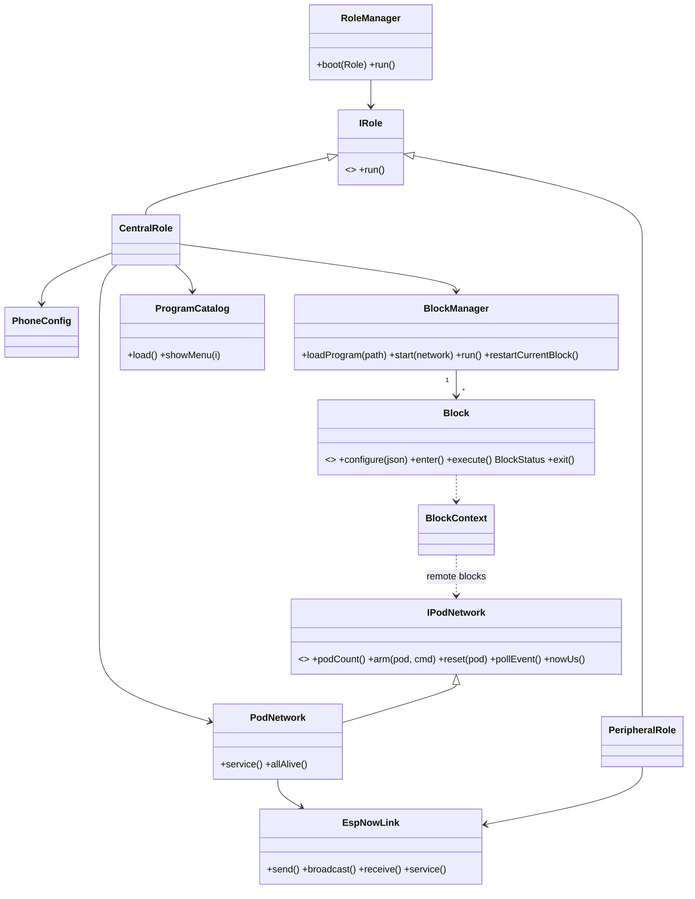
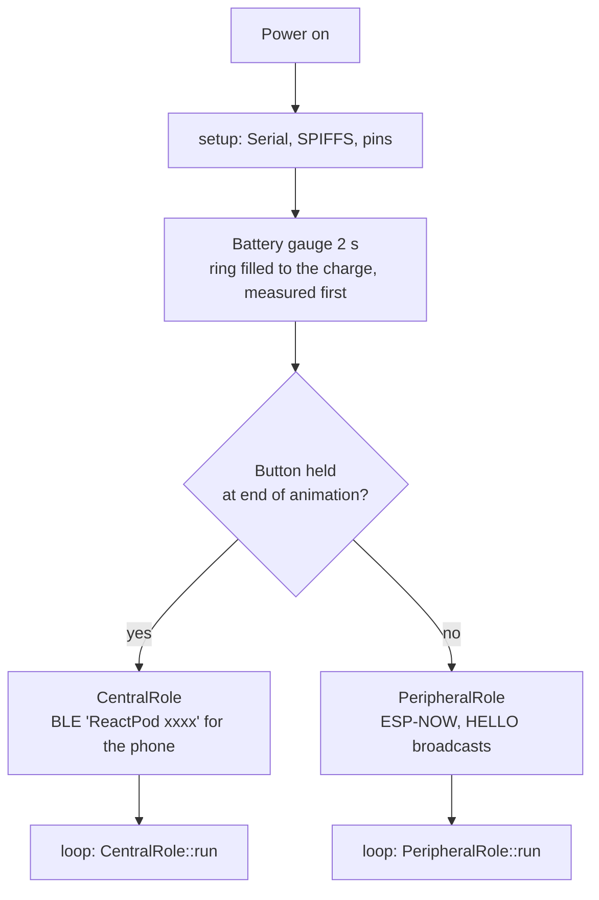
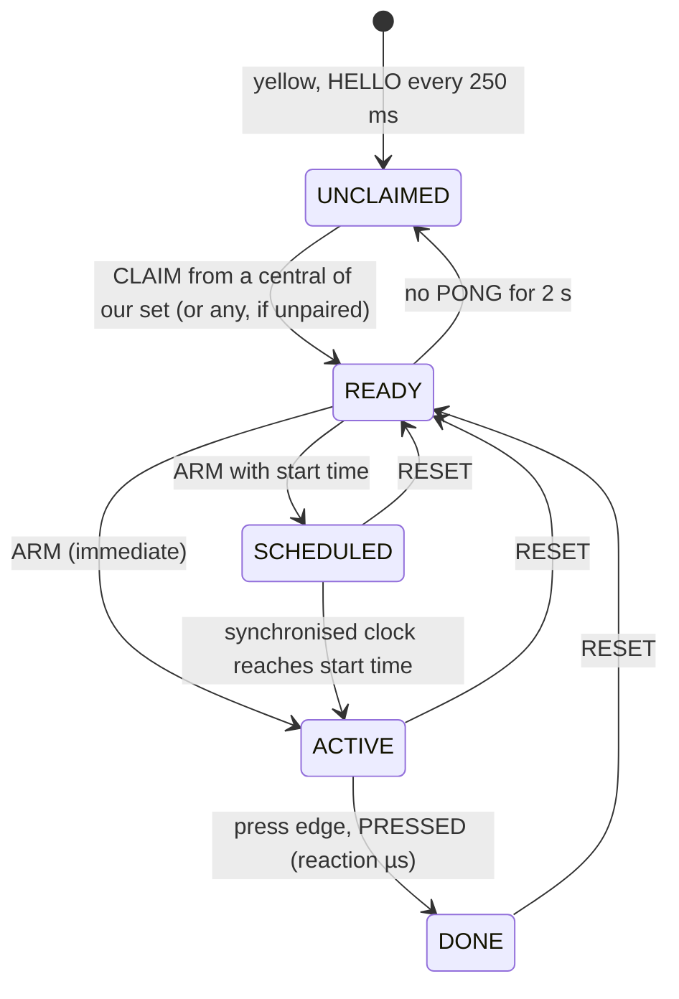
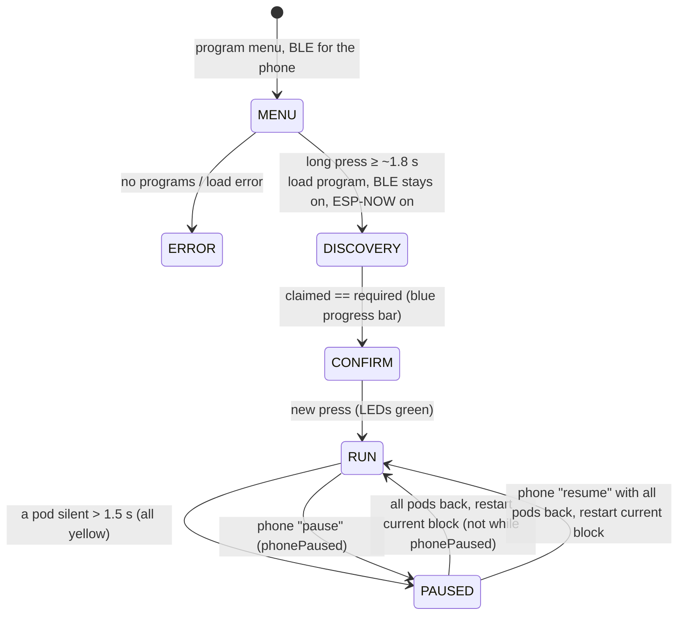

# Architecture

## 1. Hardware view

```
            ┌──────────────────────────────────────────┐
            │                ReactPod                  │
            │                                          │
  USB-C ───►│ charger / step-up ──► ESP32-C3 module    │
            │                                          │
            │   GPIO 3  ◄── push button (active LOW)   │
            │   GPIO 5  ◄── battery voltage (÷2)       │
            │   GPIO 7  ──► 18 × WS2812 LED ring       │
            │   GPIO 0  ◄── ADC read once for seeding  │
            └──────────────────────────────────────────┘
```

PCB and casing sources are in `hardware/pcb` (KiCad) and `hardware/casing` (FreeCAD).

## 2. Build configuration

| File | Purpose |
|---|---|
| `platformio.ini` | Single env `NewBoard`: ESP32-C3, Arduino + ESP-IDF, USB-CDC console |
| `sdkconfig.NewBoard` | ESP-IDF config. Relevant: WiFi + SW coexistence on, Bluedroid (phone config only), `FREERTOS_HZ=1000`, task WDT **off**, C++ exceptions **off**, flash size 4 MB, compiler optimisation `-Os`, Arduino log level INFO, assertions kept |
| `partitions.csv` | nvs 20 KB, otadata, **one** app slot (`ota_0`, 2 MB), SPIFFS 1.9 MB, coredump 64 KB |
| `CMakeLists.txt`, `src/CMakeLists.txt` | ESP-IDF build glue (globs all of `src/`) |
| `firmware/data/programs.json`, `firmware/data/prog/` | Game programs (JSON), uploaded with `pio run -d firmware -t uploadfs`. See [programs.md](programs.md) |
| `tools/validate_programs.py` | Checks the program files on the PC before upload |

## 3. Module structure

```
src/
├── main.cpp                  setup(): battery gauge, role selection; loop(): battery, run role
├── _Definitions.h            firmware version, pins, ESP-NOW channel, phone BLE UUIDs
├── Roles/
│   ├── RoleManager.*         creates CentralRole or PeripheralRole at boot
│   ├── IRole.h               interface: run() once per loop pass
│   ├── Central/
│   │   ├── CentralRole.*     menu, discovery, confirm, run, pause/resume
│   │   ├── PodNetwork.*      central side of the link: claims pods, heartbeats, ARM/RESET, events
│   │   └── PhoneConfig.*     BLE config API: settings + program upload/download (menu only)
│   └── Peripheral/
│       └── PeripheralRole.*  announce, get claimed, clock sync, arm/measure/report
├── Link/
│   ├── Protocol.h            wire format (frames, message types)
│   ├── EspNowLink.*          ESP-NOW transport: ordered reliable unicast, dedupe, tx timestamps
│   ├── ClockSync.h           NTP-style offset estimation (peripheral)
│   └── IPodNetwork.h         what the game logic sees of the peripherals
├── Config/
│   ├── ConfigApi.*           configuration API (JSON requests), shared by BLE and USB serial
│   ├── SerialConsole.*       USB serial transport: JSON / text commands, event lines
│   └── Console.*             USB serial port object (HWCDC) + ESP-IDF log redirection
├── Diagnostics/Diag.*        reset reason + last step across reboots (crash breadcrumbs)
├── Settings/Settings.*       values in flash (NVS): set id, store generation, boot role
├── Battery/Battery.*         cell voltage on GPIO 5 (16-sample average), percent, low-battery thresholds
├── Store/
│   ├── ProgramStore.*        program files: list, CRC, manifest, atomic commit, generation
│   └── StoreSync.*           pod-to-pod sync of the program store over ESP-NOW
├── BlockManager/             loads JSON programs into blocks, runs the block graph
├── Block/                    block types (see §6)
│   ├── Block.h               base class: configure / enter / execute / exit, named ports
│   ├── BlockContext.h        what blocks may use: variables, LEDs, button, results, pod network
│   ├── Value.*               parameter that is a constant or a variable reference
│   ├── JsonUtil.*            colour parsing
│   └── BlockFactory/         table: JSON "type" -> block class
├── Program/ProgramCatalog.*  program menu read from /programs.json
├── Input/Button.*            debounced button with edge counters and µs timestamps
├── Results/Results.*         measurement records + statistics, CSV on serial
│   └── Reports.*             measurement log and report buffer of the `communicate` block
├── VariableManager/          program variables (int64), resolved to ids at load time
├── LEDManager/               NeoPixel wrapper, palette patterns, boot + error animations, effect player
└── ColorSet/                 RGB struct and colour constants
```

All managers are lazily created singletons (`getManager()`). Objects are allocated
with `new` once and never freed.



## 4. Boot flow



The role cannot change without a reboot. Protocol details: [link-protocol.md](link-protocol.md).

## 5. State machines

### 5.1 Peripheral (`PeripheralRole`)



- While claimed, a PING goes to the central every 200 ms (heartbeat + clock sync).
- **ACTIVE**: the LEDs are updated, then `t0` is taken. Only presses that start after
  that count. Reaction time = press edge − `t0`, in µs.
- Frames are processed when they arrive (no polling of values), in the order sent.
- Holding the button 3 s while UNCLAIMED clears the stored set id (white flash).
- Identity (firmware ≥ 2.13): UNCLAIMED shows yellow with a MAC-derived segment; READY shows the number for
  1.5 s after a claim (`FLASH`), then spins it while the central sends `PONG_FLAG_IDENTIFY` (`SPIN`). An EFFECT
  from the central (blink) takes the ring until it ends. Any ARM or RESET hands the ring back to the activation.

### 5.2 Central (`CentralRole`)



- **MENU**: the menu is read from `/programs.json` (`ProgramCatalog`). The current
  program's LED pattern is shown at once. The button hold used to enter CENTRAL mode is
  ignored until it is released. A short press (< 1 s) selects the next program. A long press
  (~1.8 s, a white LED group ramps up in brightness) loads it. The phone's MaxLoop value
  is read at this moment. See [game-modes.md](../user/game-modes.md).
- **DISCOVERY**: does not block. Pods are claimed one at a time, as their HELLOs arrive.
  SOLO (0 peripherals) does not start the ESP-NOW radio at all. BLE stays connected from here on
  (firmware ≥ 2.12, `liveBle`, [ADR 0005](../decisions/0005-live-results-over-ble.md)): the phone
  keeps its connection through DISCOVERY, CONFIRM, RUN and PAUSED. Its requests are handled in
  every state (`PhoneConfig::service()` runs in `CentralRole::run()`); the response and event
  lines go out from a sender task ([link-protocol.md](link-protocol.md) §6).
- **RUN, the central's own ring**: a light with a start time (`syncStartMs`) is armed on an
  esp_timer by `LEDManager::playEffect` and drawn at that time, not by the loop pass
  ([timing.md](timing.md) §4.1).
- **CONFIRM**: a press that starts after CONFIRM was entered starts the program. Events
  that arrived before are discarded.
- **PAUSED**: the game resumes automatically when a lost peripheral is back. The current block is
  left and re-entered, which re-arms its pods. A phone `pause` (RUN only, `phonePaused` flag)
  does not resume by itself: only `resume` does, and a peripheral lost meanwhile still holds the
  game until it is back (config-api.md §5).
- **ERROR**: red blink, reboot needed.

## 6. Block engine

Game programs are directed graphs of *blocks*, loaded from JSON files on SPIFFS
(`firmware/data/` in the repository). The file format and every block type are documented in
[programs.md](programs.md). This section describes how the engine works.

### 6.1 Loading (`BlockManager::loadProgram`)

1. Clear all blocks and variables.
2. Read the program file. Load its `include` fragments first (recursively, max depth 3),
   then its own `peripherals`, `variables` and `blocks`.
3. For each block, `BlockFactory::create(type)` → `block->configure(json)`. The block
   parses its own parameters. Variable names are resolved to `VarId`s here.
4. After all blocks are known, resolve the port targets (names) to indices. Unknown
   names, duplicate names, unknown types and invalid parameters all abort the load with
   a message that names the file and the block. The central then shows the error blink.

### 6.2 Execution model (`BlockManager::run`, called once per `loop()`)

```
(CentralRole has already called button.update() and network.service() in this pass)
repeat up to 32 times:
    status = current.execute(ctx)
    if status == running: return                 // block waits, try again next pass
    next = current.target[status.port]
    if not connected and block has "next": next = current.target[next]
    current.exit(ctx); stop current.timerStop     // records the timer as a metric
    if next == none: program ends
    current = next; start current.timerStart; current.enter(ctx)
```

- `enter()` runs every time a block becomes current, also for the start block and
  when a block links to itself.
- Instant blocks are chained within one pass. Waiting blocks (delay, button, remote)
  return `running` and never block the loop.
- Blocks get everything they need through `BlockContext`: variables, LEDs, button,
  results, peripherals, and the central's pod id.
- The `timerStart` / `timerStop` flags that every block may carry are handled by
  `BlockManager` (enter / exit), not by the blocks. `restartCurrentBlock` (pause) does not
  touch them. See [programs.md](programs.md) §2 (*Timers*) and §7.9.

### 6.3 Block types

| JSON `type` | Class | Ports |
|---|---|---|
| `led` | `LEDBlock` | next |
| `delay` | `DelayBlock` (non-blocking) | next |
| `button` | `ButtonBlock` | next, short, long, pressed, timeout |
| `if` | `IfBlock` | true, false |
| `setVariable` | `SetVariableBlock` | next |
| `remotePress` | `RemotePressBlock` | next, timeout |
| `remoteMultiPress` | `RemoteMultiplePressBlock` | next, avoidHit, timeout |
| `remoteResetAll` | `RemoteResetAllBlock` | next |
| `summary` | `SummaryBlock` | next |
| `repeat` | `RepeatBlock` | next, body, done |
| `effect` | `EffectBlock` | next |
| `charge` | `ChargeBlock` (on `HoldBlock`) | next, released, early, full, timeout |
| `release` | `ReleaseBlock` (on `HoldBlock`) | next, noHold, falseStart, timeout |
| `toggle` | `ToggleBlock` | next, allA, allB |

### 6.4 Variables

`VariableManager` holds `int64` values in a vector. Names are resolved to ids once at
load time. Unknown variables read as 0. Variables set by the system:

| Variable | Set by | Used by |
|---|---|---|
| `REQUIRED_PERIPHERALS` | `"peripherals"` in the program file | CentralRole (how many to claim), programs |
| `NODE_COUNT` | `peripherals + 1` | random mode |
| `MAX_LOOPS` | program variables, phone override in CONFIRM | `lib/loop.json` |

### 6.5 Events from peripherals and measurements

- ESP-NOW receive callbacks run in the WiFi task and only copy frames into a FreeRTOS
  queue (`EspNowLink`). `PodNetwork::service()` processes them in the main loop and turns
  PRESSED frames into `PodEvent {podId, cmdSeq, result, reactionUs, rxTimeUs}`; RELEASED frames (hold
  activations, firmware ≥ 2.9) become `PodEvent`s of kind `RELEASED` with `flags`, `heldMs`, `chargeMs`.
  `HoldSession` (Link/) measures and animates a hold; the peripheral runs it for an ARM of mode CHARGE /
  RELEASE and the `charge` / `release` blocks run it for the central's own button.
  PRESSED frames of a TOGGLE activation (firmware ≥ 2.10) also carry `owner` and `flipCount` into the `PodEvent`;
  the `toggle` block keeps the owner and owned time per pod from them (programs.md §7.15).
- Remote blocks get the `cmdSeq` back from `IPodNetwork::arm()` and only accept the event
  with the same pod and `cmdSeq`.
- Blocks with `record` pass measurements to `Results`. Results prints a `RESULT,…` CSV
  line and keeps per-metric statistics for the `summary` block.
- `Results/Reports` also logs every measurement (48 values, cleared per report). The
  `communicate` block turns the log into a report: 8 reports in a RAM buffer (structs, rendered
  to JSON on demand) until the client acknowledges them (`ack`). Programs §7.16.

## 7. LED subsystem

- `LEDManager::setLEDColors(ColorSet*)` – all LEDs one colour.
- `setLEDColors(uint8_t colorId)` – colour index used on the wire:
  `0 red, 1 green, 2 blue, 3 yellow, 4 magenta, 5 cyan, 6 white, 255 off`; other values are ignored.
- `setLEDColors(index, ColorSet*)` – single pixel (calls `show()` each time).
- `setLEDColors(LEDPattern*)` – palette pattern: up to 8 palette colours, per-LED palette
  index packed as 3 bits × 18 into a `uint64_t` (`LEDPaletteID`), plus an optional
  `LEDAnimation::animate(now)` that mutates the indices.
- `playEffect(EffectDesc, startUs, ledMask)` – effect player (firmware ≥ 2.8): one effect at a time,
  table of effects in [link-protocol.md](link-protocol.md) §2.1. Every static call above stops it.
  `RoleManager::run()` calls `LEDManager::service()` after the role in every loop pass; it
  returns at once when nothing animates (`isAnimating()` false, light sleep allowed, #21).
  A frame is computed from the time since the start and shown only when it changed, at most
  every 16 ms. The first frame is shown inside `playEffect` when the start time has come.
- Effects on other pods: `IPodNetwork::effect(pod, desc, startAtUs)` (EFFECT frame) and
  `ArmCommand::waiting` (effect while an armed pod waits for the press). Check
  `IPodNetwork::supportsEffects(pod)`; pods with older firmware show static colours.
- `LEDManager/EffectJson` parses the JSON form of an effect (used by the `effect` test op).
  The `effect` block and the `countdown` option build `EffectDesc`s from block fields
  (`Block/EffectTarget`, `Block/Countdown`, programs.md §7.11, §7.12); `ledMask` is the block's `leds`.
- Brightness cap `setBrightnessCap(0…255)` scales all output, static colours included
  (default 255 = full brightness).
- `setSegment(first, count, colorId, restId)` – static: `count` LEDs from `first` in one colour, the rest in another
  (firmware ≥ 2.13, used for the identity and the MAC pattern of an unclaimed pod).
- Pod identity (firmware ≥ 2.13): `LEDManager/Identity.h` holds the palette (colour indices 0…8, the identity
  colours orange 7 and violet 8 are only used by pods), the numbers and the timings. The pattern itself is drawn by
  `PeripheralRole::updateIdentity` (link-protocol.md §2.4). The central's own pattern is its `blink` op
  (`CentralRole::opBlink`, white) and it sends the menu flag `PONG_FLAG_IDENTIFY` through `PodNetwork::setIdentify`.
