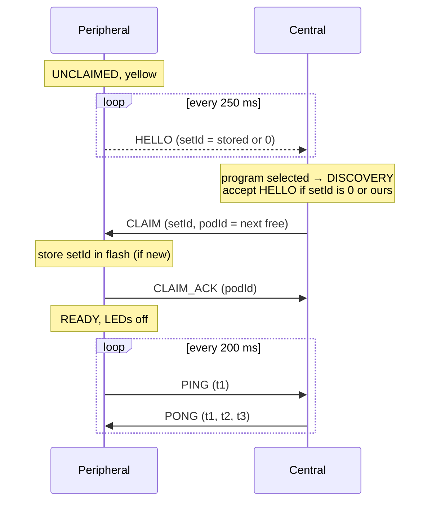
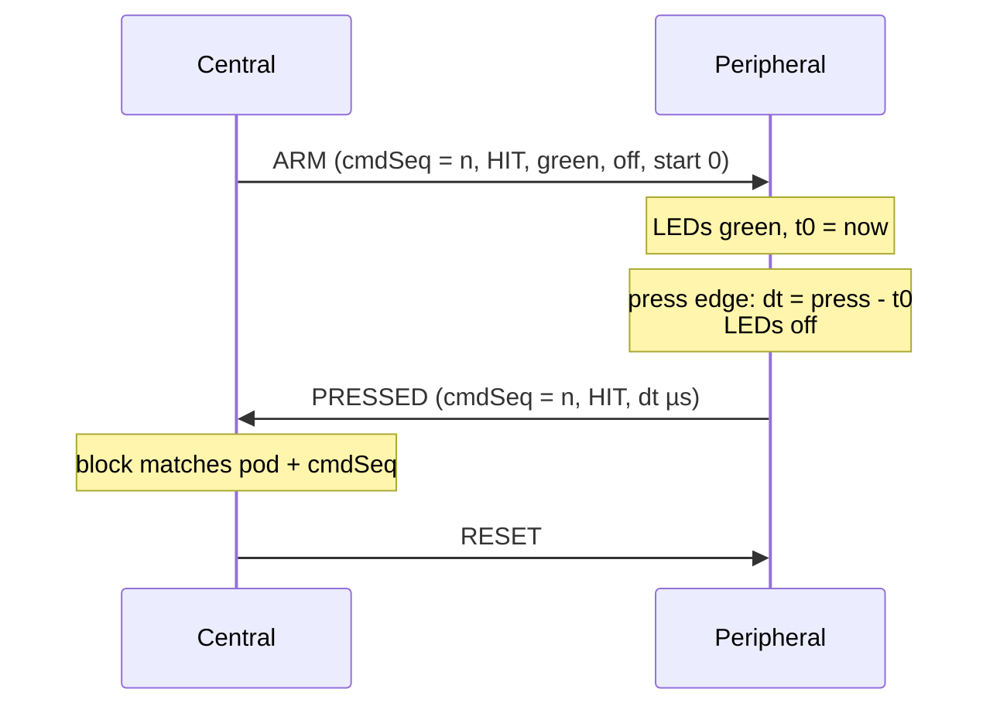

# Pod Link Protocol (ESP-NOW)

Since firmware 2.0 the pods talk to each other over **ESP-NOW**: connectionless WiFi
frames between MAC addresses, without an access point. BLE is only used on the
central for a phone, and only while the program menu is shown (see §6).

Source: [Protocol.h](../../firmware/src/Link/Protocol.h) (wire format),
[EspNowLink](../../firmware/src/Link/EspNowLink.cpp) (transport),
[PodNetwork](../../firmware/src/Roles/Central/PodNetwork.cpp) (central),
[PeripheralRole](../../firmware/src/Roles/Peripheral/PeripheralRole.cpp) (peripheral).

## 1. Radio settings

| Setting | Value |
|---|---|
| Mode | WiFi station, not connected to any network |
| Channel | `ESPNOW_CHANNEL` = 1 ([_Definitions.h](../../firmware/src/_Definitions.h)), must be equal on all pods |
| Power save | off (`WIFI_PS_NONE`): the receiver is always on, for lowest latency |
| Encryption | none. Frames are filtered by protocol version and set id |
| Frame size | ≤ 250 bytes (ESP-NOW limit). Game frames are ≤ 30 bytes; only sync responses are large |

## 2. Frame format

All frames start with an 8-byte header (packed, little endian):

| Field | Type | Meaning |
|---|---|---|
| `magic` | u8 | `0x52` ('R') |
| `version` | u8 | protocol version (1). Frames with another version are ignored |
| `type` | u8 | message type |
| `seq` | u8 | per sender, set by the link layer. Retransmissions keep it, so duplicates can be dropped |
| `setId` | u32 | set of the sender. 0 = unpaired peripheral |

| Type | Direction | Payload | Purpose |
|---|---|---|---|
| `HELLO` | P → broadcast | fwMajor, fwMinor | unclaimed peripheral announces itself (every 250 ms) |
| `CLAIM` | C → P | podId | central takes the peripheral into its set |
| `CLAIM_ACK` | P → C | podId | peripheral accepts |
| `PING` | P → C | t1 (µs, peripheral clock, stamped at transmission), store generation + hash | heartbeat every 200 ms + clock sync + store state |
| `PONG` | C → P | t1, t2 (central rx time), t3 (central tx time), store generation + hash, flags (bit 0: sync allowed) | clock sync answer + store state |
| `ARM` | C → P | cmdSeq, mode (HIT/AVOID), colorActive, colorAfter, startAtUs | light up now (`startAtUs = 0`) or at a central-clock time |
| `RESET` | C → P | – | switch off, cancel a pending activation |
| `PRESSED` | P → C | podId, cmdSeq, result (HIT/AVOID_HIT), reactionUs | button pressed while active |
| `SYNC_READ_REQ` | either | reqId, offset, path (32 bytes) | read a chunk of a store file or of `@manifest` |
| `SYNC_READ_RESP` | either | reqId, status, offset, total, len, data (≤ 200 bytes) | the chunk |

Colour indices: `0 red, 1 green, 2 blue, 3 yellow, 4 magenta, 5 cyan, 6 white, 255 off`.

## 3. Transport rules (`EspNowLink`)

- **Unicast is reliable and ordered per peer.** Only one frame per peer is on air at a
  time. The next one goes out when the receiver's radio has acknowledged it (ESP-NOW send
  callback). Unacknowledged frames are retried: ARM/RESET 5×, PRESSED 8×, CLAIM 3×, PING/PONG 0×.
  This keeps e.g. RESET before ARM.
- **Urgent frames** (ARM, RESET, PRESSED) skip ahead of queued non-urgent frames
  (PING/PONG). Among themselves they stay in order.
- **Duplicates** (frame received, but the acknowledgement was lost, so it was resent) are
  dropped by comparing `seq` with the previous frame of the same sender.
- **Timestamps** for clock sync are written into the frame right before it is handed to
  the radio, and taken in the receive callback. Queueing time therefore does not add
  to the error.
- Broadcast (HELLO only) is not acknowledged. It is repeated every 250 ms anyway.

## 4. Sequences

### 4.1 Joining a set



The central claims one peripheral at a time, so pod ids are handed out in order without gaps.

### 4.2 One activation



A PRESSED event only counts for the block if pod **and** `cmdSeq` match the activation
the block sent. Late or stale events are ignored.

### 4.3 Synchronous start (RUN modes)

`remoteMultiPress` sends every pod `ARM` with the same `startAtUs` = now + `syncStartMs`
(default 20 ms) on the central clock. Each peripheral converts it to its own clock and
lights at that moment. The central lights itself at the same time. If an ARM arrives
after the start time, for example after several retries, the pod lights immediately and
measures from its actual LED onset.

## 5. Pairing, supervision, recovery

| Situation | Behaviour |
|---|---|
| New pod (setId 0) | Any central can claim it. It adopts the central's set id |
| Pod of another set | Its HELLO is ignored. Its frames carry another set id |
| Central has no set id | Created randomly on the first program start, stored in flash |
| Clear pairing | On an unclaimed (yellow) peripheral, hold the button 3 s → white flash, set id 0 |
| Pod silent > 1.5 s | Central pauses the game (all yellow) |
| No PONG > 2 s | Peripheral returns to UNCLAIMED and sends HELLO again |
| Pod is back | Central re-claims it with its old id. When all pods are alive, the current block is restarted (re-arms) and the game continues |

All pods of a set end up with the **same** set id, so any of them can be the central next time.

### 5.1 Clock synchronisation

Each PING/PONG gives four timestamps (t1, t4 peripheral; t2, t3 central):

```
offset = ((t2 - t1) + (t3 - t4)) / 2      central = local + offset
delay  = (t4 - t1) - (t3 - t2)
```

The peripheral keeps the last 8 samples and uses the offset of the one with the smallest
delay. Crystal drift (±20 ppm ≈ 40 µs/s) is small compared to the 200 ms sample period.

### 5.2 Program store sync

Every pod keeps the full program store (`/programs.json`, `/prog/…`), so any pod can be
the central ([StoreSync](../../firmware/src/Store/StoreSync.cpp), [ProgramStore](../../firmware/src/Store/ProgramStore.cpp)).

- **Store state** = generation (u32, in NVS, increased on every local change) + hash
  (CRC-32 over the manifest). It is sent in every PING and PONG.
- **Newer** = higher generation, or same generation and higher hash. The pod with the
  older store pulls. This works in both directions: a peripheral pulls from the central,
  and the central pulls from a peripheral.
- **Pull**: read `@manifest` (text, one line per file: `path\tsize\tcrc-hex\n`, sorted),
  then read every missing or different file into a temp file (`/t/<n>`). Each file is
  checked against its size and CRC. Then all files are renamed into place together, files
  missing in the manifest are deleted, and the source's generation is taken over.
- **Stop-and-wait**: one request outstanding, 300 ms timeout, 5 retries. On failure the
  temp files are discarded and the pull starts again after 3 s. The old store is never
  half-replaced.
- **When**: the central sets *sync allowed* in its PONGs and allows its own pulls in
  DISCOVERY, CONFIRM and PAUSED, but not in RUN. During a game no sync traffic delays
  game frames, and a running pull pauses.
- **Local changes** (config API) take a generation above every generation seen from any
  peer (`seenGen` in NVS), so they win over older stores.
- Throughput (estimate): ~200 bytes per round trip of a few ms. A typical program set
  (~15 KB) takes well under a second per pod.

## 6. Phone configuration (BLE)

Only on the central, only in the program menu. When a program is selected, BLE is shut
down, and then ESP-NOW starts. The two radios never run at the same time. The program
upload/download API is described in [config-api.md](config-api.md).

| Characteristic | UUID | Props | Meaning |
|---|---|---|---|
| MaxLoop | `12345678-1234-1234-1234-1234567890a7` | W, R | ASCII number > 0 overrides `MAX_LOOPS` of the selected program |
| Command | `12345678-1234-1234-1234-1234567890b1` | W, W-NR | config API requests (JSON lines) |
| Response | `12345678-1234-1234-1234-1234567890b2` | Indicate | config API responses (JSON lines) |

Device name: "ReactPod <last 4 hex digits of setId>" or "ReactPod <set name>" (see
[config-api.md](config-api.md) §2.1). Service UUID `12345678-1234-1234-1234-1234567890ab`.

## 7. Compatibility

Protocol version 1 (firmware 2.0) is **not** compatible with the BLE firmware 1.x.
All pods of a set must be updated together. Pods with a different protocol version do not
see each other.
