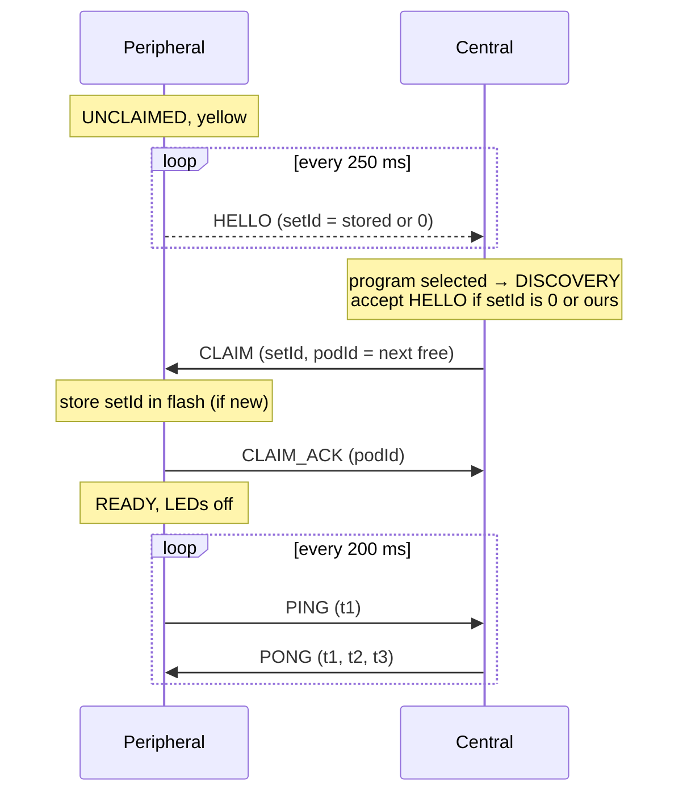
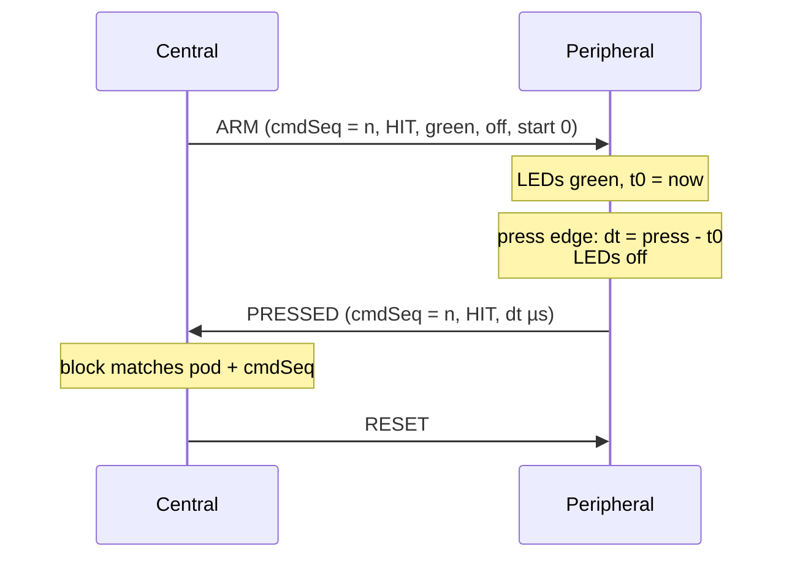
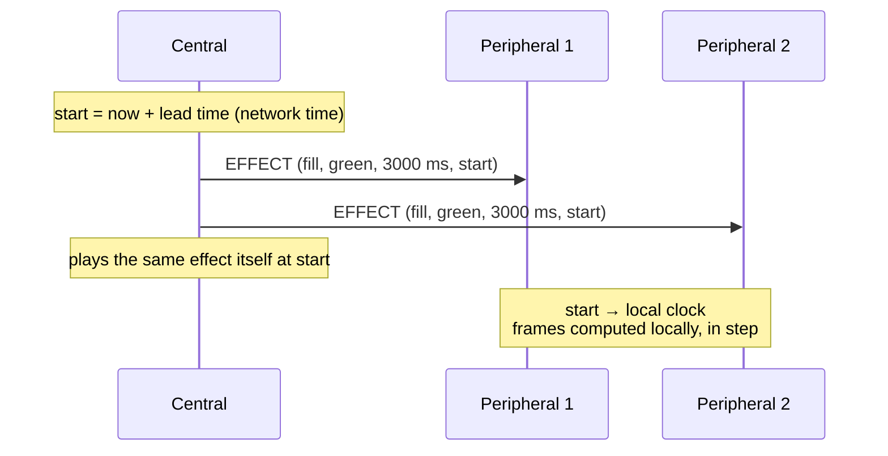

# Pod Link Protocol (ESP-NOW)

Since firmware 2.0 the pods talk to each other over **ESP-NOW**: connectionless WiFi
frames between MAC addresses, without an access point. BLE is only used on the
central for a phone, and only while the program menu is shown (see §6).

Source: [Protocol.h](../../firmware/src/Link/Protocol.h) (wire format),
[EspNowLink](../../firmware/src/Link/EspNowLink.cpp) (transport),
[PodNetwork](../../firmware/src/Roles/Central/PodNetwork.cpp) (central),
[PeripheralRole](../../firmware/src/Roles/Peripheral/PeripheralRole.cpp) (peripheral).

## 1. Radio settings

| Setting | Value |
|---|---|
| Mode | WiFi station, not connected to any network |
| Channel | `ESPNOW_CHANNEL` = 1 ([_Definitions.h](../../firmware/src/_Definitions.h)), must be equal on all pods |
| Power save | off (`WIFI_PS_NONE`): the receiver is always on, for lowest latency |
| Encryption | none. Frames are filtered by protocol version and set id |
| Frame size | ≤ 250 bytes (ESP-NOW limit). Game frames are ≤ 41 bytes; only sync responses are large |

## 2. Frame format

All frames start with an 8-byte header (packed, little endian):

| Field | Type | Meaning |
|---|---|---|
| `magic` | u8 | `0x52` ('R') |
| `version` | u8 | protocol version (1). Frames with another version are ignored. Extensions do not change it (§7) |
| `type` | u8 | message type |
| `seq` | u8 | per sender, set by the link layer. Retransmissions keep it, so duplicates can be dropped |
| `setId` | u32 | set of the sender. 0 = unpaired peripheral |

| Type | Direction | Payload | Purpose |
|---|---|---|---|
| `HELLO` | P → broadcast | fwMajor, fwMinor | unclaimed peripheral announces itself (every 250 ms) |
| `CLAIM` | C → P | podId | central takes the peripheral into its set |
| `CLAIM_ACK` | P → C | podId, linkFeatures (≥ 2.8, appended) | peripheral accepts and says what it understands (§7) |
| `PING` | P → C | t1 (µs, peripheral clock, stamped at transmission), store generation + hash | heartbeat every 200 ms + clock sync + store state |
| `PONG` | C → P | t1, t2 (central rx time), t3 (central tx time), store generation + hash, flags (bit 0: sync allowed) | clock sync answer + store state |
| `ARM` | C → P | cmdSeq, mode (HIT/AVOID), colorActive, colorAfter, startAtUs, waiting effect (≥ 2.8, appended, optional) | light up now (`startAtUs = 0`) or at a central-clock time |
| `RESET` | C → P | – | switch off, cancel a pending activation |
| `PRESSED` | P → C | podId, cmdSeq, result (HIT/AVOID_HIT), reactionUs | button pressed while active |
| `SYNC_READ_REQ` | either | reqId, offset, path (32 bytes) | read a chunk of a store file or of `@manifest` |
| `SYNC_READ_RESP` | either | reqId, status, offset, total, len, data (≤ 200 bytes) | the chunk |
| `EFFECT` (11) | C → P | EffectDesc (12 bytes), startAtUs | play an effect on the ring (≥ 2.8, only to pods with the `effects` feature) |

Colour indices: `0 red, 1 green, 2 blue, 3 yellow, 4 magenta, 5 cyan, 6 white, 255 off`.

### 2.1 Ring effects (firmware ≥ 2.8)

Peripherals still receive **colour indices only**. An effect is described once, with a start
time on the synchronised clock, and every pod computes its frames itself (blends,
brightness): no frame per animation step. A frame is a pure function of the time since
the start, so pods with the same start time show the same frame, and a pod that gets its
frame late joins the running animation instead of starting it again.

`EffectDesc` (12 bytes, packed):

| Field | Type | Meaning |
|---|---|---|
| `effect` | u8 | effect id, see below. 0 = none |
| `color` | u8 | main colour (index) |
| `color2` | u8 | second colour: target of `colorShift`, background of the other effects (255 = dark) |
| `brightness` | u8 | 0…255 (`dim`: end brightness) |
| `durationMs` | u32 | timed effects: length. Periodic effects: 0 = endless, else they end after it |
| `periodMs` | u16 | `blink`, `pulse`, `spin`: one cycle; 0 = 1000 |
| `param` | u8 | `spin`: segment length (0 = 3), `dim`: start brightness, `level`: percent (0…100) |
| `flags` | u8 | bit 0 `reverse` (counter-clockwise), bit 1 `endOff` (LEDs off at the end instead of keeping the end frame) |

| Id | Name | Frames | End frame |
|---|---|---|---|
| 0 | `none` | EFFECT: stop and switch off. ARM: no waiting effect | – |
| 1 | `solid` | all LEDs `color` | (static) |
| 2 | `fill` | LEDs light one by one from LED 0, the n-th after n/18 of `durationMs` | full ring |
| 3 | `drain` | full ring, LEDs go out one by one; the last one at the end | all `color2` |
| 4 | `dim` | `color`, brightness `param` → `brightness` linearly | `brightness` |
| 5 | `colorShift` | RGB blend `color` → `color2` | `color2` |
| 6 | `trafficLight` | green, yellow, red, one third of `durationMs` each (colours ignored) | red |
| 7 | `blink` | `color` for the first half of each period, `color2` for the second | `color` |
| 8 | `pulse` | brightness `brightness` → 0 → `brightness` per period (eased) | `color` |
| 9 | `spin` | segment of `param` LEDs in `color` turning once per period on `color2` | `color` |
| 10 | `level` | gauge: the first `param` % of the ring in `color`, the rest `color2` | (static) |

Effects start with a visible frame (`pulse` bright, `blink` on), so a reaction time
measured from the first LED update means the same as with a static colour. An unknown
effect id is ignored (the pod keeps its LEDs; for an ARM it shows `colorActive`).

All output, also static colours, is scaled by a brightness cap on the pod (255 by default;
for power management, #21). The cap is not sent on the link.

**EFFECT** (central → peripheral): `EffectDesc` + `startAtUs` (i64, central clock, 0 = now).
The peripheral converts the start time with its clock offset and plays the effect. It only
changes the LEDs, not the state: an armed pod stays armed, and its next LED change (ARM
activation, press, RESET) replaces the effect. Sent urgent with 5 retries, like RESET.

**ARM waiting effect**: an `EffectDesc` appended to ARM. While the pod waits for the press
it plays this effect instead of `colorActive`, timed from `startAtUs` (or from the
activation if 0). The central appends it only for pods with the `effects` feature, so older
pods show `colorActive`, which the central keeps filling in as the static fallback. The
reaction time is still measured from the first LED update of the activation.

## 3. Transport rules (`EspNowLink`)

- **Unicast is reliable and ordered per peer.** Only one frame per peer is on air at a
  time. The next one goes out when the receiver's radio has acknowledged it (ESP-NOW send
  callback). Unacknowledged frames are retried: ARM/RESET/EFFECT 5×, PRESSED 8×, CLAIM 3×, PING/PONG 0×.
  This keeps e.g. RESET before ARM.
- **Urgent frames** (ARM, RESET, EFFECT, PRESSED) skip ahead of queued non-urgent frames
  (PING/PONG). Among themselves they stay in order.
- **Duplicates** (frame received, but the acknowledgement was lost, so it was resent) are
  dropped by comparing `seq` with the previous frame of the same sender.
- **Timestamps** for clock sync are written into the frame right before it is handed to
  the radio, and taken in the receive callback. Queueing time therefore does not add
  to the error.
- Broadcast (HELLO only) is not acknowledged. It is repeated every 250 ms anyway.

## 4. Sequences

### 4.1 Joining a set



The central claims one peripheral at a time, so pod ids are handed out in order without gaps.

### 4.2 One activation



A PRESSED event only counts for the block if pod **and** `cmdSeq` match the activation
the block sent. Late or stale events are ignored.

### 4.3 Synchronous start (RUN modes)

`remoteMultiPress` sends every pod `ARM` with the same `startAtUs` = now + `syncStartMs`
(default 20 ms) on the central clock. Each peripheral converts it to its own clock and
lights at that moment. The central lights itself at the same time. If an ARM arrives
after the start time, for example after several retries, the pod lights immediately and
measures from its actual LED onset.

### 4.4 Effects on several pods



Nothing more is sent while the effect runs. If a retried EFFECT arrives after the start
time, that pod starts in the middle of the animation, in step with the others.

## 5. Pairing, supervision, recovery

| Situation | Behaviour |
|---|---|
| New pod (setId 0) | Any central can claim it. It adopts the central's set id |
| Pod of another set | Its HELLO is ignored. Its frames carry another set id |
| Central has no set id | Created randomly on the first program start, stored in flash |
| Clear pairing | On an unclaimed (yellow) peripheral, hold the button 3 s → white flash, set id 0 |
| Pod silent > 1.5 s | Central pauses the game (all yellow) |
| No PONG > 2 s | Peripheral returns to UNCLAIMED and sends HELLO again |
| Pod is back | Central re-claims it with its old id. When all pods are alive, the current block is restarted (re-arms) and the game continues |

All pods of a set end up with the **same** set id, so any of them can be the central next time.

### 5.1 Clock synchronisation

Each PING/PONG gives four timestamps (t1, t4 peripheral; t2, t3 central):

```
offset = ((t2 - t1) + (t3 - t4)) / 2      central = local + offset
delay  = (t4 - t1) - (t3 - t2)
```

The peripheral keeps the last 8 samples and uses the offset of the one with the smallest
delay. Crystal drift (±20 ppm ≈ 40 µs/s) is small compared to the 200 ms sample period.

### 5.2 Program store sync

Every pod keeps the full program store (`/programs.json`, `/prog/…`), so any pod can be
the central ([StoreSync](../../firmware/src/Store/StoreSync.cpp), [ProgramStore](../../firmware/src/Store/ProgramStore.cpp)).

- **Store state** = generation (u32, in NVS, increased on every local change) + hash
  (CRC-32 over the manifest). It is sent in every PING and PONG.
- **Newer** = higher generation, or same generation and higher hash. The pod with the
  older store pulls. This works in both directions: a peripheral pulls from the central,
  and the central pulls from a peripheral.
- **Pull**: read `@manifest` (text, one line per file: `path\tsize\tcrc-hex\n`, sorted),
  then read every missing or different file into a temp file (`/t/<n>`). Each file is
  checked against its size and CRC. Then all files are renamed into place together, files
  missing in the manifest are deleted, and the source's generation is taken over.
- **Stop-and-wait**: one request outstanding, 300 ms timeout, 5 retries. On failure the
  temp files are discarded and the pull starts again after 3 s. The old store is never
  half-replaced.
- **When**: the central sets *sync allowed* in its PONGs and allows its own pulls in
  DISCOVERY, CONFIRM and PAUSED, but not in RUN. During a game no sync traffic delays
  game frames, and a running pull pauses.
- **Local changes** (config API) take a generation above every generation seen from any
  peer (`seenGen` in NVS), so they win over older stores.
- Throughput (estimate): ~200 bytes per round trip of a few ms. A typical program set
  (~15 KB) takes well under a second per pod.

## 6. Phone configuration (BLE)

Only on the central, only in the program menu. When a program is selected, BLE is shut
down, and then ESP-NOW starts. The two radios never run at the same time. The program
upload/download API is described in [config-api.md](config-api.md).

| Characteristic | UUID | Props | Meaning |
|---|---|---|---|
| MaxLoop | `12345678-1234-1234-1234-1234567890a7` | W, R | ASCII number > 0 overrides `MAX_LOOPS` of the selected program |
| Command | `12345678-1234-1234-1234-1234567890b1` | W, W-NR | config API requests (JSON lines) |
| Response | `12345678-1234-1234-1234-1234567890b2` | Indicate | config API responses (JSON lines) |

Device name: "ReactPod <last 4 hex digits of setId>" or "ReactPod <set name>" (see
[config-api.md](config-api.md) §2.1). Service UUID `12345678-1234-1234-1234-1234567890ab`.

## 7. Compatibility

Protocol version 1 (firmware 2.0) is **not** compatible with the BLE firmware 1.x.
Pods with a different protocol version do not see each other.

Within version 1 the protocol is extended without breaking older pods, so a set can mix
firmware versions:

- New fields are **appended** to a frame. The minimum frame length a receiver checks
  (`Protocol::frameSize`) stays the length without them, so older firmware accepts the
  longer frame and ignores the tail. A receiver reads an appended field only if the frame
  is long enough.
- **New message types** are ignored by older firmware (unknown type → no handler).
- **Link features**: the peripheral sends a bit mask in `CLAIM_ACK.linkFeatures` (appended;
  a short CLAIM_ACK means 0). The central keeps it per pod, sends feature frames only to pods
  that have the feature and reports it in `status.pods[]`.

| Bit | Feature | Firmware | Meaning |
|---|---|---|---|
| 0 | `effects` | ≥ 2.8 | EFFECT frames and the ARM waiting effect (§2.1) |

A central with older firmware ignores `linkFeatures` and never sends EFFECT. A central with
newer firmware treats a pod with older firmware as "no effects": blocks show a static colour
on it instead.
