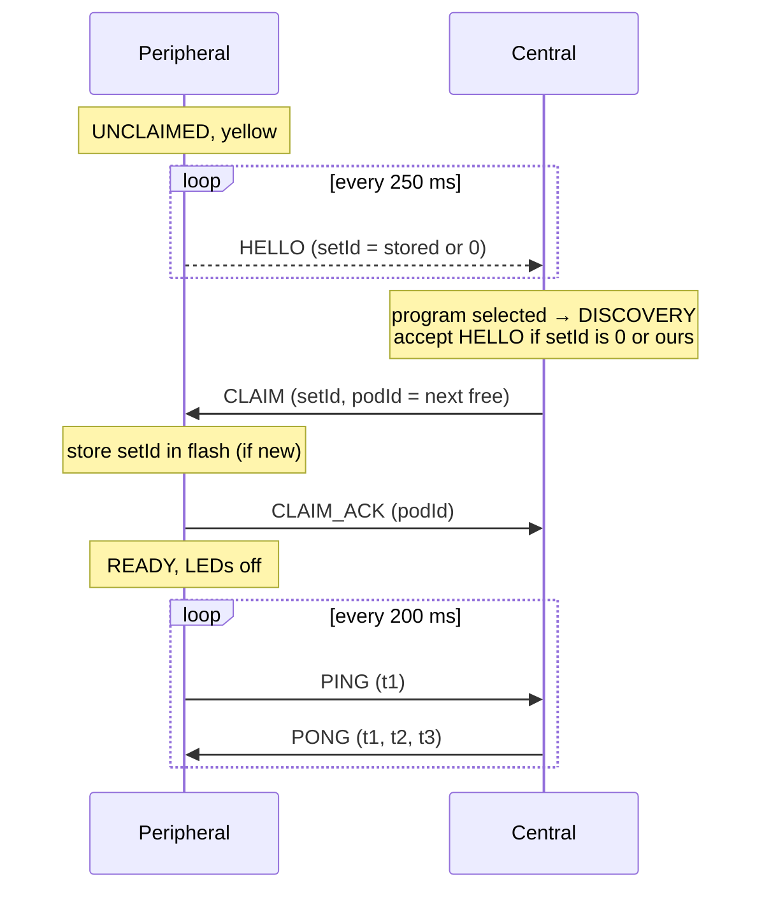
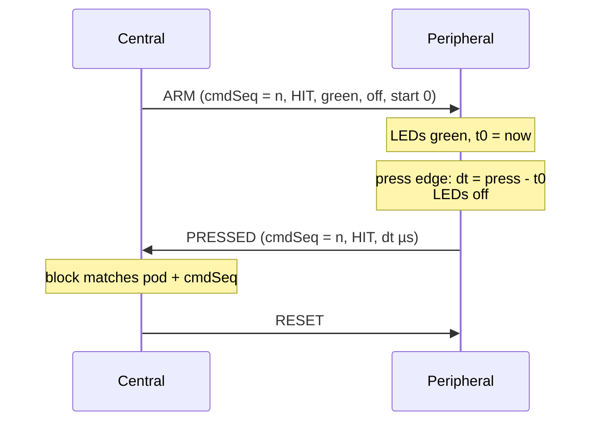
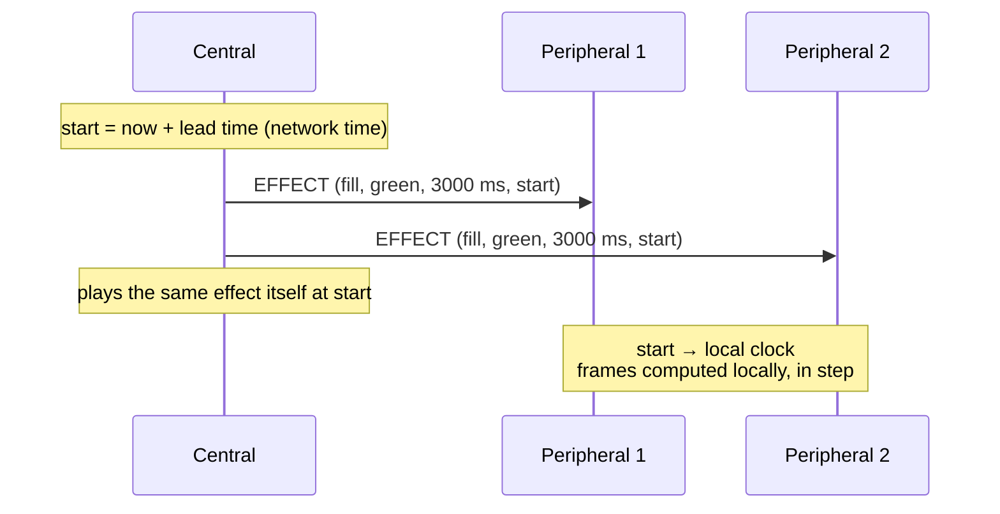

# Pod Link Protocol (ESP-NOW)

Since firmware 2.0 the pods talk to each other over **ESP-NOW**: connectionless WiFi
frames between MAC addresses, without an access point. BLE is only used on the
central for a phone, and only while the program menu is shown (see §6).

Source: [Protocol.h](../../firmware/src/Link/Protocol.h) (wire format),
[EspNowLink](../../firmware/src/Link/EspNowLink.cpp) (transport),
[PodNetwork](../../firmware/src/Roles/Central/PodNetwork.cpp) (central),
[PeripheralRole](../../firmware/src/Roles/Peripheral/PeripheralRole.cpp) (peripheral).

## 1. Radio settings

| Setting | Value |
|---|---|
| Mode | WiFi station, not connected to any network |
| Channel | `ESPNOW_CHANNEL` = 1 ([_Definitions.h](../../firmware/src/_Definitions.h)), must be equal on all pods |
| Power save | off (`WIFI_PS_NONE`): the receiver is always on, for lowest latency |
| Encryption | none. Frames are filtered by protocol version and set id |
| Frame size | ≤ 250 bytes (ESP-NOW limit). Game frames are ≤ 72 bytes (ARM of a toggle activation); only sync responses are large |

## 2. Frame format

All frames start with an 8-byte header (packed, little endian):

| Field | Type | Meaning |
|---|---|---|
| `magic` | u8 | `0x52` ('R') |
| `version` | u8 | protocol version (1). Frames with another version are ignored. Extensions do not change it (§7) |
| `type` | u8 | message type |
| `seq` | u8 | per sender, set by the link layer. Retransmissions keep it, so duplicates can be dropped |
| `setId` | u32 | set of the sender. 0 = unpaired peripheral |

| Type | Direction | Payload | Purpose |
|---|---|---|---|
| `HELLO` | P → broadcast | fwMajor, fwMinor | unclaimed peripheral announces itself (every 250 ms) |
| `CLAIM` | C → P | podId | central takes the peripheral into its set |
| `CLAIM_ACK` | P → C | podId, linkFeatures (≥ 2.8, appended) | peripheral accepts and says what it understands (§7) |
| `PING` | P → C | t1 (µs, peripheral clock, stamped at transmission), store generation + hash, batteryMv (appended, firmware ≥ 2.13) | heartbeat every 200 ms + clock sync + store state + battery |
| `PONG` | C → P | t1, t2 (central rx time), t3 (central tx time), store generation + hash, flags (bit 0: sync allowed, bit 1: identify, §2.4) | clock sync answer + store state |
| `ARM` | C → P | cmdSeq, mode (HIT/AVOID/CHARGE/RELEASE/TOGGLE), colorActive, colorAfter, startAtUs, waiting effect (≥ 2.8, appended, optional), hold parameters (≥ 2.9, appended, only CHARGE / RELEASE), toggle parameters (≥ 2.10, appended, only TOGGLE) | light up now (`startAtUs = 0`) or at a central-clock time |
| `RESET` | C → P | – | switch off, cancel a pending activation |
| `PRESSED` | P → C | podId, cmdSeq, result (HIT/AVOID_HIT), reactionUs, owner + flipCount (≥ 2.10, appended, only TOGGLE) | button pressed while active. For CHARGE / RELEASE: a hold started (§2.2). For TOGGLE: the pod flipped (§2.3) |
| `RELEASED` (12) | P → C | podId, cmdSeq, flags, heldMs, reactionUs, chargeMs | end of a hold, measured on the peripheral (≥ 2.9, only for CHARGE / RELEASE, §2.2) |
| `SYNC_READ_REQ` | either | reqId, offset, path (32 bytes) | read a chunk of a store file or of `@manifest` |
| `SYNC_READ_RESP` | either | reqId, status, offset, total, len, data (≤ 200 bytes) | the chunk |
| `EFFECT` (11) | C → P | EffectDesc (12 bytes), startAtUs | play an effect on the ring (≥ 2.8, only to pods with the `effects` feature) |

Colour indices: `0 red, 1 green, 2 blue, 3 yellow, 4 magenta, 5 cyan, 6 white, 255 off`. `7 orange` and `8 violet`
are the identity colours of the pods (firmware ≥ 2.13, §2.4); a central does not send them.

### 2.1 Ring effects (firmware ≥ 2.8)

Peripherals still receive **colour indices only**. An effect is described once, with a start
time on the synchronised clock, and every pod computes its frames itself (blends,
brightness): no frame per animation step. A frame is a pure function of the time since
the start, so pods with the same start time show the same frame, and a pod that gets its
frame late joins the running animation instead of starting it again.

`EffectDesc` (12 bytes, packed):

| Field | Type | Meaning |
|---|---|---|
| `effect` | u8 | effect id, see below. 0 = none |
| `color` | u8 | main colour (index) |
| `color2` | u8 | second colour: target of `colorShift`, background of the other effects (255 = dark) |
| `brightness` | u8 | 0…255 (`dim`: end brightness) |
| `durationMs` | u32 | timed effects: length. Periodic effects: 0 = endless, else they end after it |
| `periodMs` | u16 | `blink`, `pulse`, `spin`: one cycle; 0 = 1000 |
| `param` | u8 | `spin`: segment length (0 = 3), `dim`: start brightness, `level`: percent (0…100) |
| `flags` | u8 | bit 0 `reverse` (counter-clockwise), bit 1 `endOff` (LEDs off at the end instead of keeping the end frame) |

| Id | Name | Frames | End frame |
|---|---|---|---|
| 0 | `none` | EFFECT: stop and switch off. ARM: no waiting effect | – |
| 1 | `solid` | all LEDs `color` | (static) |
| 2 | `fill` | LEDs light one by one from LED 0, the n-th after n/18 of `durationMs` | full ring |
| 3 | `drain` | full ring, LEDs go out one by one; the last one at the end | all `color2` |
| 4 | `dim` | `color`, brightness `param` → `brightness` linearly | `brightness` |
| 5 | `colorShift` | RGB blend `color` → `color2` | `color2` |
| 6 | `trafficLight` | green, yellow, red, one third of `durationMs` each (colours ignored) | red |
| 7 | `blink` | `color` for the first half of each period, `color2` for the second | `color` |
| 8 | `pulse` | brightness `brightness` → 0 → `brightness` per period (eased) | `color` |
| 9 | `spin` | segment of `param` LEDs in `color` turning once per period on `color2` | `color` |
| 10 | `level` | gauge: the first `param` % of the ring in `color`, the rest `color2` | (static) |

Effects start with a visible frame (`pulse` bright, `blink` on), so a reaction time
measured from the first LED update means the same as with a static colour. An unknown
effect id is ignored (the pod keeps its LEDs; for an ARM it shows `colorActive`).

All output, also static colours, is scaled by a brightness cap on the pod (255 by default;
for power management, #21). The cap is not sent on the link.

**EFFECT** (central → peripheral): `EffectDesc` + `startAtUs` (i64, central clock, 0 = now).
The peripheral converts the start time with its clock offset and plays the effect. It only
changes the LEDs, not the state: an armed pod stays armed, and its next LED change (ARM
activation, press, RESET) replaces the effect. Sent urgent with 5 retries, like RESET.

**ARM waiting effect**: an `EffectDesc` appended to ARM. While the pod waits for the press
it plays this effect instead of `colorActive`, timed from `startAtUs` (or from the
activation if 0). The central appends it only for pods with the `effects` feature, so older
pods show `colorActive`, which the central keeps filling in as the static fallback. The
reaction time is still measured from the first LED update of the activation.

**Use by programs** (firmware ≥ 2.9, programs.md §7.11, §7.12): the `effect` block sends EFFECT
frames; the `countdown` of `remotePress` / `remoteMultiPress` is the ARM waiting effect (a drain,
fill, dim, colorShift or trafficLight over the timeout), the `countdown` of `delay` uses EFFECT
frames. The frames did not change for this: header version 1, no new fields.

### 2.2 Hold activations (link protocol revision 2, firmware ≥ 2.9)

For the `charge` and `release` blocks (programs.md §7.13, §7.14) the peripheral measures how long
its button is held, shows it on its own ring and reports the result. The central streams no
frames; it sends one ARM and receives PRESSED (a hold started) and RELEASED (the hold ended).
Only pods with the `hold` link feature (§7, CLAIM_ACK bit 1) get such an ARM; for a pod without it
the blocks take their `timeout` port at once, as for a pod that does not exist.

**PodMode** (ARM `mode`): `3 CHARGE`, `4 RELEASE` (older modes: `1 HIT`, `2 AVOID`).

**ARM** of a hold activation always carries the waiting effect (it may be `none`) followed by the
hold parameters. `colorActive` is the idle colour, `colorAfter` the colour after the end, the waiting effect (if not `none`)
is played instead of `colorActive` while no hold is active (the idle ring, e.g. a countdown). `startAtUs` is 0.

`HoldParams` (36 bytes, packed, appended after `waiting`):

| Field | Type | Meaning |
|---|---|---|
| `flags` | u8 | bit 0 `allowHeld` (RELEASE: a hold that is active on activation counts, from the activation on), bit 1 `signal` (RELEASE: colour switch after `goDelayMs`), bit 2 `accumulate` (CHARGE: a release pauses / drains the charge instead of ending) |
| `heldColor` | u8 | RELEASE: colour once the hold is detected |
| `goColor` | u8 | RELEASE signal: colour after the switch |
| reserved | u8 | 0 |
| `onsetMs` | u32 | CHARGE: hold time before the charge starts (for every hold) |
| `maxMs` | u32 | CHARGE: charging time (after the onset) for a full charge (≥ 1) |
| `decayMs` | u32 | CHARGE accumulate: time to drain a full charge while released, 0 = keep |
| `goDelayMs` | u32 | RELEASE signal: hold start → switch |
| `limitMs` | u32 | CHARGE accumulate: time limit counted from the activation, 0 = none |
| `effect` | EffectDesc | CHARGE: the charge, an effect with `durationMs = maxMs` (frame = f(charge)). RELEASE trigger: countdown over `maxHoldMs`, started at the hold start. RELEASE signal: countdown over `timeoutMs`, started at the switch. `none` = static `heldColor` / `goColor` |

**Pod behaviour** (`HoldSession`, the central runs the same code for its own button):

- Only a press edge after the activation starts a hold (a button that is down on activation is
  ignored until released and pressed again), except RELEASE with `allowHeld`, where the hold
  starts at the activation. On every hold start the pod sends `PRESSED` (`reactionUs` = activation → press, 0 if already held).
- CHARGE shows the charge effect frozen at the current charge at the hold start (it replaces an idle
  countdown) and lets it run from `hold start + onsetMs`. The effect is a pure function of the time
  since its start, so a charge of `c` ms is shown by starting the effect `c` ms in the past.
  While a charge drains (`decayMs`) the pod redraws the frozen frame about every 33 ms.
- CHARGE reaching the maximum ends the activation at once: the pod flashes the ring (200 ms
  period, 600 ms, dark at the end) and sends `RELEASED` with `FULL`. It does not wait for the release.
- RELEASE `signal` switches the ring at `hold start + goDelayMs` (`goColor`, or the countdown effect).
  A release before that is a false start. `reactionUs` = switch (the moment the LEDs were updated) → release.
- Everything is measured from the button edge timestamps on the pod, not from when a frame arrives.

**RELEASED** (12, P → C, 23 bytes):

| Field | Type | Meaning |
|---|---|---|
| `podId`, `cmdSeq` | u8, u8 | as PRESSED; only the activation the central sent counts |
| `flags` | u8 | bit 0 `falseStart` (RELEASE signal), bit 1 `full` (CHARGE: full charge, reported when reached), bit 2 `limit` (CHARGE accumulate: `limitMs` reached, `chargeMs` is final), bit 3 `early` (CHARGE: released before the onset) |
| `heldMs` | u32 | hold time (release − hold start). With `full` / `limit` and `accumulate`: all holds together up to that moment |
| `reactionUs` | i32 | RELEASE signal: switch → release, else 0 |
| `chargeMs` | u32 | CHARGE: charge at the end (0 … `maxMs`), else 0 |

A release of an accumulating charge is not reported (the charge goes on); only `full` and `limit` end it.
RELEASED is sent urgent with 8 retries, like PRESSED, and ordered after the PRESSED of the same hold.
After RELEASED the pod keeps the ring as it is (flash, `colorAfter`) until the next ARM or RESET; the
central sends RESET after every end except `full` (so the flash stays visible).

### 2.3 Toggle activations (link protocol revision 3, firmware ≥ 2.10)

Used by the `toggle` block (programs.md §7.15): the pod stays armed and flips between two team colours on every
press. The flip happens **on the pod** at the press, so there is no round-trip latency; the central only learns
of it. Only pods with the `toggle` link feature (§7, CLAIM_ACK bit 2) get such an ARM; the block leaves the
others out of the game.

**ARM** of a toggle activation (72 bytes) carries the waiting effect (the countdown over the game, may be `none`),
the hold parameters (all zero, only there to keep the layout) and then the toggle parameters. `colorActive` is the
colour of team A, `colorAfter` the colour of team B.

| Field | Type | Meaning |
|---|---|---|
| `startOwner` | u8 | `0` team A, `1` team B, `2` nobody (the ring is dark until the first press, which makes the pod A) |
| `reserved` | u8 | 0 |
| `cooldownMs` | u16 | minimum time between two flips of this pod. A press less than `cooldownMs` after the last accepted press (button timestamps) is ignored; the first press always counts |

**PRESSED** has two appended fields: `owner` (u8, `0` A / `1` B, **after** this press) and `flipCount` (u16, accepted
flips since the ARM, 1 for the first). `reactionUs` = activation → press. The owner is absolute: the central
takes `owner` from the newest PRESSED it has seen, so a lost PRESSED (all retries failed) is corrected by the next one
and `flipCount` still tells how many flips there were. A frame with a `flipCount` that is not above the last one (duplicate,
reordered) is dropped.

- The pod shows the owner's colour at once (`setLEDColors`). With a waiting effect (countdown) the effect is replayed
  with the owner's colour as `color` and the **original start time**, so the animation does not restart on a flip.
- The pod stays armed until RESET or the next ARM. The pod does not know the game length; the central ends the
  game with a plain HIT ARM whose `colorActive` and `colorAfter` are the final colour, so the ring keeps the colour and
  a press no longer flips it (the `PRESSED` of that ARM carries another `cmdSeq` and is ignored). `remoteResetAll` switches it off.
- A toggle ARM shorter than 72 bytes is ignored.

### 2.4 Pod identity (link protocol revision 4, firmware ≥ 2.13)

A pod has a **number** 1 … 7 (its pod id + 1) and a fixed **colour** from a palette of seven
(red, green, blue, magenta, cyan, orange, violet; no yellow, no white). It shows the number as that many
LEDs in its colour, the rest dark. The palette is `Identity::PALETTE` in `LEDManager/Identity.h`; the central
reports both in `status.pods[]` (`number`, `color` as `#rrggbb`), so the app draws the same.

- **Menu flag:** the central sets `PONG_FLAG_IDENTIFY` (bit 1 of the PONG flags) while it is in the program
  menu, discovery or confirm. A pod spins its number (`spin`, one turn per 3 s) while the flag is set, and goes
  dark when it is cleared (game start, pause, error). Older firmware ignores the bit, so no feature bit is needed.
- **After a claim:** the number is shown static for 1.5 s (`FLASH`), then the menu flag decides.
- **Never during a game:** the flag is off in RUN and PAUSED, and an ARM always takes the ring.
- **Blink:** the central sends an EFFECT (`blink`, the pod's colour, 500 ms period, 2 s, end off) to a pod with the
  `effects` feature. The pod's identity comes back after the effect. The central itself blinks white.
  Config API op `blink` (config-api.md §5), only in menu, discovery and confirm.
- **Before the claim:** an unclaimed pod shows yellow (waiting for a central) with one segment of two LEDs in a
  colour and at a position taken from its MAC. Unclaimed pods can be told apart, the yellow stays dominant.

## 3. Transport rules (`EspNowLink`)

- **Unicast is reliable and ordered per peer.** Only one frame per peer is on air at a
  time. The next one goes out when the receiver's radio has acknowledged it (ESP-NOW send
  callback). Unacknowledged frames are retried: ARM/RESET/EFFECT 5×, PRESSED/RELEASED 8×, CLAIM 3×, PING/PONG 0×.
  This keeps e.g. RESET before ARM.
- **Urgent frames** (ARM, RESET, EFFECT, PRESSED, RELEASED) skip ahead of queued non-urgent frames
  (PING/PONG). Among themselves they stay in order.
- **Duplicates** (frame received, but the acknowledgement was lost, so it was resent) are
  dropped by comparing `seq` with the previous frame of the same sender.
- **Timestamps** for clock sync are written into the frame right before it is handed to
  the radio, and taken in the receive callback. Queueing time therefore does not add
  to the error.
- Broadcast (HELLO only) is not acknowledged. It is repeated every 250 ms anyway.

## 4. Sequences

### 4.1 Joining a set



The central claims one peripheral at a time, so pod ids are handed out in order without gaps.

### 4.2 One activation



A PRESSED event only counts for the block if pod **and** `cmdSeq` match the activation
the block sent. Late or stale events are ignored.

### 4.3 Synchronous start (RUN modes)

`remoteMultiPress` sends every pod `ARM` with the same `startAtUs` = now + `syncStartMs`
(default 20 ms) on the central clock. Each peripheral converts it to its own clock and
lights at that moment. The central lights itself at the same time. If an ARM arrives
after the start time, for example after several retries, the pod lights immediately and
measures from its actual LED onset.

### 4.4 Effects on several pods



Nothing more is sent while the effect runs. If a retried EFFECT arrives after the start
time, that pod starts in the middle of the animation, in step with the others.

## 5. Pairing, supervision, recovery

| Situation | Behaviour |
|---|---|
| New pod (setId 0) | Any central can claim it. It adopts the central's set id |
| Pod of another set | Its HELLO is ignored. Its frames carry another set id |
| Central has no set id | Created randomly on the first program start, stored in flash |
| Clear pairing | On an unclaimed (yellow) peripheral, hold the button 3 s → white flash, set id 0 |
| Pod silent > 1.5 s | Central pauses the game (all yellow) |
| No PONG > 2 s | Peripheral returns to UNCLAIMED and sends HELLO again |
| Pod is back | Central re-claims it with its old id. When all pods are alive, the current block is restarted (re-arms) and the game continues |

All pods of a set end up with the **same** set id, so any of them can be the central next time.

### 5.1 Clock synchronisation

Each PING/PONG gives four timestamps (t1, t4 peripheral; t2, t3 central):

```
offset = ((t2 - t1) + (t3 - t4)) / 2      central = local + offset
delay  = (t4 - t1) - (t3 - t2)
```

The peripheral keeps the last 8 samples and uses the offset of the one with the smallest
delay. Crystal drift (±20 ppm ≈ 40 µs/s) is small compared to the 200 ms sample period.

### 5.2 Program store sync

Every pod keeps the full program store (`/programs.json`, `/prog/…`), so any pod can be
the central ([StoreSync](../../firmware/src/Store/StoreSync.cpp), [ProgramStore](../../firmware/src/Store/ProgramStore.cpp)).

- **Store state** = generation (u32, in NVS, increased on every local change) + hash
  (CRC-32 over the manifest). It is sent in every PING and PONG.
- **Newer** = higher generation, or same generation and higher hash. The pod with the
  older store pulls. This works in both directions: a peripheral pulls from the central,
  and the central pulls from a peripheral.
- **Pull**: read `@manifest` (text, one line per file: `path\tsize\tcrc-hex\n`, sorted),
  then read every missing or different file into a temp file (`/t/<n>`). Each file is
  checked against its size and CRC. Then all files are renamed into place together, files
  missing in the manifest are deleted, and the source's generation is taken over.
- **Stop-and-wait**: one request outstanding, 300 ms timeout, 5 retries. On failure the
  temp files are discarded and the pull starts again after 3 s. The old store is never
  half-replaced.
- **When**: the central sets *sync allowed* in its PONGs and allows its own pulls in
  DISCOVERY, CONFIRM and PAUSED, but not in RUN. During a game no sync traffic delays
  game frames, and a running pull pauses.
- **Local changes** (config API) take a generation above every generation seen from any
  peer (`seenGen` in NVS), so they win over older stores.
- Throughput (estimate): ~200 bytes per round trip of a few ms. A typical program set
  (~15 KB) takes well under a second per pod.

## 6. Phone configuration (BLE)

Only on the central. BLE runs from boot through the game ([ADR 0005](../decisions/0005-live-results-over-ble.md),
firmware ≥ 2.12, `liveBle`): when a program is selected, ESP-NOW starts and the phone keeps its connection.
The two radios run together: the WiFi driver uses modem sleep (`WIFI_PS_MIN_MODEM`) while the BT controller
is on, see `EspNowLink::begin`. The program upload/download API is described in [config-api.md](config-api.md).

- **Connection interval:** after `select` (and on a phone that connects during the game) the central asks for
  100 ms (80 units) with peripheral latency 0 and a 6 s supervision timeout (`esp_ble_gap_update_conn_params`).
  The phone may answer differently; the interval it got is in `status.ble.intervalMs` (0 = not known yet).
- **Advertising** stops while a phone is connected and restarts on disconnect, also during the game.
- **Indications from a sender task:** responses and report events are queued (8 lines) and indicated by a
  separate task at priority 2. The game loop never waits for a confirmation. A line is dropped if the queue is
  full, or if no phone is connected (a report stays in the report buffer and is read with `reports`).
- **Game-time requests:** `PhoneConfig::service()` runs in every state. File changes answer `busy` from
  DISCOVERY on (config-api.md §1).

| Characteristic | UUID | Props | Meaning |
|---|---|---|---|
| MaxLoop | `12345678-1234-1234-1234-1234567890a7` | W, R | ASCII number > 0 overrides `MAX_LOOPS` of the selected program |
| Command | `12345678-1234-1234-1234-1234567890b1` | W, W-NR | config API requests (JSON lines) |
| Response | `12345678-1234-1234-1234-1234567890b2` | Indicate | config API responses and `report` events (JSON lines) |

Device name: "ReactPod <last 4 hex digits of setId>" or "ReactPod <set name>" (see
[config-api.md](config-api.md) §2.1). Service UUID `12345678-1234-1234-1234-1234567890ab`.

## 7. Compatibility

Protocol version 1 (firmware 2.0) is **not** compatible with the BLE firmware 1.x.
Pods with a different protocol version do not see each other.

Within version 1 the protocol is extended without breaking older pods, so a set can mix
firmware versions:

- New fields are **appended** to a frame. The minimum frame length a receiver checks
  (`Protocol::frameSize`) stays the length without them, so older firmware accepts the
  longer frame and ignores the tail. A receiver reads an appended field only if the frame
  is long enough.
- **New message types** are ignored by older firmware (unknown type → no handler).
- **Link features**: the peripheral sends a bit mask in `CLAIM_ACK.linkFeatures` (appended;
  a short CLAIM_ACK means 0). The central keeps it per pod, sends feature frames only to pods
  that have the feature and reports it in `status.pods[]`.

| Bit | Feature | Firmware | Meaning |
|---|---|---|---|
| 0 | `effects` | ≥ 2.8 | EFFECT frames and the ARM waiting effect (§2.1) |
| 1 | `hold` | ≥ 2.9 | PodMode CHARGE / RELEASE, the hold parameters in ARM and the RELEASED frame (§2.2) |
| 2 | `toggle` | ≥ 2.10 | PodMode TOGGLE, the toggle parameters in ARM and owner / flipCount in PRESSED (§2.3) |
| 3 | `battery` | ≥ 2.13 | `batteryMv` appended to PING: cell voltage in mV, 0 = unknown (§1, config-api.md §5) |

A central with older firmware ignores `linkFeatures` and never sends EFFECT or a hold ARM. A central with
newer firmware treats a pod with older firmware as "no effects": blocks show a static colour
on it instead. A pod without `hold` cannot measure holds: `charge` and `release` take their `timeout`
port at once for it (programs.md §7.13, §7.14). A peripheral with firmware ≥ 2.9 that receives a CHARGE /
RELEASE ARM without the hold parameters ignores it. A pod without `toggle` gets no TOGGLE ARM: the `toggle` block
leaves it out of the game and logs a warning (programs.md §7.15).

**Link protocol revision.** The header `version` (1) says whether pods can talk at all and never changes
for compatible extensions. The *revision* counts the compatible extensions: revision 1 = firmware 2.0 … 2.8
(effects came with 2.8 as a feature bit), revision 2 = firmware 2.9 (hold reporting, feature bit 1),
**revision 3 = firmware 2.10** (toggle, feature bit 2), **revision 4 = firmware 2.13** (identity, §2.4: PONG flag bit 1,
colours 7 and 8; no feature bit, an older pod ignores the flag). It is
`Protocol::REVISION` and reported as `info.linkRevision` ([config-api.md](config-api.md) §5). The per-pod
`hold` and `toggle` flags in `status.pods[]` tell whether a pod supports revision 2 / 3.
**Revision 4 = firmware 2.13** (identity and battery). `number` and `color` in `status.pods[]` are the identity
(§2.4, PONG flag bit 1). The PING of a peripheral ends with `batteryMv` (uint16, cell voltage in mV, 0 = unknown;
feature bit 3). A PING of older firmware is shorter: the level is unknown. The central keeps the value per pod and
reports it as `status.pods[].battery`; a pod reports its own level as `status.battery`
([config-api.md](config-api.md) §5). `info.linkRevision` is 4 from firmware 2.13 on.
