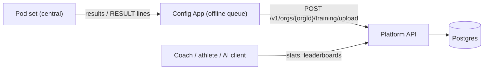
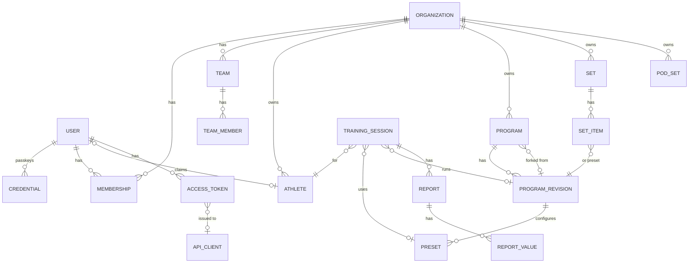
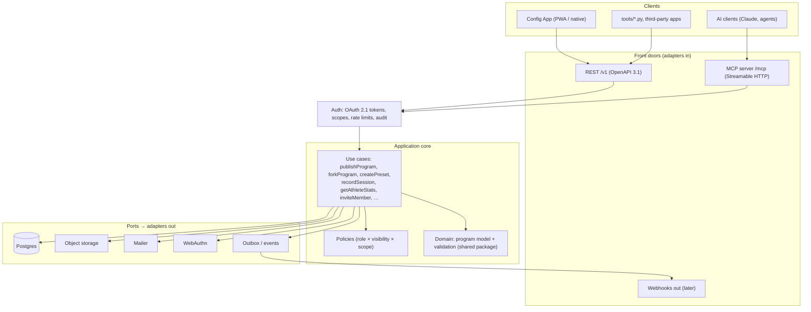
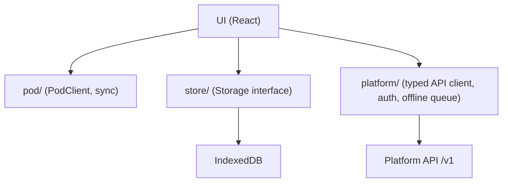

# ReactPod Platform – Specification

Status: **draft** (2026-10-19), PL0 implemented, PL1 and PL2 implemented (API) · Decisions: [ADR 0003](../decisions/0003-community-platform.md),
[ADR 0004](../decisions/0004-platform-architecture.md)

The ReactPod platform is the online part of ReactPod: accounts, clubs and teams, sharing of
programs, presets and sets, and the training results of athletes. The Config App stays the
editor and the only thing that talks to pods; the platform stores, shares and analyses.

Everything a client may do on the platform goes through one documented API. The Config App,
the Python tools, third-party apps and **AI clients** (via MCP) are all clients of that API and
get exactly the rights of the user they act for.

Program format and block semantics: [programs.md](../firmware/programs.md). Pod API:
[config-api.md](../firmware/config-api.md). App: [spec.md](../app/spec.md).

---

## 1. Goals and non-goals

### Version 1

| # | Feature |
|---|---|
| G1 | **Accounts** without passwords: email magic link and passkeys |
| G2 | **Clubs (organisations) and teams** with roles, invitations, managed athletes |
| G3 | **Programs**: publish from the app, versions, fork with attribution, search |
| G4 | **Presets**: named parameter sets for a program (difficulty, timing, colours) |
| G5 | **Sets**: a menu with its programs, shareable and installable to a pod via the app |
| G6 | **Training sessions and results** per athlete, statistics, team leaderboards |
| G7 | **Pod sets** registered to a user or a club (what firmware, last sync) |
| G8 | **AI clients** connect over MCP with the user's rights; writes become drafts |
| G9 | GDPR: EU hosting, data export, account deletion, minors protected by default |

### Not in version 1

- Payments, subscriptions, paid tiers.
- Social feed, chat, comments on programs (only ratings and reports).
- Remote control of pods over the internet. Pods never talk to the platform directly;
  the app is always in between.
- Public athlete profiles. Results are never public by default.
- Training plans and webhooks (designed here, built in a later phase, §14).

---

## 2. Users and roles

### 2.1 Personas

| Persona | Typical use |
|---|---|
| Hobby user | Downloads programs and presets, shares own programs, tracks own times |
| Coach | Runs sessions with a team, picks presets, looks at athlete progress |
| Club admin | Creates the club, teams, invites coaches, manages athletes and pod sets |
| Athlete (adult) | Own account, sees own results, may join several teams |
| Managed athlete | Usually a minor: profile **without** login, owned by the club, results entered by the coach's app |
| Maker / developer | Uses the API with a personal access token, writes tools |
| AI client | Claude or another agent, acting **for one user** with a scoped token (§7) |

### 2.2 Roles

Roles are per organisation (club); a user can have different roles in different clubs. A
personal space (no club) is an organisation of one, so every resource has exactly one owner
organisation.

| Role | Can |
|---|---|
| **owner** | everything in the club, delete the club, transfer ownership |
| **admin** | members, teams, athletes, pod sets, club content |
| **coach** | sessions and results for the teams they coach, presets, club programs (draft + publish to club) |
| **athlete** | own results, club content readable |
| **viewer** | club content readable (e.g. parents, assistants) |
| platform admin | moderation, abuse handling (not part of a club) |

Team-level: a membership can be limited to teams (`coach` of team U12 only).

### 2.3 Visibility

Every shareable resource (program, preset, set) has a visibility:
`private` (owner) · `team` · `org` (club) · `public` (everyone, also without login).
Sessions and results know only `private`, `team` and `org`; leaderboards inside a club can be
switched on per team.

---

## 3. Functional outline

### 3.1 Accounts and login

- **Sign up / sign in by email**: one mail with a 6-digit code and a link into the app
  (`#/login?token=…`); both work once and for 15 minutes, a code for 5 attempts. The code helps
  when the link opens in another browser than the installed app. Always answers 202, also for
  unknown addresses. Rate limits: 5 requests per address and 20 per IP per hour.
- **Session tokens**: opaque bearer tokens (30 days), stored hashed, sent as
  `Authorization: Bearer …`. No cookies: the app runs on another origin than the API.
- **Passkeys** (WebAuthn): postponed until the app's own domain is decided (decision P13); a
  passkey is bound to the domain, so registering them on `runningjoke.github.io` would break
  with a move.
  Several passkeys per user (phone, laptop).
- Sessions: list of signed-in devices, sign out one or all.
- Profile: display name, avatar (optional), language (en / de), units.
- **Data export** (JSON + programs as .zip) and **account deletion** (results of managed
  athletes stay with the club; own content can be transferred or deleted).
- No passwords are stored anywhere.

### 3.2 Clubs and teams

- Create a club (name, country, optional logo). The creator is the owner.
- **Invite** by email or by link (role and teams preset, expiry, max uses).
- **Teams** inside a club (e.g. "U12", "First team"), members per team.
- **Managed athletes**: profiles without login (name or nickname, birth year, team). A managed
  athlete can later be **claimed** by a user account (invitation from the club); the results
  move with it.
- Leave a club, remove members, transfer ownership. A club without an owner is not possible.

### 3.3 Programs

- **Publish** from the app: the program JSON exactly as on the pod ([programs.md](../firmware/programs.md)),
  plus title, description, tags, number of pods, difficulty, language, licence.
- The platform **validates** with the same rules and issue codes as the app (shared package,
  §5.3). Invalid programs cannot be published, only saved as draft.
- **Revisions**: every save creates a numbered revision with the file text exactly as on the pod
  (`sha256` of the text). Revisions are never changed; publishing marks one draft as the
  published version readers get. Presets and sets point to a revision, so they never change under
  their users. Readers see published revisions, editors also drafts.
- **Fork**: copy into the own space with a link to the source revision (attribution shown).
- **Includes**: only the shipped library parts (`/prog/lib/*`) may be included; the platform serves
  them itself. Other includes are flattened in the app first ("convert to editable copy"), the
  API answers `include_not_shipped` (decision P17).
- **Who edits**: coaches and above of the owning club (team-limited coaches: team items of their
  teams); private items only their author. Deleting hides a program; its revisions stay for the
  presets and sets that use them.
- **Search and browse**: text (title, description), tags (any of), pod count, club; sort by new,
  rating or title; offset paging. Anonymous callers find public published programs only.
- **Rating** (1–5) and **report** (abuse, broken, licence). Reported content can be hidden by
  platform admins.
- Licence: **CC BY 4.0** by default for public content; the author can choose CC0.

### 3.4 Presets

A **preset** is a named, reusable configuration of a program revision: the same game with other
numbers. Programs already have `variables` (initial integer values, [programs.md](../firmware/programs.md));
a preset overrides some of them.

```json
{ "name": "Sprint – U12 easy",
  "program": { "id": "…", "revision": 3 },
  "variables": { "MAX_LOOPS": 8, "TIMEOUT_MS": 2500 },
  "target": { "pods": 4, "ageGroup": "U12", "level": "easy" },
  "notes": "Warm-up, 2 rounds" }
```

- Only variables that exist in the program (with its library includes) can be overridden.
- `GET /presets/{id}/program` renders the program file with the changed `variables`, named after the
  preset; the app pushes it like any local program (app spec §9). No firmware change needed.
- Presets made by AI clients are **drafts** (visible to their creator only) until a person sets
  `status: ready`. Draft presets cannot go into sets.
- Presets belong to a user or a club and have a visibility like programs.
- **Naming**: the app spec (§7.2) uses "preset" for a library include. To avoid two meanings,
  that app term is renamed to **"library part"** when the app integrates the platform (PL2).

### 3.5 Sets

A **set** is what a pod set runs: a menu (order, menu LED patterns) plus the programs, the same
layout as the `.zip` export of the app and `firmware/data/`. On the platform a set item points to
a program revision or a preset.

- Publish the app's local menu as a set; install a set into the app's workspace, then push.
- `GET /sets/{id}/files` returns the pod files: `/programs.json`, every program (presets applied,
  under a path made from the preset name), and the library parts they include. JSON, not a .zip:
  the app zips it with its existing set export. Entries the caller can no longer read are
  skipped and listed.
- Club sets: "Hall A standard set" shared with all coaches of the club.

### 3.6 Pod sets (devices)

- A pod set is registered from the app with its `setId`, name and firmware version
  (from `info` / `status`, config-api §5). Owner: a user or a club.
- The platform shows which set and firmware a pod set had at its last sync. It never controls
  pods; OTA files stay on Pages ([ADR 0002](../decisions/0002-versions-and-firmware-delivery.md)).

### 3.7 Training sessions and results (core)



The pod side is epic [#37](https://github.com/RunningJoke/reactionButton/issues/37): BLE stays on
during the game, and a `communicate` block sends a **report** with everything recorded since the
last one ([#41](https://github.com/RunningJoke/reactionButton/issues/41)), tagged with the
athlete the app set ([#42](https://github.com/RunningJoke/reactionButton/issues/42)). The app
stores reports per athlete ([#47](https://github.com/RunningJoke/reactionButton/issues/47)) and
uploads them ([#48](https://github.com/RunningJoke/reactionButton/issues/48)).

- **Training session**: one athlete on one pod set running one program, from the moment the app
  assigns the athlete until it changes the athlete or the program. It holds the athlete, the pod
  set id (`setId`), the program's pod path, and optionally the platform revision / preset it came
  from (the app knows them from its install cache) with the content hash, start time and notes.
- **Report** (the upload unit, P21): one per `communicate` block, as the firmware sends it:
  pod report id, cycle, `startMs` / `endMs`, single values `{ t, metric, pod, ms }`, the firmware's
  stats per metric and the reported variables. Reports followed by a `repeat` are marked
  `discarded`: they are kept, but not counted.
- **Offline queue**: the app keeps reports in IndexedDB and uploads when online. Each session
  and report carries an id the app generates (UUID); a repeated upload stores nothing twice
  (P22). The pod's report id is not unique: it starts again after a reboot.
- **Statistics** from the single values (discarded reports excluded): count, best, average,
  worst per metric, and a weekly trend, per athlete and program / preset. **Team leaderboards**:
  best value per athlete of a team, only inside the club and only when the team has them
  switched on.
- **Who sees results**: coaches and above see the results of the athletes they see (team-limited
  coaches: their teams). An athlete sees the results of their own (claimed) profile, viewers see
  none. Leaderboards are visible to every member of the team.
- Corrections: a coach can delete a report or a whole session (audit logged). Deleting an athlete
  deletes their results (P24). The app passes its deletions on: a linked athlete or an uploaded
  session deleted on the phone is deleted on the platform too, queued like the uploads when the
  phone is offline or signed out (`DELETE .../athletes/{id}`, `DELETE .../training/sessions/{id}`).
  The queue runs on sign-in and at app start, whether or not auto upload is on (P26).
- **Self-delete** (P24): the user who claimed an athlete profile deletes it (`DELETE
  /v1/orgs/{orgId}/me/athletes/{athleteId}`; anyone else gets 404). Everything that names the
  athlete goes with it: training sessions with their reports and values, invitations and links to
  the profile. Coaches' `DELETE .../athletes/{athleteId}` removes the same set. The team ids sit on
  the profile itself, so nothing else is left. The user's club membership stays.
- Reports that a pod still holds for a deleted athlete are dismissed on the phone (they are not
  uploaded, and the platform never sees them).
- Idempotency: the body ids (P22) are the only dedupe key; there is no `Idempotency-Key` header.
- **Firmware dependency**: without the `reports` feature (#41) there are no live results; the
  API needs no change for it, it only receives fewer reports.

### 3.8 Training plans (later)

An ordered list of presets per training day / week, assigned to a team, with completion tracked
from the sessions.

### 3.9 Notifications and webhooks (later)

New revision of a forked program, invitation, plan assigned. Delivered by email and, later, as
signed webhooks (outbox table, §5.1) for third-party integrations.

---

## 4. Domain model



| Entity | Key fields | Notes |
|---|---|---|
| User | id, email, displayName, locale, createdAt | email verified by magic link |
| Credential | userId, webauthnId, publicKey, signCount, label | passkeys |
| Organization | id, name, kind `personal \| club`, country | personal = space of one user |
| Membership | orgId, userId, role, teamIds? | §2.2 |
| Team | id, orgId, name, leaderboard (bool) | |
| Athlete | id, orgId, userId?, name, birthYear?, teamIds, consentAt, consentBy | managed when userId is null; consent confirmed by the coach who adds the profile (P23) |
| Program | id, orgId, title, visibility, forkOf (revision id), licence | |
| ProgramRevision | id, programId, n, json, programFormat, sha256, createdBy, status `draft \| published` | immutable once published |
| Preset | id, orgId, revisionId, name, variables, target, visibility | |
| Set / SetItem | id, orgId, name, visibility / setId, index, revisionId \| presetId, menuLeds | |
| PodSet | id, orgId, setId, name, firmware, lastSeenAt | |
| TrainingSession | id, orgId, clientId, athleteId, setId?, programPath, revisionId?, presetId?, contentSha256?, startedAt, notes | `clientId` = the app's UUID, unique per club |
| Report | id, sessionId, clientId, podReportId?, cycle?, startMs?, endMs?, recordedAt, stats, vars, discarded | one per `communicate` block (#41) |
| ReportValue | reportId, t, metric, pod, ms | many rows; partitioned by month if large |
| AccessToken | id, userId, clientId?, scopes, kind `session \| pat \| oauth \| agent`, expiresAt | stored hashed |
| ApiClient | id, name, redirectUris, kind `first-party \| third-party \| ai` | OAuth clients, incl. MCP dynamic registration |
| AuditLog | at, actor (user + token kind), action, resource, orgId | every write; every agent call |
| Report | resource, reason, by, state | moderation |

Ids are UUIDv7. Every row carries its `orgId`; authorization (§5.1) always filters by it, and
Postgres row-level security is a second fence.

---

## 5. Architecture

Details and alternatives: [ADR 0004](../decisions/0004-platform-architecture.md).

### 5.1 One core, many front doors

The platform is a **modular monolith** with a **hexagonal** (ports and adapters) structure.
All business rules live in one **application core** of use cases. Clients reach it through thin
**front doors** that only translate protocols. Nothing below the front doors knows whether a
call came from the app, a script or an AI client.



Modules inside the core (each with its own folder, tables and use cases): `identity`
(users, credentials, tokens), `orgs` (clubs, teams, memberships, athletes), `catalog`
(programs, revisions, presets, sets), `training` (sessions, attempts, stats), `devices`
(pod sets), `moderation`. Modules call each other only through their public use cases.

### 5.2 Contract-first use cases

Each use case is defined **once**:

```ts
export const createPreset = useCase({
  name: "create_preset",                       // MCP tool name; REST: POST /v1/presets
  description: "Create a named parameter set for a program revision.",
  scope: "presets:write",
  input: z.object({ revisionId: z.string().uuid(), name: z.string().max(60),
                    variables: z.record(z.number().int()), visibility: Visibility }),
  output: Preset,
  agent: { mode: "draft" },                    // §7.3: AI calls create drafts
  run: async (ctx, input) => { … },            // ctx = actor, org, scopes, ports
});
```

From this one definition the build generates:

- the REST route and its part of `spec/platform-api.yaml` (OpenAPI 3.1),
- the MCP tool (name, description, JSON schema of input and output),
- the typed TypeScript client used by the app (`app/src/platform/`).

Adding a use case therefore makes it available to the app **and** to AI clients at once, with the
same validation and the same authorization. This is what keeps attaching AI clients easy.

### 5.3 Shared program model

The program types, block definitions, limits, formatting and the validator (port of
`tools/validate_programs.py`) live in `packages/program-model/` (`@reactpod/program-model`,
TypeScript source, no build step). The app and the platform depend on it with
`"file:../packages/program-model"`; Vite and esbuild compile it. The platform rejects the same
programs as the app, with the same issue codes. `spec/program.schema.json` (JSON Schema 2020-12,
generated from the block definitions, `x-programFormat` = `PROGRAM_FORMAT`) describes the structure
for other languages and editors ([ADR 0003](../decisions/0003-community-platform.md)); the
validator stays the authority for references, reachability and pod limits.

### 5.4 App integration



- New module `app/src/platform/` next to `pod/`: login (magic link, passkey), generated client,
  offline queue for results, cache of downloaded programs / presets / sets.
- The app stays **offline-first** and fully usable without an account (as today). The platform
  is an add-on: publish, install, sync results.
- The app checks `GET /v1/meta` (API version, features) like it checks `info` on a pod: a
  missing feature means the older behaviour.

---

## 6. API outline (REST, `/v1`)

| Area | Endpoints | Scope |
|---|---|---|
| Auth | `POST /auth/login` (202), `POST /auth/verify` (token or email + code → session token), `POST /auth/logout`; later OAuth: `/oauth/authorize`, `/oauth/token`, `/oauth/register`, `/.well-known/oauth-authorization-server` | – |
| Me | `GET/PATCH/DELETE /me` (`GET` lists the athlete profiles the user claimed, with their `athleteId`), `GET /me/sessions`, `DELETE /me/sessions/{sessionId}`, `GET /me/export` | `profile` |
| Clubs | `GET/POST /orgs`, `GET/PATCH/DELETE /orgs/{orgId}`, `POST /orgs/{orgId}/leave`, `POST /orgs/{orgId}/transfer` | `org:read`, `org:write` |
| Members | `GET /orgs/{orgId}/members`, `PATCH/DELETE /orgs/{orgId}/members/{userId}` | `org:*` |
| Invitations | `GET/POST /orgs/{orgId}/invites`, `DELETE /orgs/{orgId}/invites/{inviteId}`, `POST /invites/accept` (also claims an athlete profile) | `org:*` |
| Teams | `GET/POST /orgs/{orgId}/teams`, `PATCH/DELETE /orgs/{orgId}/teams/{teamId}` | `org:*` |
| Athletes | `GET/POST /orgs/{orgId}/athletes` (`?teamId=`), `PATCH/DELETE /orgs/{orgId}/athletes/{athleteId}` | `athletes:*` |
| Audit | `GET /orgs/{orgId}/audit?cursor=&limit=` (admins) | `audit:read` |
| Programs | `GET /programs?q=&tags=&pods=&orgId=&sort=&offset=&limit=`, `POST /programs` (draft), `GET/PATCH/DELETE /programs/{programId}` (`?revision=n`), `GET/POST /programs/{programId}/revisions`, `POST /programs/{programId}/revisions/{n}/publish`, `POST /programs/{programId}/fork`, `PUT /programs/{programId}/rating`, `POST /programs/validate` | `programs:*` |
| Presets | `GET/POST /presets` (`?programId=&orgId=`), `GET/PATCH/DELETE /presets/{presetId}`, `GET /presets/{presetId}/program` (rendered file) | `programs:*` |
| Sets | `GET/POST /sets`, `GET/PATCH/DELETE /sets/{setId}`, `GET /sets/{setId}/files` (pod files as JSON) | `programs:*` |
| Pod sets | `GET/POST /orgs/{org}/pod-sets`, `PATCH /pod-sets/{id}` | `devices:*` |
| Training | `POST /orgs/{orgId}/training/upload` (sessions with reports, idempotent by the app's ids), `GET /orgs/{orgId}/training/sessions?athleteId=&teamId=&from=&to=&cursor=`, `GET/DELETE /orgs/{orgId}/training/sessions/{sessionId}`, `PATCH/DELETE /orgs/{orgId}/training/reports/{reportId}` | `results:*` |
| Stats | `GET /orgs/{orgId}/athletes/{athleteId}/stats?programPath=&revisionId=&presetId=&from=&to=`, `GET /orgs/{orgId}/teams/{teamId}/leaderboard?metric=&programPath=&presetId=&from=` | `results:read` |
| Moderation | `POST /reports`; admin `GET/PATCH /reports/{id}` later (PL5) | `programs:read` |
| Tokens | `GET/POST/DELETE /tokens` (personal access tokens) | `tokens` |
| Meta | `GET /meta` (version, features, limits) | – |

Conventions:

- JSON, UTF-8; errors as `application/problem+json` with a stable `code`
  (program validation issues reuse the app's issue codes).
- Cursor pagination (`?cursor=&limit=`), `ETag` + `If-Match` on updates (no lost writes).
- Breaking changes only with `/v2`; additive changes are announced in `GET /meta`.
- CORS only for the app origins (Pages, localhost, Capacitor schemes).

---

## 7. AI clients

### 7.1 How an AI client attaches

- The platform runs an **MCP server** at `https://<api>/mcp` (Streamable HTTP transport).
- Authorization follows the MCP authorization spec: **OAuth 2.1** with PKCE, authorization
  server metadata and **dynamic client registration**. A user adds the URL in Claude (or any MCP
  client), signs in with magic link / passkey, picks the club and approves the scopes.
- Scripts and local agents can use a **personal access token** (scoped, expiring) instead.
- The MCP tools are generated from the use cases (§5.2), so the AI sees the same operations,
  input schemas and errors as the app.

### 7.2 Tools and resources (v1)

| Tool | Use case | Scope |
|---|---|---|
| `search_programs`, `get_program`, `list_revisions` | find and read programs | `programs:read` (public without) |
| `validate_program` | run the shared validator, return issues | – |
| `create_program`, `save_revision`, `fork_program` | save drafts (never published, never public) | `programs:write` |
| `list_presets`, `get_preset`, `render_preset`, `create_preset` (draft) | presets | `programs:*` |
| `list_sets`, `get_set`, `export_set`, `create_set` (draft) | sets | `programs:*` |
| `list_training_sessions`, `get_training_session` | sessions of an athlete / team in a time range, with reports | `results:read` |
| `get_athlete_stats` | bests, averages, trend | `results:read` |
| `get_team_leaderboard` | ranking for a metric and program / preset | `results:read` |
| `list_teams`, `list_athletes` | club structure | `org:read` |

Resources: `reactpod://spec/program.schema.json` (the JSON Schema) and
`reactpod://spec/block-types.json` (block definitions, ports, defaults, issue codes from the shared
package). Not exposed: `publish_revision`, `update_*`, `delete_*`, ratings, reports. With these an AI can write a valid program from a description,
validate it and leave it as a draft for the coach.

Prompts (MCP prompts, optional): "design a warm-up for N pods", "analyse the last 4 weeks of
team X".

### 7.3 Guard rails

- The AI acts **as the user** who authorized it: never more rights than that user, further
  limited by the token's scopes. Tokens carry `kind: agent`.
- **Drafts only**: AI writes create drafts. Publishing, making something public, deleting,
  inviting people and editing athletes need a human confirmation in the app (use cases are
  marked `agent: { mode: "draft" | "deny" | "allow" }`).
- **Minors**: personal data of managed athletes (names, birth year) is pseudonymised in agent
  responses ("Athlete A3") unless a club admin allows real names for agents.
- Rate limits per token, stricter for agent tokens; every agent call is in the audit log and
  visible to the user ("connected apps" list, revoke at any time).

### 7.4 Later

An assistant inside the app uses the **same** MCP server (via the Claude API with an MCP
connector), so there is only one AI integration to build and secure.

---

## 8. Security and privacy

| Topic | Rule |
|---|---|
| Hosting | EU only (database, storage, backups, mail provider with EU processing) |
| Data minimisation | email, display name; athletes: name or nickname, optional birth year. No addresses, no health data beyond reaction times |
| Minors | managed by the club; the coach who adds a profile confirms the consent (of the parents for minors), recorded with date and user (P23). Not visible outside the club, pseudonymised for agents |
| Athlete data | the club owns managed profiles and their results; a claimed profile is still the club's, the athlete can see and export it. Deleting a profile deletes its results (P24) |
| Export / delete | self-service (§3.1), the export includes the results of claimed profiles; coaches can delete their athletes with all results; an athlete can delete their own claimed profile with all its results and links (P24) |
| Retention | results kept until deleted; inactive accounts reminded after 24 months, then deleted |
| Tokens | opaque, stored as SHA-256, revocable, 30-day sessions; sign-in links and codes single use, 15 min |
| Transport | HTTPS only, HSTS, CORS restricted (§6) |
| Abuse | rate limits, reports, platform admin moderation, audit log |
| Legal | imprint, privacy policy, data processing agreement for clubs (before PL3 goes live) |

---

## 9. Technology

| Part | Choice | Why |
|---|---|---|
| Language | TypeScript (Node LTS) | same as the app, shares the program model |
| HTTP | Hono | small, typed, runs on Node and edge if needed |
| Schemas | zod + OpenAPI generation | one definition for validation, REST, MCP and client |
| MCP | `@modelcontextprotocol/sdk` (Streamable HTTP) | reference implementation |
| Database | Postgres 17. Staging: container on the VPS (below). Production: same, or managed EU Postgres via `DATABASE_URL` | relational data, RLS, JSONB for program JSON |
| ORM / migrations | Drizzle | typed, SQL-near, plain migration files |
| Auth | own module: email code + link, opaque bearer tokens; later SimpleWebAuthn (passkeys) and an OAuth 2.1 server | full control over scopes and agent tokens |
| Mail | nodemailer over SMTP (`MAIL_URL`); printed to the log when unset | any EU provider |
| Database in tests / dev | PGlite (embedded Postgres, `DATABASE_URL=pglite:…`) | no database server needed, real Postgres SQL |
| Storage | S3-compatible object storage (EU) | avatars, set archives |
| Mail | transactional provider with EU processing | magic links, invitations |
| Bundle | esbuild → one `dist/main.js` (+ `dist-migrate/migrate.js`), no `node_modules` in the image | small image, fast start |
| Deploy | Hetzner VPS (EU): Docker Compose with API, Postgres and Caddy (HTTPS), deployed by CI over SSH ([platform/deploy](../../platform/deploy/README.md)) | cheap, EU, no lock-in |
| CI / release | `.github/workflows/platform.yml`: tests, image `ghcr.io/runningjoke/reactpod-platform`, staging deploy; tags `platform-vX.Y.Z` | like firmware and app ([ADR 0002](../decisions/0002-versions-and-firmware-delivery.md)) |

---

## 10. Repository layout

```
platform/
├── src/
│   ├── main.ts            node entry: config → ports → HTTP server
│   ├── config.ts          environment (PORT, PUBLIC_URL, DATABASE_URL, CORS_ORIGINS, SHIPPED_DATA_DIR)
│   ├── core/              useCase.ts (defineUseCase, execute), context.ts (Ctx, Actor), ports.ts,
│   │                      errors.ts (AppError → problem+json), registry.ts (all use cases)
│   ├── modules/           one folder per module: useCases.ts, later policies.ts, schema.ts (tables)
│   │   ├── meta/          get_meta, validate_program (PL0)
│   │   ├── identity/      sign-in, sessions, profile, export, deletion (PL1)
│   │   ├── orgs/          clubs, members, teams, invitations, athletes, policies (PL1)
│   │   ├── audit/         audit log (PL1)
│   │   ├── catalog/       programs, revisions, presets, sets, ratings, reports, access rules (PL2)
│   │   └── training/      training sessions, reports, values, statistics, leaderboards (PL3)
│   ├── adapters/          db.ts (postgres.js + Drizzle), migrate.ts, library.ts (shipped /prog/lib)
│   ├── http/app.ts        REST front door generated from the registry, /mcp, /healthz, /readyz, /v1/openapi.json
│   ├── mcp/server.ts      MCP front door: one tool per use case with agent ≠ deny
│   └── openapi.ts         OpenAPI 3.1 from the registry
├── scripts/gen-openapi.ts writes spec/platform-api.yaml (--check in CI)
├── test/                  REST, MCP (real /mcp route with the SDK client), OpenAPI
├── migrations/            Drizzle (first tables in PL1)
├── deploy/                compose.yaml, Caddyfile, .env.example, README (Hetzner)
├── compose.dev.yaml       local Postgres
└── Dockerfile             built from the repo root
packages/
└── program-model/         program types, block definitions, limits, validator, formatting
spec/
├── platform-api.yaml      generated by platform (npm run openapi), checked in
└── program.schema.json    generated by packages/program-model (npm run schema), checked in
```

## 11. Risks

| Risk | Mitigation |
|---|---|
| Personal data of minors | club-managed, pseudonymised for agents, no public results, EU hosting, DPA |
| Results need firmware work | API accepts summaries now; `/fw-request` for per-attempt results over BLE |
| Moderation effort for public content | reports + hide; public publishing can start invite-only |
| MCP spec still changes | MCP door is a thin adapter; REST stays the stable contract |
| Running our own auth | small surface (no passwords), well-known libraries, security review before PL1 goes live |
| Hosting cost | modular monolith in one container + managed Postgres; scale later |

---

## 12. Decisions

| # | Topic | Decision |
|---|---|---|
| P1 | Backend | own TypeScript API service on managed EU Postgres |
| P2 | Login | email magic link + passkeys, no passwords |
| P3 | Training results | core feature (G6) |
| P4 | Architecture | modular monolith, hexagonal core, use cases defined once ([ADR 0004](../decisions/0004-platform-architecture.md)) |
| P5 | Client contract | REST `/v1` with OpenAPI 3.1 for apps and tools |
| P6 | AI clients | MCP server generated from the same use cases, OAuth 2.1, agent tokens |
| P7 | AI writes | drafts only; publish, delete, share, people data need a human |
| P8 | Preset | named variable overrides of a program revision; app's "preset" (include) becomes "library part" |
| P9 | Licence | CC BY 4.0 default for public content, CC0 optional |
| P10 | Tenancy | every resource has one owner organisation; personal space = organisation of one |
| P11 | Hosting (staging) | Hetzner VPS in the EU, Docker Compose (API, Postgres, Caddy), deployed by CI over SSH |
| P12 | Shared model | `packages/program-model` as TypeScript source via `file:` dependency, no root workspace; JSON Schema in PL2 |
| P13 | Passkeys | postponed until the own domain is decided; email code + link only |
| P14 | Sessions | opaque bearer tokens, hashed in the database, 30 days; no cookies, no JWT (instant revocation) |
| P15 | Test database | PGlite in memory per test file; production Postgres 17 |
| P17 | Includes | only shipped library parts; other includes are flattened in the app before saving |
| P18 | AI writes | programs: draft revisions (publishing is `deny`); presets and sets: `status: draft`, visible to the creator until a person sets `ready`; AI clients cannot set `public` |
| P19 | Set export | JSON map of pod files (`/programs.json` + programs + library parts); the app zips |
| P20 | Scopes | `programs:read` / `programs:write` cover programs, presets and sets; session tokens always carry all scopes |
| P16 | Privacy defaults | non-members get 404 for a club; e-mail addresses only for admins, never for AI clients; athletes pseudonymised for AI clients unless the club allows real names; audit details hold ids, not names |
| P21 | Results | the upload unit is the firmware's report (#41), grouped into training sessions; statistics come from the single values |
| P22 | Idempotency | sessions and reports carry a UUID made by the app, unique per club; a repeated upload stores nothing twice (the pod's report id restarts after a reboot). Re-uploading may only change `discarded` |
| P23 | Consent | adding an athlete requires `consent: true`; the platform records when and by whom |
| P24 | Deletion | deleting an athlete or a club deletes its sessions, reports, values, invitations and links; the claiming user may delete their own profile (`/me/athletes/{id}`, 404 for everyone else) |
| P25 | Scopes | `results:read` / `results:write` for training sessions, reports and statistics; AI clients may read (pseudonymised) but not upload or delete |
| P26 | Deletion queue | queued platform deletions run on sign-in and at app start, independent of the auto-upload setting; uploads still follow it |

---

## 13. Open questions

1. ~~Result granularity from the firmware~~ → reports over BLE during the game (#37, #41), P21.
2. Public leaderboards across clubs (opt-in) – wanted at all?
3. ~~Includes on publish~~ → P17.
4. Domain name for app + API (same site helps cookies and passkeys).
5. Who moderates public content, and is public publishing open from the start?
6. Paid tiers later (e.g. large clubs)? Influences quotas in `GET /meta`.

---

## 14. Phases

Like the app phases: the user approves each phase.

| Phase | Content | Done when | Status |
|---|---|---|---|
| PL0 | Skeleton: `platform/`, CI, `packages/program-model` extracted from the app (app tests still green), use-case helper, OpenAPI + MCP generation, deploy pipeline to a staging host | `GET /v1/meta` deployed; app builds against the package | implemented; staging deploy waits for the server + secrets ([deploy](../../platform/deploy/README.md)) |
| PL1 | Accounts (email code + link; passkeys later, P13), clubs, teams, invitations, managed athletes, audit log | sign up, create club, invite coach, add athletes from the app | API implemented and tested (REST + MCP); app screens later; user test pending |
| PL2 | Programs, revisions, forks, presets, sets, search, ratings, reports, `spec/program.schema.json`; app: login, publish, install, apply preset | a program made in the app can be published, found and installed on another phone | API implemented and tested (REST + MCP, Postgres 17); app integration later; user test pending |
| PL3 | Training sessions and reports (upload from the app's offline queue), stats, team leaderboards; pod side: epic #37 | a session on real pods appears in the athlete's stats | API implemented and tested (REST + MCP); app upload with #47 / #48; #38 done (ADR 0005 accepted), #41 done; real pods wait for #39 (live BLE), #42 → #45–#47; user test pending |
| PL4 | OAuth for third-party / AI clients, agent tokens, guard rails (the MCP door exists since PL0) | Claude connects, writes a valid program draft and analyses a team's sessions | – |
| PL5 | Training plans, webhooks, moderation tooling, data export polish | – | – |
