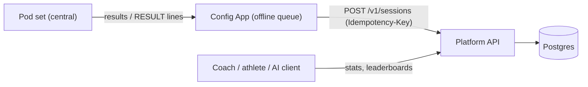
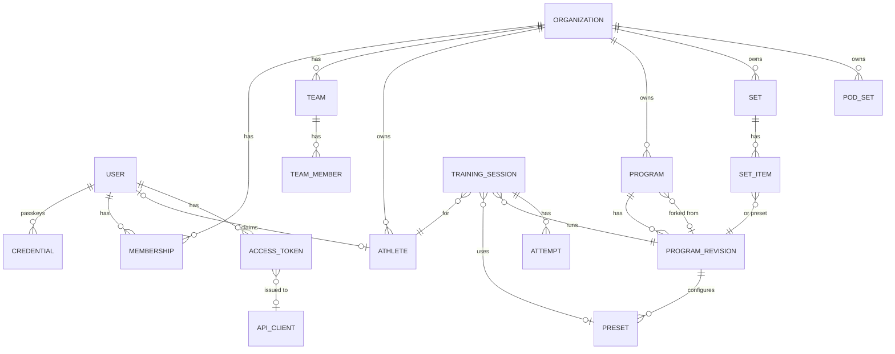
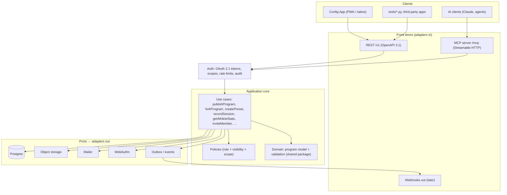
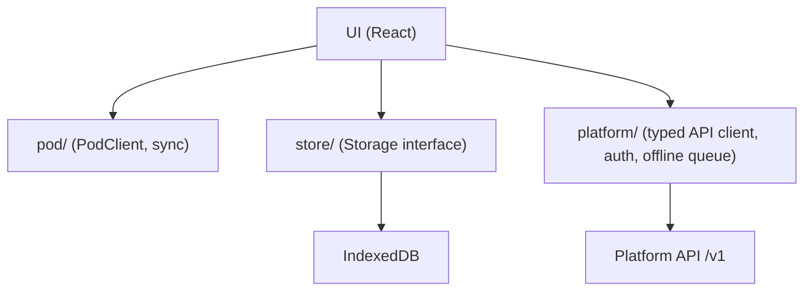

# ReactPod Platform – Specification

Status: **draft** (2026-10-19), PL0 implemented · Decisions: [ADR 0003](../decisions/0003-community-platform.md),
[ADR 0004](../decisions/0004-platform-architecture.md)

The ReactPod platform is the online part of ReactPod: accounts, clubs and teams, sharing of
programs, presets and sets, and the training results of athletes. The Config App stays the
editor and the only thing that talks to pods; the platform stores, shares and analyses.

Everything a client may do on the platform goes through one documented API. The Config App,
the Python tools, third-party apps and **AI clients** (via MCP) are all clients of that API and
get exactly the rights of the user they act for.

Program format and block semantics: [programs.md](../firmware/programs.md). Pod API:
[config-api.md](../firmware/config-api.md). App: [spec.md](../app/spec.md).

---

## 1. Goals and non-goals

### Version 1

| # | Feature |
|---|---|
| G1 | **Accounts** without passwords: email magic link and passkeys |
| G2 | **Clubs (organisations) and teams** with roles, invitations, managed athletes |
| G3 | **Programs**: publish from the app, versions, fork with attribution, search |
| G4 | **Presets**: named parameter sets for a program (difficulty, timing, colours) |
| G5 | **Sets**: a menu with its programs, shareable and installable to a pod via the app |
| G6 | **Training sessions and results** per athlete, statistics, team leaderboards |
| G7 | **Pod sets** registered to a user or a club (what firmware, last sync) |
| G8 | **AI clients** connect over MCP with the user's rights; writes become drafts |
| G9 | GDPR: EU hosting, data export, account deletion, minors protected by default |

### Not in version 1

- Payments, subscriptions, paid tiers.
- Social feed, chat, comments on programs (only ratings and reports).
- Remote control of pods over the internet. Pods never talk to the platform directly;
  the app is always in between.
- Public athlete profiles. Results are never public by default.
- Training plans and webhooks (designed here, built in a later phase, §14).

---

## 2. Users and roles

### 2.1 Personas

| Persona | Typical use |
|---|---|
| Hobby user | Downloads programs and presets, shares own programs, tracks own times |
| Coach | Runs sessions with a team, picks presets, looks at athlete progress |
| Club admin | Creates the club, teams, invites coaches, manages athletes and pod sets |
| Athlete (adult) | Own account, sees own results, may join several teams |
| Managed athlete | Usually a minor: profile **without** login, owned by the club, results entered by the coach's app |
| Maker / developer | Uses the API with a personal access token, writes tools |
| AI client | Claude or another agent, acting **for one user** with a scoped token (§7) |

### 2.2 Roles

Roles are per organisation (club); a user can have different roles in different clubs. A
personal space (no club) is an organisation of one, so every resource has exactly one owner
organisation.

| Role | Can |
|---|---|
| **owner** | everything in the club, delete the club, transfer ownership |
| **admin** | members, teams, athletes, pod sets, club content |
| **coach** | sessions and results for the teams they coach, presets, club programs (draft + publish to club) |
| **athlete** | own results, club content readable |
| **viewer** | club content readable (e.g. parents, assistants) |
| platform admin | moderation, abuse handling (not part of a club) |

Team-level: a membership can be limited to teams (`coach` of team U12 only).

### 2.3 Visibility

Every shareable resource (program, preset, set) has a visibility:
`private` (owner) · `team` · `org` (club) · `public` (everyone, also without login).
Sessions and results know only `private`, `team` and `org`; leaderboards inside a club can be
switched on per team.

---

## 3. Functional outline

### 3.1 Accounts and login

- **Sign up / sign in by magic link**: email → one-time link (15 min, single use) → session.
- **Passkeys** (WebAuthn) can be added after the first login; then login without email.
  Several passkeys per user (phone, laptop).
- Sessions: list of signed-in devices, sign out one or all.
- Profile: display name, avatar (optional), language (en / de), units.
- **Data export** (JSON + programs as .zip) and **account deletion** (results of managed
  athletes stay with the club; own content can be transferred or deleted).
- No passwords are stored anywhere.

### 3.2 Clubs and teams

- Create a club (name, country, optional logo). The creator is the owner.
- **Invite** by email or by link (role and teams preset, expiry, max uses).
- **Teams** inside a club (e.g. "U12", "First team"), members per team.
- **Managed athletes**: profiles without login (name or nickname, birth year, team). A managed
  athlete can later be **claimed** by a user account (invitation from the club); the results
  move with it.
- Leave a club, remove members, transfer ownership. A club without an owner is not possible.

### 3.3 Programs

- **Publish** from the app: the program JSON exactly as on the pod ([programs.md](../firmware/programs.md)),
  plus title, description, tags, number of pods, difficulty, language, licence.
- The platform **validates** with the same rules and issue codes as the app (shared package,
  §5.3). Invalid programs cannot be published, only saved as draft.
- **Revisions**: every publish creates an immutable revision (`sha256` of the JSON). Clients
  refer to a revision, so a preset or set never changes under its user.
- **Fork**: copy into the own space with a link to the source revision (attribution shown).
- Includes: a program that uses `include` is stored together with the library parts it needs,
  or flattened on publish (decision in phase PL2).
- **Search and browse**: text, tags, pod count, difficulty, sort by new / popular / rating.
- **Rating** (1–5) and **report** (abuse, broken, licence). Reported content can be hidden by
  platform admins.
- Licence: **CC BY 4.0** by default for public content; the author can choose CC0.

### 3.4 Presets

A **preset** is a named, reusable configuration of a program revision: the same game with other
numbers. Programs already have `variables` (initial integer values, [programs.md](../firmware/programs.md));
a preset overrides some of them.

```json
{ "name": "Sprint – U12 easy",
  "program": { "id": "…", "revision": 3 },
  "variables": { "MAX_LOOPS": 8, "TIMEOUT_MS": 2500 },
  "target": { "pods": 4, "ageGroup": "U12", "level": "easy" },
  "notes": "Warm-up, 2 rounds" }
```

- Only variables that exist in the program can be overridden (validated).
- Applying a preset in the app produces a program file with the changed `variables` that is
  pushed like any local program (app spec §9). No firmware change needed.
- Presets belong to a user or a club and have a visibility like programs.
- **Naming**: the app spec (§7.2) uses "preset" for a library include. To avoid two meanings,
  that app term is renamed to **"library part"** when the app integrates the platform (PL2).

### 3.5 Sets

A **set** is what a pod set runs: a menu (order, menu LED patterns) plus the programs, the same
layout as the `.zip` export of the app and `firmware/data/`. On the platform a set item points to
a program revision or a preset.

- Publish the app's local menu as a set; install a set into the app's workspace, then push.
- Club sets: "Hall A standard set" shared with all coaches of the club.

### 3.6 Pod sets (devices)

- A pod set is registered from the app with its `setId`, name and firmware version
  (from `info` / `status`, config-api §5). Owner: a user or a club.
- The platform shows which set and firmware a pod set had at its last sync. It never controls
  pods; OTA files stay on Pages ([ADR 0002](../decisions/0002-versions-and-firmware-delivery.md)).

### 3.7 Training sessions and results (core)



- **Session**: who (one athlete, or a team with an athlete per round), what (program revision or
  preset), where (pod set), when, notes.
- **Attempts**: per reaction `{ t, metric, pod, ms, hit }`; plus the summary per metric
  (count, avg, best, worst) as the firmware reports it.
- The app collects results and keeps them in an **offline queue** (IndexedDB); upload is
  idempotent so a retry never duplicates a session.
- **Statistics**: personal best, average and trend per program / preset, comparison over weeks,
  team leaderboards (only inside the club, switchable per team).
- Corrections: a coach can delete an attempt or a whole session (audit logged).
- **Firmware dependency**: today `results` (config-api, control ops) returns statistics per
  metric since the last summary, and per-attempt `RESULT,…` lines appear only on USB serial. BLE
  is off while a program runs. Reading results over BLE after a game (or keeping a result log on
  the pod) needs a firmware change → requested with `/fw-request`. Until then: summary only, or
  USB serial. The platform API accepts both (attempts are optional).

### 3.8 Training plans (later)

An ordered list of presets per training day / week, assigned to a team, with completion tracked
from the sessions.

### 3.9 Notifications and webhooks (later)

New revision of a forked program, invitation, plan assigned. Delivered by email and, later, as
signed webhooks (outbox table, §5.1) for third-party integrations.

---

## 4. Domain model



| Entity | Key fields | Notes |
|---|---|---|
| User | id, email, displayName, locale, createdAt | email verified by magic link |
| Credential | userId, webauthnId, publicKey, signCount, label | passkeys |
| Organization | id, name, kind `personal \| club`, country | personal = space of one user |
| Membership | orgId, userId, role, teamIds? | §2.2 |
| Team | id, orgId, name, leaderboard (bool) | |
| Athlete | id, orgId, userId?, name, birthYear?, teamIds | managed when userId is null |
| Program | id, orgId, title, visibility, forkOf (revision id), licence | |
| ProgramRevision | id, programId, n, json, programFormat, sha256, createdBy, status `draft \| published` | immutable once published |
| Preset | id, orgId, revisionId, name, variables, target, visibility | |
| Set / SetItem | id, orgId, name, visibility / setId, index, revisionId \| presetId, menuLeds | |
| PodSet | id, orgId, setId, name, firmware, lastSeenAt | |
| TrainingSession | id, orgId, athleteId \| teamId, revisionId, presetId?, podSetId?, startedAt, summary | |
| Attempt | sessionId, t, metric, pod, ms, hit | many rows; partitioned by month if large |
| AccessToken | id, userId, clientId?, scopes, kind `session \| pat \| oauth \| agent`, expiresAt | stored hashed |
| ApiClient | id, name, redirectUris, kind `first-party \| third-party \| ai` | OAuth clients, incl. MCP dynamic registration |
| AuditLog | at, actor (user + token kind), action, resource, orgId | every write; every agent call |
| Report | resource, reason, by, state | moderation |

Ids are UUIDv7. Every row carries its `orgId`; authorization (§5.1) always filters by it, and
Postgres row-level security is a second fence.

---

## 5. Architecture

Details and alternatives: [ADR 0004](../decisions/0004-platform-architecture.md).

### 5.1 One core, many front doors

The platform is a **modular monolith** with a **hexagonal** (ports and adapters) structure.
All business rules live in one **application core** of use cases. Clients reach it through thin
**front doors** that only translate protocols. Nothing below the front doors knows whether a
call came from the app, a script or an AI client.



Modules inside the core (each with its own folder, tables and use cases): `identity`
(users, credentials, tokens), `orgs` (clubs, teams, memberships, athletes), `catalog`
(programs, revisions, presets, sets), `training` (sessions, attempts, stats), `devices`
(pod sets), `moderation`. Modules call each other only through their public use cases.

### 5.2 Contract-first use cases

Each use case is defined **once**:

```ts
export const createPreset = useCase({
  name: "create_preset",                       // MCP tool name; REST: POST /v1/presets
  description: "Create a named parameter set for a program revision.",
  scope: "presets:write",
  input: z.object({ revisionId: z.string().uuid(), name: z.string().max(60),
                    variables: z.record(z.number().int()), visibility: Visibility }),
  output: Preset,
  agent: { mode: "draft" },                    // §7.3: AI calls create drafts
  run: async (ctx, input) => { … },            // ctx = actor, org, scopes, ports
});
```

From this one definition the build generates:

- the REST route and its part of `spec/platform-api.yaml` (OpenAPI 3.1),
- the MCP tool (name, description, JSON schema of input and output),
- the typed TypeScript client used by the app (`app/src/platform/`).

Adding a use case therefore makes it available to the app **and** to AI clients at once, with the
same validation and the same authorization. This is what keeps attaching AI clients easy.

### 5.3 Shared program model

The program types, block definitions, limits, formatting and the validator (port of
`tools/validate_programs.py`) live in `packages/program-model/` (`@reactpod/program-model`,
TypeScript source, no build step). The app and the platform depend on it with
`"file:../packages/program-model"`; Vite and esbuild compile it. The platform rejects the same
programs as the app, with the same issue codes. `spec/program.schema.json` (JSON Schema, versioned
with `PROGRAM_FORMAT`) for other languages ([ADR 0003](../decisions/0003-community-platform.md))
follows in PL2.

### 5.4 App integration



- New module `app/src/platform/` next to `pod/`: login (magic link, passkey), generated client,
  offline queue for results, cache of downloaded programs / presets / sets.
- The app stays **offline-first** and fully usable without an account (as today). The platform
  is an add-on: publish, install, sync results.
- The app checks `GET /v1/meta` (API version, features) like it checks `info` on a pod: a
  missing feature means the older behaviour.

---

## 6. API outline (REST, `/v1`)

| Area | Endpoints | Scope |
|---|---|---|
| Auth | `POST /auth/magic-link`, `POST /auth/magic-link/verify`, `POST /auth/passkey/options`, `POST /auth/passkey/verify`, `POST /auth/logout`, OAuth: `/oauth/authorize`, `/oauth/token`, `/oauth/register`, `/.well-known/oauth-authorization-server` | – |
| Me | `GET/PATCH /me`, `GET /me/sessions`, `GET /me/export`, `DELETE /me` | `profile` |
| Clubs | `GET/POST /orgs`, `GET/PATCH/DELETE /orgs/{org}`, `GET/POST /orgs/{org}/invites`, `POST /invites/{code}/accept`, `GET/PATCH/DELETE /orgs/{org}/members/{user}` | `org:read`, `org:write` |
| Teams | `GET/POST /orgs/{org}/teams`, `PATCH/DELETE /teams/{team}` | `org:*` |
| Athletes | `GET/POST /orgs/{org}/athletes`, `PATCH/DELETE /athletes/{id}`, `POST /athletes/{id}/claim` | `athletes:*` |
| Programs | `GET /programs?q=&tags=&pods=`, `POST /programs`, `GET/PATCH /programs/{id}`, `GET/POST /programs/{id}/revisions`, `POST /programs/{id}/revisions/{n}/publish`, `POST /programs/{id}/fork`, `POST /programs/validate`, `PUT /programs/{id}/rating` | `programs:*` |
| Presets | `GET/POST /presets`, `GET/PATCH/DELETE /presets/{id}`, `GET /presets/{id}/program` (rendered program JSON) | `presets:*` |
| Sets | `GET/POST /sets`, `GET/PATCH/DELETE /sets/{id}`, `GET /sets/{id}/archive` (.zip) | `sets:*` |
| Pod sets | `GET/POST /orgs/{org}/pod-sets`, `PATCH /pod-sets/{id}` | `devices:*` |
| Training | `POST /sessions` (with attempts, `Idempotency-Key`), `GET /sessions?athlete=&team=&from=`, `GET/DELETE /sessions/{id}` | `sessions:*` |
| Stats | `GET /stats/athletes/{id}?program=&preset=`, `GET /stats/teams/{id}/leaderboard?preset=` | `sessions:read` |
| Moderation | `POST /reports`, admin: `GET/PATCH /reports/{id}` | `reports:write` |
| Tokens | `GET/POST/DELETE /tokens` (personal access tokens) | `tokens` |
| Meta | `GET /meta` (version, features, limits) | – |

Conventions:

- JSON, UTF-8; errors as `application/problem+json` with a stable `code`
  (program validation issues reuse the app's issue codes).
- Cursor pagination (`?cursor=&limit=`), `ETag` + `If-Match` on updates (no lost writes).
- `Idempotency-Key` header on all `POST`s that create data from offline queues.
- Breaking changes only with `/v2`; additive changes are announced in `GET /meta`.
- CORS only for the app origins (Pages, localhost, Capacitor schemes).

---

## 7. AI clients

### 7.1 How an AI client attaches

- The platform runs an **MCP server** at `https://<api>/mcp` (Streamable HTTP transport).
- Authorization follows the MCP authorization spec: **OAuth 2.1** with PKCE, authorization
  server metadata and **dynamic client registration**. A user adds the URL in Claude (or any MCP
  client), signs in with magic link / passkey, picks the club and approves the scopes.
- Scripts and local agents can use a **personal access token** (scoped, expiring) instead.
- The MCP tools are generated from the use cases (§5.2), so the AI sees the same operations,
  input schemas and errors as the app.

### 7.2 Tools and resources (v1)

| Tool | Use case | Scope |
|---|---|---|
| `search_programs` | find programs by text, tags, pods | `programs:read` |
| `get_program` | program JSON + metadata of a revision | `programs:read` |
| `validate_program` | run the shared validator, return issues | – |
| `create_program_draft` | save a program as draft in the user's space | `programs:write` |
| `create_preset` | preset as draft | `presets:write` |
| `list_sessions` | sessions of an athlete / team in a time range | `sessions:read` |
| `get_athlete_stats` | bests, averages, trend | `sessions:read` |
| `get_team_leaderboard` | ranking for a preset | `sessions:read` |
| `list_teams`, `list_athletes` | club structure | `org:read` |

Resources: `reactpod://docs/programs` (programs.md: block types, ports, semantics),
`reactpod://docs/block-types` (machine-readable block definitions from the shared package),
`reactpod://programs/{id}`. With these an AI can write a valid program from a description,
validate it and leave it as a draft for the coach.

Prompts (MCP prompts, optional): "design a warm-up for N pods", "analyse the last 4 weeks of
team X".

### 7.3 Guard rails

- The AI acts **as the user** who authorized it: never more rights than that user, further
  limited by the token's scopes. Tokens carry `kind: agent`.
- **Drafts only**: AI writes create drafts. Publishing, making something public, deleting,
  inviting people and editing athletes need a human confirmation in the app (use cases are
  marked `agent: { mode: "draft" | "deny" | "allow" }`).
- **Minors**: personal data of managed athletes (names, birth year) is pseudonymised in agent
  responses ("Athlete A3") unless a club admin allows real names for agents.
- Rate limits per token, stricter for agent tokens; every agent call is in the audit log and
  visible to the user ("connected apps" list, revoke at any time).

### 7.4 Later

An assistant inside the app uses the **same** MCP server (via the Claude API with an MCP
connector), so there is only one AI integration to build and secure.

---

## 8. Security and privacy

| Topic | Rule |
|---|---|
| Hosting | EU only (database, storage, backups, mail provider with EU processing) |
| Data minimisation | email, display name; athletes: name or nickname, optional birth year. No addresses, no health data beyond reaction times |
| Minors | managed by the club; the club confirms it has consent (terms). Not visible outside the club, pseudonymised for agents |
| Export / delete | self-service (§3.1); club admins can export / delete their athletes |
| Retention | results kept until deleted; inactive accounts reminded after 24 months, then deleted |
| Tokens | stored hashed, short-lived access + refresh tokens, revocable; magic links single use |
| Transport | HTTPS only, HSTS, CORS restricted (§6) |
| Abuse | rate limits, reports, platform admin moderation, audit log |
| Legal | imprint, privacy policy, data processing agreement for clubs (before PL3 goes live) |

---

## 9. Technology

| Part | Choice | Why |
|---|---|---|
| Language | TypeScript (Node LTS) | same as the app, shares the program model |
| HTTP | Hono | small, typed, runs on Node and edge if needed |
| Schemas | zod + OpenAPI generation | one definition for validation, REST, MCP and client |
| MCP | `@modelcontextprotocol/sdk` (Streamable HTTP) | reference implementation |
| Database | Postgres 17. Staging: container on the VPS (below). Production: same, or managed EU Postgres via `DATABASE_URL` | relational data, RLS, JSONB for program JSON |
| ORM / migrations | Drizzle | typed, SQL-near, plain migration files |
| Auth | own module: magic links + SimpleWebAuthn + OAuth 2.1 server | full control over scopes and agent tokens |
| Storage | S3-compatible object storage (EU) | avatars, set archives |
| Mail | transactional provider with EU processing | magic links, invitations |
| Bundle | esbuild → one `dist/main.js` (+ `dist-migrate/migrate.js`), no `node_modules` in the image | small image, fast start |
| Deploy | Hetzner VPS (EU): Docker Compose with API, Postgres and Caddy (HTTPS), deployed by CI over SSH ([platform/deploy](../../platform/deploy/README.md)) | cheap, EU, no lock-in |
| CI / release | `.github/workflows/platform.yml`: tests, image `ghcr.io/runningjoke/reactpod-platform`, staging deploy; tags `platform-vX.Y.Z` | like firmware and app ([ADR 0002](../decisions/0002-versions-and-firmware-delivery.md)) |

---

## 10. Repository layout

```
platform/
├── src/
│   ├── main.ts            node entry: config → ports → HTTP server
│   ├── config.ts          environment (PORT, PUBLIC_URL, DATABASE_URL, CORS_ORIGINS, SHIPPED_DATA_DIR)
│   ├── core/              useCase.ts (defineUseCase, execute), context.ts (Ctx, Actor), ports.ts,
│   │                      errors.ts (AppError → problem+json), registry.ts (all use cases)
│   ├── modules/           one folder per module: useCases.ts, later policies.ts, schema.ts (tables)
│   │   └── meta/          get_meta, validate_program (PL0)
│   ├── adapters/          db.ts (postgres.js + Drizzle), migrate.ts, library.ts (shipped /prog/lib)
│   ├── http/app.ts        REST front door generated from the registry, /mcp, /healthz, /readyz, /v1/openapi.json
│   ├── mcp/server.ts      MCP front door: one tool per use case with agent ≠ deny
│   └── openapi.ts         OpenAPI 3.1 from the registry
├── scripts/gen-openapi.ts writes spec/platform-api.yaml (--check in CI)
├── test/                  REST, MCP (real /mcp route with the SDK client), OpenAPI
├── migrations/            Drizzle (first tables in PL1)
├── deploy/                compose.yaml, Caddyfile, .env.example, README (Hetzner)
├── compose.dev.yaml       local Postgres
└── Dockerfile             built from the repo root
packages/
└── program-model/         program types, block definitions, limits, validator, formatting
spec/
└── platform-api.yaml      generated, checked in (CI fails if out of date)
```

## 11. Risks

| Risk | Mitigation |
|---|---|
| Personal data of minors | club-managed, pseudonymised for agents, no public results, EU hosting, DPA |
| Results need firmware work | API accepts summaries now; `/fw-request` for per-attempt results over BLE |
| Moderation effort for public content | reports + hide; public publishing can start invite-only |
| MCP spec still changes | MCP door is a thin adapter; REST stays the stable contract |
| Running our own auth | small surface (no passwords), well-known libraries, security review before PL1 goes live |
| Hosting cost | modular monolith in one container + managed Postgres; scale later |

---

## 12. Decisions

| # | Topic | Decision |
|---|---|---|
| P1 | Backend | own TypeScript API service on managed EU Postgres |
| P2 | Login | email magic link + passkeys, no passwords |
| P3 | Training results | core feature (G6) |
| P4 | Architecture | modular monolith, hexagonal core, use cases defined once ([ADR 0004](../decisions/0004-platform-architecture.md)) |
| P5 | Client contract | REST `/v1` with OpenAPI 3.1 for apps and tools |
| P6 | AI clients | MCP server generated from the same use cases, OAuth 2.1, agent tokens |
| P7 | AI writes | drafts only; publish, delete, share, people data need a human |
| P8 | Preset | named variable overrides of a program revision; app's "preset" (include) becomes "library part" |
| P9 | Licence | CC BY 4.0 default for public content, CC0 optional |
| P10 | Tenancy | every resource has one owner organisation; personal space = organisation of one |
| P11 | Hosting (staging) | Hetzner VPS in the EU, Docker Compose (API, Postgres, Caddy), deployed by CI over SSH |
| P12 | Shared model | `packages/program-model` as TypeScript source via `file:` dependency, no root workspace; JSON Schema in PL2 |

---

## 13. Open questions

1. Result granularity from the firmware: per attempt over BLE, or a result log file on the pod?
2. Public leaderboards across clubs (opt-in) – wanted at all?
3. Includes on publish: store library parts with the program, or always flatten?
4. Domain name for app + API (same site helps cookies and passkeys).
5. Who moderates public content, and is public publishing open from the start?
6. Paid tiers later (e.g. large clubs)? Influences quotas in `GET /meta`.

---

## 14. Phases

Like the app phases: the user approves each phase.

| Phase | Content | Done when | Status |
|---|---|---|---|
| PL0 | Skeleton: `platform/`, CI, `packages/program-model` extracted from the app (app tests still green), use-case helper, OpenAPI + MCP generation, deploy pipeline to a staging host | `GET /v1/meta` deployed; app builds against the package | implemented; staging deploy waits for the server + secrets ([deploy](../../platform/deploy/README.md)) |
| PL1 | Accounts (magic link, passkeys), clubs, teams, invitations, managed athletes, audit log | sign up, create club, invite coach, add athletes from the app | – |
| PL2 | Programs, revisions, forks, presets, sets, search, `spec/program.schema.json`; app: login, publish, install, apply preset | a program made in the app can be published, found and installed on another phone | – |
| PL3 | Training sessions and results, offline queue, stats, team leaderboards (+ firmware request for results) | a session on real pods appears in the athlete's stats | – |
| PL4 | OAuth for third-party / AI clients, agent tokens, guard rails (the MCP door exists since PL0) | Claude connects, writes a valid program draft and analyses a team's sessions | – |
| PL5 | Training plans, webhooks, moderation tooling, data export polish | – | – |
