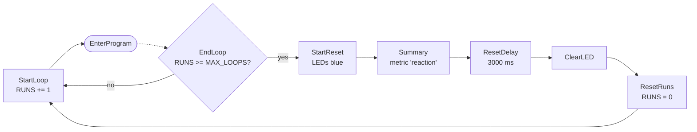
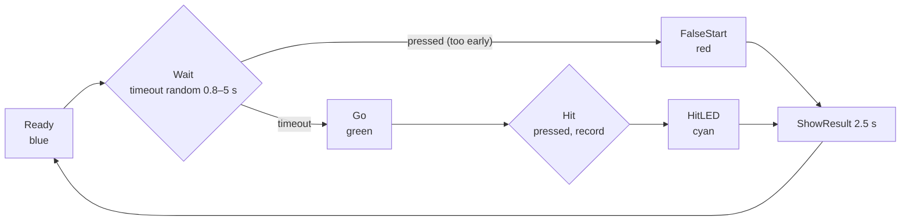
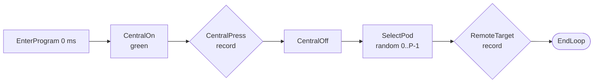
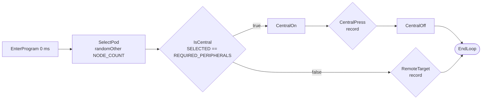
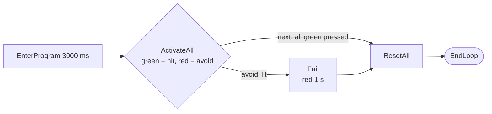

# Current Capabilities & Game Modes

Technical reference. For a non-technical guide, see the [user manual](manual.md).

## 1. What the firmware can do today

| Capability | Status |
|---|---|
| Role selection at boot (button held → CENTRAL) | ✅ |
| Program menu on the central, read from `/programs.json` | ✅ |
| Programs as JSON files (no recompile for new games), validator tool | ✅ |
| Pod link over ESP-NOW (~1–3 ms per hop, estimate) | ✅ |
| Automatic discovery of 1 … 7 peripherals, non-blocking | ✅ (shipped programs use ≤ 4) |
| Set pairing (pods only join their own set) | ✅ |
| Pause on pod loss, automatic reconnect and resume | ✅ |
| Synchronous start of all pods (RUN modes) | ✅ |
| Single-target activation (HIT / AVOID, configurable colours, optional timeout) | ✅ |
| Multi-target activation with "avoid" targets | ✅ |
| Round counting with automatic restart (`MAX_LOOPS`) | ✅ |
| Phone override of the round count (`MaxLoop` characteristic) | ✅ (only in the program menu) |
| Ring effects (pulse, spin, level, traffic light, countdown) | ✅ firmware 2.9 |
| Hold / release / charge / toggle interactions | ✅ firmware 2.9 / 2.10 |
| Reports per cycle, continue / repeat / stop and variables from the app (`communicate`) | ✅ firmware 2.11 (USB; over BLE during the game: #39) |
| Reaction times: peripheral (measured on the pod) and central (press edge) | ✅ recorded |
| Results as CSV on the serial console, summary per cycle | ✅ |
| Results in the app | 🟡 reports exist (2.11); live over BLE with #39 |
| Results on the LED ring | ❌ (#25) |
| Countdown on timed blocks | ✅ (`countdown` option, firmware 2.9) |
| Battery measurement / low-battery warning | ❌ (#19) |
| Power saving / auto power-off | ❌ (#21) |
| OTA firmware update | ❌ (not planned, flash over USB) |

## 2. Program menu

Short press = next program, long press (~1.8 s) = select. The LED pattern shows the
program: **B** blue, **Y** yellow, **C** cyan, **R** red. LED index 0…17 around the ring.
The menu and patterns come from the JSON files (`"menu"`).

| # | File | Manual name | Pods (central + peripherals) | Rounds (`MAX_LOOPS`) | Menu LEDs |
|---|---|---|---|---|---|
| 0 | `prog/solo.json` | SOLO | 1 + 0 | endless | 9 B |
| 1 | `prog/weiche.json` | WEICHE | 1 + 2 | 255 | 7 B, 9 Y, 11 B |
| 2 | `prog/dreieck.json` | DREIECK (triangle) | 1 + 2 | 12 | 7, 9, 11 B |
| 3 | `prog/quadrat.json` | QUADRAT (square) | 1 + 3 | 12 | 6, 8, 10, 12 B |
| 4 | `prog/stern.json` | STERN (4 targets) | 1 + 4 | 12 | 5, 7 B, 9 Y, 11, 13 B |
| 5 | `prog/dreizack.json` | DREIZACK (3 targets) | 1 + 3 | 18 | 6 Y, 8, 10, 12 B |
| 6 | `prog/run.json` | RUN | 1 + 2, 0 avoid | 12 | 5, 7, 9 C |
| 7 | `prog/run5.json` | RUN5 | 1 + 4, 2 avoid | 12 | 5 C, 7 R, 9 C, 11 R, 13 C |
| 8 | `prog/duo.json` | DUO (new, not in the manual) | 1 + 1 | 10 | 8, 10 B |
| 9 | `prog/effects.json` | EFFECTS (demo) | 1 + 1 | – | 6, 12 magenta, 9 Y |
| 10 | `prog/charge.json` | CHARGE (demo) | 1 + 1 | – | 3, 9, 15 C |
| 11 | `prog/release.json` | RELEASE (demo) | 1 + 1 | – | 4, 13 green |
| 12 | `prog/domination.json` | DOMINATION (team game) | 1 + 2 | – | 0, 6, 12 R, 3, 9, 15 B |

**Duo**: the central and one peripheral take turns, each after a random 0.5–2 s pause.
A target that is not pressed within 5 s counts as a miss (variable `MISSES`). It is
also the default program of the guided USB test ([testing.md](../firmware/testing.md)).

> The manual lists DREIZACK before STERN, but #4 has 4 targets and #5 has 3. To change
> the order, reorder `firmware/data/programs.json`.

After a program is selected, the central switches from BLE (phone) to ESP-NOW and claims
peripherals. A blue progress bar shows the progress (LED pairs `2i`/`2i+1`, one pair per
required peripheral, second LED lit when claimed). When all are claimed it turns green.
A new press starts the program.

## 3. Program block graphs

The graphs show the shipped JSON files. All central presses react on the **press edge**,
and only presses that start after the LED came on count.

### 3.1 Shared round loop (`lib/loop.json`, used by all programs except SOLO)

After `MAX_LOOPS` rounds the summary (count, average, best, worst reaction time) is
printed on the serial console. The ring is blue for 3 s, then the next cycle starts.

### 3.2 SOLO (`solo.json`)

The reaction time (green → press) is recorded as `reaction` and stored in `LAST_REACTION`.

### 3.3 WEICHE / STERN / DREIZACK (`lib/star.json`)

The central and a random peripheral alternate. The same peripheral can be chosen twice in a row.

### 3.4 DREIECK / QUADRAT (`lib/random.json`)

Each round lights one random pod (central included). It is never the same pod twice in a row.

### 3.5 RUN / RUN5 (`lib/multi.json`)

All pods, the central included, light at the same moment (scheduled start, 20 ms after
the block begins). Every green pod's reaction time is recorded. Pressing a red pod ends
the round with a 1 s red flash on the central.

### 3.6 Changes compared to the old hard-coded programs

| Program | Change |
|---|---|
| all | Central presses react on press instead of release. Held buttons no longer leak into the next step |
| all | Delays no longer block the main loop |
| loop | `EndLoop` uses `>=`, so a phone override lower than the current round still ends the cycle. A summary is printed each cycle |
| SOLO | False start is shown on press. The reaction time is measured |
| RUN / RUN5 | Use the round loop (12 rounds + summary). A red flash on a failed round. Synchronous start (firmware 2.0) |
| star / random | No 10 ms gap before each round (firmware 2.0) |

## 4. LED status codes

| Pod | Pattern | Meaning |
|---|---|---|
| any | blue dot running around (2 s) | booting. Hold button now for CENTRAL |
| peripheral | yellow | not claimed: waiting for a central of its set |
| peripheral | white flash | pairing cleared (button held 3 s while yellow) |
| peripheral | off | claimed / ready |
| peripheral | green | press me (HIT) |
| peripheral | red | do not press (AVOID) |
| central | single LED group | program menu |
| central | white LEDs ramping | long press in progress |
| central | blue pairs | claiming peripherals (progress) |
| central | all green | ready, press to start |
| central | all yellow | game paused: a peripheral stopped answering. Continues by itself when it is back |
| central | red blinking 1 Hz | error: no programs on the file system, program load error, or radio failure |
