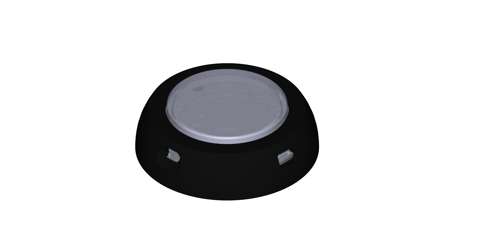
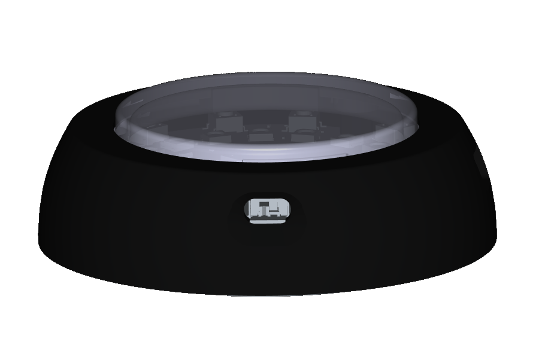

# ReactPod user manual

For coaches, athletes and anyone who wants to train with ReactPods. No technical knowledge needed.
A German short guide with pictures is in [anleitung.pdf](anleitung.pdf); the technical
details of each game are in [game-modes.md](game-modes.md). Planning sessions: [coach guide](coach-guide.md).

> **Safety:** never leave ReactPods charging unattended. They get warm while charging.

---

## 1. What ReactPods are

ReactPods are round training lights that you press. Each pod has a ring of lights and one big
button under its top. You place several pods around you (on the floor, a wall, a table, a
cone), start a game, and press the pods as fast as you can when they light up. The pods measure
how fast you react.

Typical uses: reaction and footwork training, agility drills, warm-ups, team games, rehab and
fun at children's training.

A few pods that play together are called a **set**. One pod of the set leads the game; we call
it the **central**. All other pods are **targets** (in the technical documents: *peripherals*).
Any pod can be the central: it only depends on how you switch it on.

The pods talk to each other by radio. You need no phone, no WiFi and no cables to play the
shipped games. The **ReactPod app** is optional: with it you can change games, build your own,
try them on screen and keep results.

---

## 2. The pod

| Part | What it does |
|---|---|
| **Top (button surface)** | Press it. The whole top is the button. |
| **Light ring** | 18 lights under the top. They tell you what to do and what the pod is doing. |
| **On/off switch** | Off when the switch points away from the USB port. |
| **USB-C port** | Charging (and, for experts, updates and the USB connection to a computer). |

### Charging

- Use any common USB-C cable and charger.
- **The pod must be switched on to charge.**
- It gets warm and lights up while charging. You can keep using it.
- Never charge unattended.

A charge lasts about an hour of play. The level is shown in the app (pod page, from firmware 2.13) and by the
boot gauge below. On USB the pod measures the charger's voltage, so it shows nearly full while it charges.

### Battery gauge and low battery

- **Switch on:** for 2 seconds the light ring fills up like a gauge: up to the charge of the battery, in
  **green** above 50 %, **amber** from 20 to 50 %, **red** below 20 %. The level is measured before the lights
  come on. Hold the top during these 2 seconds to make the pod the central, as before.
- **Below 15 %:** a pod waiting in its set (not in a game) blinks **amber** once a second. Charge it soon.
- **Below 5 %:** the game does not start. When you confirm on the central, its ring flashes **red** for a
  second. Charge the pod (or the central) first.

---

## 3. Your first game in two minutes

You need: the pods the game asks for (see §6), switched off.

1. **Switch on the target pods.** Each one shows a blue light running around for about 2 seconds,
   then turns **yellow**: it is waiting for a central.
2. **Switch on the central:** switch on one more pod and **press and hold its top while the blue
   light runs around**. Let go when the light goes out. A small pattern of lights now shows the
   first game of the **program menu**.
3. **Choose a game:** a short press shows the next game. Each game has its own light pattern
   (see §6).
4. **Select it:** press and hold. A white light gets brighter; when it goes out (after about
   2 seconds), let go.
5. **Wait for the targets:** the central shows blue lights in pairs, one pair per target it
   still needs. The yellow targets go dark one after the other as they join.
   When all have joined, the central turns **green**.
6. **Start:** press the central once. Play!

To play another game: switch the central off and on again (holding the top during the blue
light, as in step 2). The targets can stay on; they wait in yellow and join again.

---

## 4. During a game

The games tell you everything through light. The most common signals:

| You see | It means |
|---|---|
| **Green** pod | Press it, as fast as you can. |
| **Red** pod | Do **not** press it. |
| **Dark** target | Ready, waiting for its turn. |
| **Cyan** central after a press | Hit, well done. |
| **Red** central | False start (you pressed too early) or a miss. |
| **All blue** for a few seconds | One round series (a *cycle*) is over; the next one starts by itself. |
| **All yellow** on the central | A target was lost (switched off, out of range, flat battery). The game waits and goes on by itself when it is back. |

How many rounds a cycle has depends on the game (often 12). After each cycle the pods
calculate your best, average and worst reaction time. The pods do not show these numbers
themselves; the app shows them (see §8.6).

---

## 5. Sets: which pods play together

- A target remembers the central it played with first and from then on only joins **its own
  set**. That way two groups can train in the same hall without stealing each other's pods.
- Any pod of the set can be the central next time.
- **Moving a pod to another set:** switch it on as a target. While it is yellow, press and hold
  its top for 3 seconds until it flashes white. It has forgotten its set and joins the next
  central it meets.
- With the app you can give a set a **name** (for example "Hall A"). The name is what you see
  when you connect by Bluetooth.

If a target stays yellow and never joins, it most likely belongs to another set. Clear it as
described above.

---

## 6. The games

The pattern is what the central shows in the program menu (light number 0 is at the top, then
clockwise; the exact look is easiest to see in the app's **Menu** page).

| Game | Pods | Pattern | How it plays |
|---|---|---|---|
| **Solo** | central only | one blue light | Blue = get ready. After a random wait it turns green: press. Pressing too early = red (false start). |
| **Weiche** (switch) | central + 2 | blue, yellow, blue | Press the central, then one of the two targets lights up at random, then the central again. |
| **Dreieck** (triangle) | central + 2 | three blue | One of the three pods lights at random; the next one lights as soon as you press. Never the same pod twice in a row. 12 rounds. |
| **Quadrat** (square) | central + 3 | four blue | Like Dreieck with four pods. |
| **Stern** (star) | central + 4 | blue, blue, yellow, blue, blue | Like Weiche with four targets. |
| **Dreizack** (trident) | central + 3 | yellow, three blue | Like Weiche with three targets. |
| **Run** | central + 2 | three cyan | All pods light up at the same moment. Press them all; then a short break and the next round. |
| **Run5** | central + 4 | cyan, red, cyan, red, cyan | All five light at once, two of them red. Press only the green ones; pressing a red one ends the round. |
| **Duo** | central + 1 | two blue | Central and target take turns after a random short wait. Not pressed within 5 s = a miss. 10 rounds. |
| **Effects** | central + 1 | magenta + yellow | A show of the light effects: traffic light countdown, then press the target and the central in time. |
| **Charge** | central + 1 | three cyan | Hold the button to "charge" the ring and let go at the right moment. |
| **Release** | central + 1 | two green | Hold the pod, and let go as soon as it turns green (start reaction, like a sprint start). |
| **Domination** | central + 2 | red and blue | Team game: two teams run around and press pods; each press flips a pod between red and blue. After 20 s the team with more pods wins. |

The menu on your pods may differ: with the app you can add, remove and reorder games.

---

## 7. The app

The ReactPod app runs in the web browser, on phones and computers:

**https://runningjoke.github.io/reactionButton/**

- Best in **Chrome or Edge** (Android, Windows, Mac, Linux). Bluetooth in the browser does not
  work on iPhone yet.
- **Install it** from the browser menu ("Install app" / "Add to home screen"). It then opens like a
  normal app and also works without internet.
- Languages: English and German (Settings → Language).
- **Demo pod:** you can try everything without pods. Choose *Demo pod* when you connect.

### 7.1 Connecting to your pods

Tap the connection chip at the top, then choose:

| Choice | When |
|---|---|
| **Bluetooth** | Phone or computer. The central must be in the **program menu** (§3, step 2). Pick "ReactPod …" in the list. |
| **USB cable** | Computer with Chrome or Edge, any pod. |
| **Demo pod** | No pods at hand: a pod simulated in the app. |

Only the **central in the program menu** can be changed. Up to firmware 2.11, Bluetooth switches off as soon as a game is
selected, so connect before you select a game. Firmware 2.12 and newer keep the connection
during the game (see §8.6).

If the pod is protected with a **PIN**, the app asks for it before you change anything.

### 7.2 The pages

| Page | What you do there |
|---|---|
| **Pod** | See the connected set: name, firmware, which games are on it, and whether they match the app. Push your changes to the pod, or restore the original games. Rename the set. |
| **Training view** (from the Pod page) | Several connected sets side by side, one card per set: who trains, the last report and, while a game waits, Continue / Repeat / Stop and the values for the next round. Pause and resume a game (firmware 2.12). See §8.6. |
| **Programs** | All games: the ones on your pod, the shipped ones and your own. Open one to see how it works, copy it, import or export it. |
| **Editor** | Change a game or build a new one, step by step (§8.3). |
| **Simulate** | Play a game on screen: tap the virtual pods instead of the real ones. Good for checking your own games. |
| **Menu** | Choose which games are in the pod's menu, in what order, and the light pattern of each. Opened from the Pod page. |
| **Results** | Athletes, training sessions and their reaction times; statistics and CSV export. |
| **Settings** (gear icon) | Language, expert mode, platform sign-in (preview), advanced tools. |

---

## 8. Everyday tasks

### 8.1 Change the number of rounds

Open the game in **Programs**, tap *Adjust* (or open it in the **Editor**) and change the number of
rounds. Saving makes your own copy on the phone; push it to the pod (§8.4).

### 8.2 Change the order of the menu

**Pod → Menu**: move games up or down, remove games you never play, pick a light pattern. Then push it to the pod (§8.4).

### 8.3 Build your own game

The Editor builds a game from **steps**, like a recipe: "light pod 2 green", "wait for a press",
"wait 1 second", "repeat 12 times", "report to the app" and so on.

1. **Programs → New program**, or copy a shipped game that is close to what you want.
2. The game wizard asks a few questions (how many pods, what should happen) and builds a first
   version (*Build my game*).
3. Add a step: tap **+** and say what it should do (light up, wait, choose a pod at random,
   count, …). Every step has a sheet with its settings.
4. Try it in **Simulate**.
5. Put it into the menu (§8.2) and send it to the pod (§8.4).

Everything works without drag and drop. Experts can switch on **Settings → Expert mode** to see every
technical detail of a step.

### 8.4 Send your changes to the pod

Connect to the central (§7.1) and open **Pod**. The app shows which games differ between the
app and the pod. Tap **Push to pod**. The targets get the new games automatically: start any
game once with all pods of the set switched on.

**Restore defaults** puts the original shipped games back.

### 8.5 Several groups in one hall

Give every set its own name (Pod → Rename set) and keep the sets apart (§5). One phone can
look after one set at a time; following several sets at once is planned.

### 8.6 Results and athletes

In **Results** you create athletes (with consent; for children, the parents' consent) and see
their training sessions, best and average times and every single value. A session can be
exported as a spreadsheet (CSV).

Live results need firmware 2.12 or newer on the central:

- it keeps Bluetooth on during the game, and
- the shipped games send a report after each cycle.

With them, the **Pod** page gets a *Training* section during a game: who trains now, the last
report, and the buttons **Continue**, **Repeat** (do the cycle again, the result is not counted)
and **Stop**. Until then the app tells you that the pod sends no results yet.

**Training view** (on the Pod page, below the menu link) shows every connected set on one screen,
one card per set. Connect a second set with *Add another set* in the connection dialog; a demo pod
can be added the same way. A card shows the set's state (menu, discovery, running, paused, waiting
for you), who trains, the last report and the controls of that set. While a game waits, the card
offers **Continue**, **Repeat** and **Stop** and a number field per value you may change for the
next round. **Pause** and **Resume** need firmware 2.12.

Keep the app open during training. The screen stays on while the view is open, but when the phone
sleeps or the app goes to the background, Bluetooth drops. The app then connects again by itself
while it is open. Reports that came in meanwhile are fetched and stored, so they are not lost.

Uploading results to an online athlete profile (club platform) is a preview feature under
Settings.

---

## 9. Troubleshooting

| Problem | Try this |
|---|---|
| A pod shows nothing when switched on | Charge it (switched on). Check the switch position. |
| The central shows a game pattern but no target joins | Targets must be on and yellow. A target of another set stays yellow: clear it (hold 3 s while yellow, white flash). |
| The central stays on blue pairs | Not enough targets for this game: switch on more pods, or choose a game for fewer pods. |
| All yellow on the central during a game | A target is lost (battery, out of range, switched off). Bring it back; the game continues by itself. |
| The central flashes red when you confirm | A battery is below 5 %. Charge the pods (and the central) and start again. |
| The central blinks red | It has no games or a game is broken. Connect with the app and use *Restore defaults*. |
| The app can't find the pod over Bluetooth | The central must be in the program menu (switch on while holding the top). Use Chrome or Edge. On a computer, switching Bluetooth off and on often helps. |
| "The pod is busy" in the app | A game is running. Switch the central off and on into the menu. |
| The app asks for a PIN | The owner protected the set. Ask them, or clear the PIN over USB. |
| I want to play a different game | Switch the central off and on (holding the top during the blue light) and choose again. |

---

## 10. Light codes at a glance

| Pod | Light | Meaning |
|---|---|---|
| any | blue light running around (2 s) | starting. Hold the top now to make it the central |
| target | yellow | waiting for the central of its set |
| any | ring fills up for 2 s: green, amber or red | battery level (switch on). Hold the top to make it the central |
| target | slow amber blink, once a second | battery below 15 %, waiting in the set (not during a game) |
| target | white flash | set forgotten (held 3 s while yellow) |
| target | dark | ready |
| target | green / red | press / don't press |
| central | small pattern | program menu: short press = next game, hold = select |
| central | white light getting brighter | selecting (keep holding) |
| central | blue pairs | waiting for targets to join |
| central | all green | ready: press to start |
| central | all yellow | paused, a target is missing |
| central | red, blinking slowly | error: no games or a broken game |
| central | red flash for 1 s when you confirm | the game does not start: a battery is below 5 % |

---

## 11. Words used

| Word | Meaning |
|---|---|
| **Pod** | One ReactPod. |
| **Set** | The pods that play together. |
| **Central** | The pod that leads the game (switched on with the top held). |
| **Target / peripheral** | Every other pod of the set. |
| **Game / program** | What the pods do. Stored on the central. |
| **Program menu** | The list of games on the central, shown as light patterns. |
| **Round** | One task, e.g. "press the green pod". |
| **Cycle** | A series of rounds (e.g. 12), followed by the summary. |
| **Report** | The results of one cycle, sent to the app. |
| **Demo pod** | A pod simulated inside the app. |
